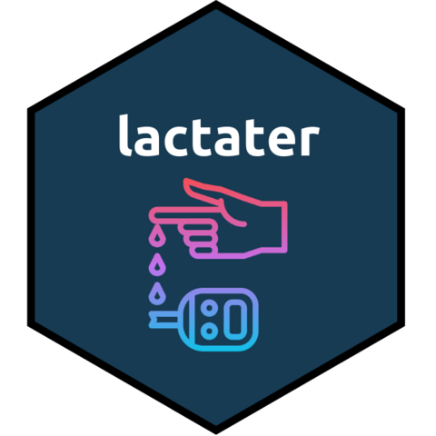
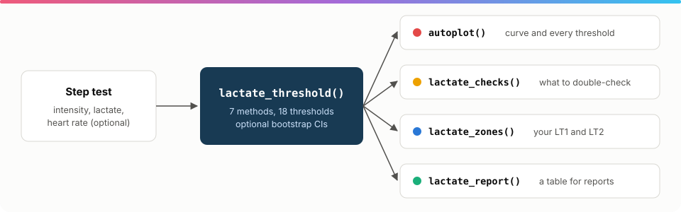

<!-- README.md is generated from README.Rmd. Please edit that file -->

```{r, include = FALSE}
knitr::opts_chunk$set(
  collapse = TRUE,
  comment = "#>",
  fig.path = "man/figures/readme/README-",
  out.width = "100%",
  dpi = 200,
  dev = "ragg_png",
  fig.align = "center",
  warning = FALSE,
  message = FALSE
)
plex <- requireNamespace("systemfonts", quietly = TRUE) &&
  isTRUE(suppressMessages(systemfonts::require_font("IBM Plex Sans", fallback = "sans")))
if (plex) options(lactater.font = "IBM Plex Sans")
```

<div align="center">

<a href="https://fmmattioni.github.io/lactater/"></a>

<!-- badges: start -->
[](https://CRAN.R-project.org/package=lactater)
[](https://github.com/fmmattioni/lactater/actions/workflows/R-CMD-check.yaml)
[](https://app.codecov.io/gh/fmmattioni/lactater)
[](https://lifecycle.r-lib.org/articles/stages.html#stable)
[](https://CRAN.R-project.org/package=lactater)
[](https://CRAN.R-project.org/package=lactater)
<!-- badges: end -->

</div>

**lactater** estimates lactate thresholds from a step incremental test, in one call and with the methods sport
scientists use: Log-log, OBLA, Bsln+, the Dmax family, the lactate turning points, LTratio and the individual
anaerobic threshold. It shows how much the methods agree, how sure each threshold is, what to double-check in your
data, and turns the thresholds you choose into training zones.



## Installation

```r
install.packages("lactater")

# development version
# install.packages("pak")
pak::pak("fmmattioni/lactater")
```

## Estimate every threshold

One row per stage: intensity, lactate and, if you have it, heart rate. The resting sample is the row with intensity 0.

```{r}
library(lactater)

results <- lactate_threshold(
  demo_data,
  intensity_column = intensity,
  lactate_column = lactate,
  heart_rate_column = heart_rate,
  sport = "cycling",
  plot = FALSE
)

results
```

## See how the methods agree

```{r overview, fig.width = 7.5, fig.height = 8.5}
autoplot(results)
```

Or look at one method in detail:

```{r dmax, fig.width = 7.5, fig.height = 4.5}
autoplot(results, method = "ModDmax")
```

## Know how sure you are

With 7 to 10 samples, a threshold to 0.1 W is false precision. `ci = TRUE` adds bootstrap confidence intervals:

```{r}
set.seed(1)
with_ci <- lactate_threshold(
  demo_data, intensity, lactate, heart_rate,
  method = c("OBLA", "Dmax", "LTP"), plot = FALSE, ci = TRUE
)
with_ci[c("method", "intensity", "intensity_low", "intensity_high")]
```

## Check before you trust

```{r}
lactate_checks(results)
```

## Turn thresholds into zones

You choose which thresholds mark LT1 and LT2:

```{r zones, fig.width = 7.5, fig.height = 4.5}
zones <- lactate_zones(results, lt1 = "LTP1", lt2 = "ModDmax")
zones
autoplot(zones)
```

## Compare tests and count training

```{r compare, fig.width = 7.5, fig.height = 4.5}
series <- subset(lactate_tests, athlete == "cyclist_series")
before <- lactate_threshold(subset(series, day == 0), intensity, lactate, heart_rate, plot = FALSE)
after <- lactate_threshold(subset(series, day == 58), intensity, lactate, heart_rate, plot = FALSE)
comparison <- compare_tests(before, after)
comparison[c("method", "before", "after", "change", "verdict")]
autoplot(comparison)
```

`compare_tests()` says whether each change is larger than the noise of the method, `curve_shift()` how far the
whole curve moved, `lactate_trend()` where a series of tests is heading, and `training_load()` how the training
was spread across the zones.

## And more

* `lactate_tests`: 15 real and simulated tests across cycling, running, rowing and swimming, from elite to untrained.
* Set your own targets (`fixed`, `baseline_plus`, `iat_rise`) and fit one turn point for submaximal tests
  (`ltp_breakpoints = 1`).
* `options(lactater.style = "night")` gives every plot a dark style.
* `lactate_report()` formats the results as a table for reports and papers; `.by` analyses a whole squad in one call.
* `lactate_fit_quality()` helps you choose the curve.
* `vlamax()` estimates the maximal lactate accumulation rate from a sprint test.
* `run_data_input()` is an RStudio gadget that writes the test protocol for you.

## The science

Every method follows its original definition, and the
[methods article](https://fmmattioni.github.io/lactater/articles/methods.html) says how each is computed, what the
evidence says about it, and how to collect data that does it justice. lactater 1.0 fixed several calculations; see
[what changed](https://fmmattioni.github.io/lactater/articles/whats-new.html).
