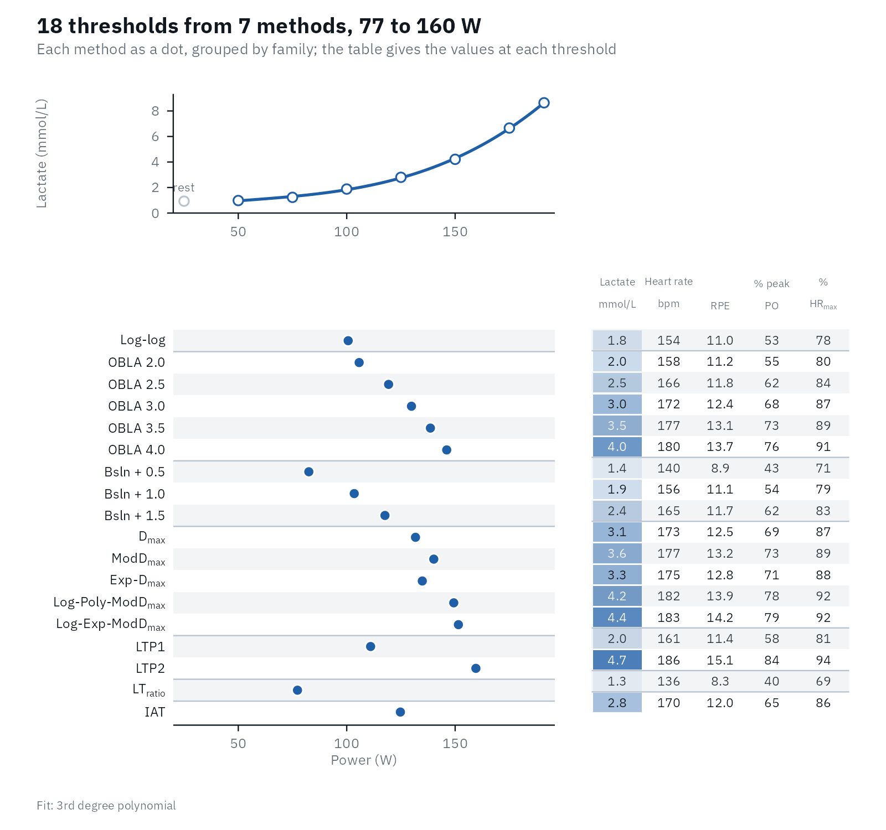
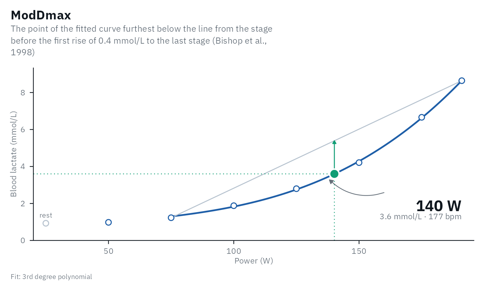
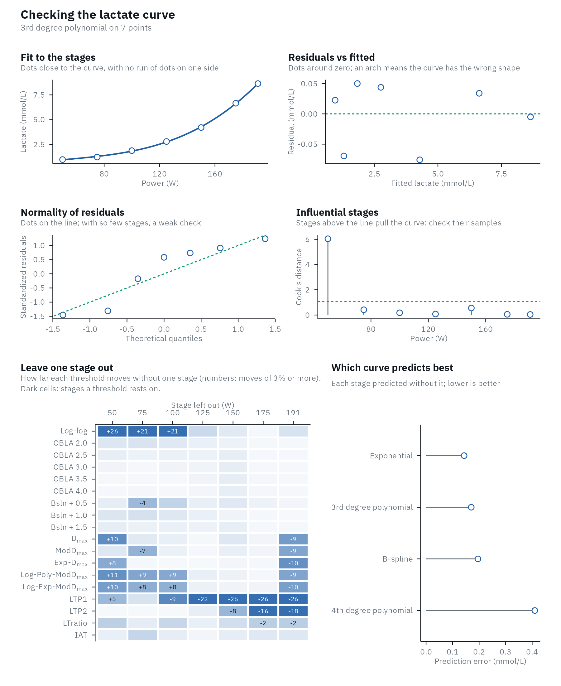
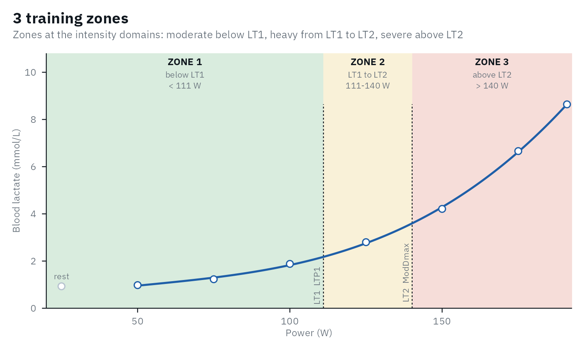
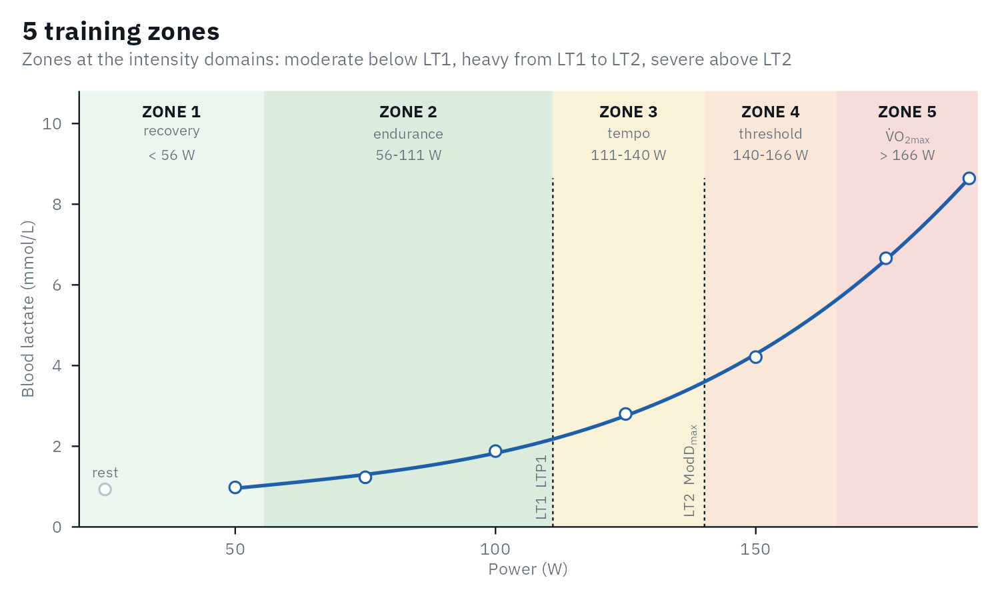
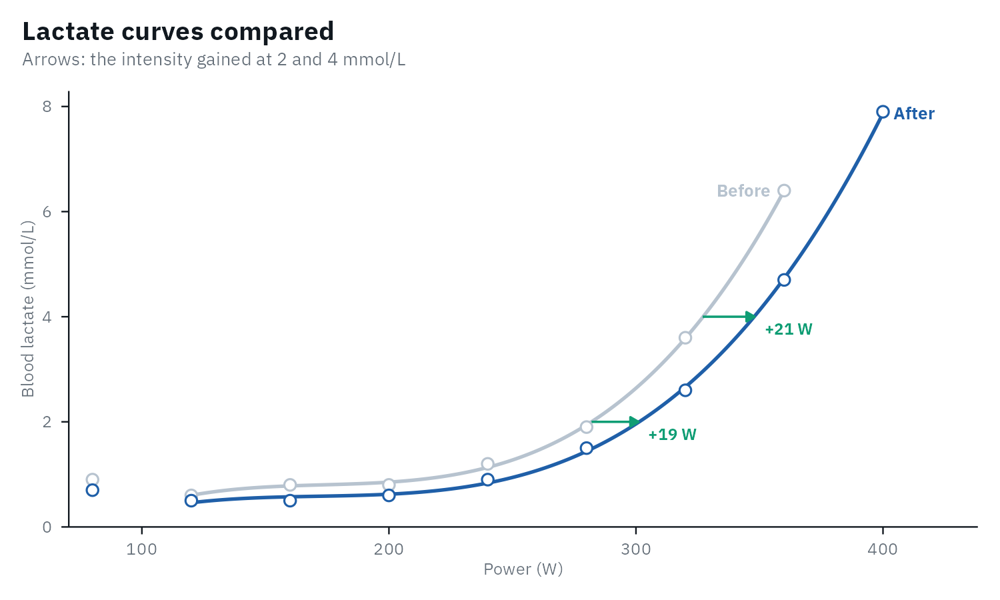

<!-- README.md is generated from README.Rmd. Please edit that file -->

<div align="center">

<a href="https://fmmattioni.github.io/lactater/"></a>

<!-- badges: start -->

[](https://CRAN.R-project.org/package=lactater)
[](https://github.com/fmmattioni/lactater/actions/workflows/R-CMD-check.yaml)
[](https://app.codecov.io/gh/fmmattioni/lactater)
[](https://lifecycle.r-lib.org/articles/stages.html#stable)
[](https://CRAN.R-project.org/package=lactater)
[](https://CRAN.R-project.org/package=lactater)
<!-- badges: end -->

</div>

**lactater** estimates lactate thresholds from a step incremental test,
in one call and with the methods sport scientists use: Log-log, OBLA,
Bsln+, the D<sub>max</sub> family, the lactate turning points,
LT<sub>ratio</sub>, and the individual anaerobic thresholds of Dickhuth
and of Stegmann. It shows how much the methods agree, how sure each
threshold is, what to double-check in your data, and turns the
thresholds you choose into training zones. It is written for teaching
too: every function and article says what the evidence behind it is.

## Installation

``` r
install.packages("lactater")

# development version
# install.packages("pak")
pak::pak("fmmattioni/lactater")
```

## Estimate every threshold

One row per stage: intensity, lactate and, if you have them, heart rate
and RPE. The resting sample is the row with intensity 0.

``` r
library(lactater)
library(dplyr)

demo_data
#> # A tibble: 8 × 6
#>    step length intensity lactate heart_rate   rpe
#>   <int>  <int>     <int>   <dbl>      <int> <int>
#> 1     0      0         0    0.93         96     6
#> 2     1      3        50    0.98        114     7
#> 3     2      3        75    1.23        134     8
#> 4     3      3       100    1.88        154    11
#> 5     4      3       125    2.8         170    12
#> 6     5      3       150    4.21        182    14
#> 7     6      3       175    6.66        193    17
#> 8     7      2       191    8.64        198    19

results <- lactate_threshold(
  demo_data,
  intensity_column = intensity,
  lactate_column = lactate,
  heart_rate_column = heart_rate,
  rpe_column = rpe,
  sport = "cycling",
  plot = FALSE
)

results
#> # Lactate thresholds: cycling, 3rd degree polynomial, 7 stages + rest
#>    method_category method           fitting   intensity lactate heart_rate   rpe
#>    <fct>           <fct>            <chr>         <dbl>   <dbl>      <dbl> <dbl>
#>  1 Log-log         Log-log          3rd degr…       101    1.8         154  11  
#>  2 OBLA            OBLA 2.0         3rd degr…       106    2           158  11.2
#>  3 OBLA            OBLA 2.5         3rd degr…       119    2.5         166  11.8
#>  4 OBLA            OBLA 3.0         3rd degr…       130    3           172  12.4
#>  5 OBLA            OBLA 3.5         3rd degr…       139    3.5         177  13.1
#>  6 OBLA            OBLA 4.0         3rd degr…       146    4           180  13.7
#>  7 Bsln+           Bsln + 0.5       3rd degr…        83    1.43        140   8.9
#>  8 Bsln+           Bsln + 1.0       3rd degr…       103    1.93        156  11.1
#>  9 Bsln+           Bsln + 1.5       3rd degr…       118    2.43        165  11.7
#> 10 Dmax            Dmax             3rd degr…       132    3.1         173  12.5
#> 11 Dmax            ModDmax          3rd degr…       140    3.6         177  13.2
#> 12 Dmax            Exp-Dmax         Exponent…       135    3.3         175  12.8
#> 13 Dmax            Log-Poly-ModDmax 3rd degr…       149    4.2         182  13.9
#> 14 Dmax            Log-Exp-ModDmax  Exponent…       152    4.4         183  14.2
#> 15 LTP             LTP1             3rd degr…       111    2           161  11.4
#> 16 LTP             LTP2             3rd degr…       160    4.7         186  15.1
#> 17 LTratio         LTratio          B-Spline…        77    1.3         136   8.3
#> 18 IAT             IAT              B-Spline…       125    2.8         170  12
```

## See how the methods agree

One row per method, grouped by family, with a table of the values at
each threshold:

``` r
autoplot(results)
```



Or look at one method in detail:

``` r
autoplot(results, method = "ModDmax")
```



## Know how sure you are

With 7 to 10 samples, a threshold to 0.1 W is false precision.
`ci = TRUE` adds bootstrap confidence intervals:

``` r
set.seed(1)
with_ci <- demo_data |>
  lactate_threshold(intensity, lactate, heart_rate, method = c("OBLA", "Dmax", "LTP"), plot = FALSE, ci = TRUE)

with_ci |>
  select(method, intensity, intensity_low, intensity_high)
#> # Lactate thresholds: cycling, 3rd degree polynomial, 7 stages + rest
#>    method           intensity intensity_low intensity_high
#>    <fct>                <dbl>         <dbl>          <dbl>
#>  1 OBLA 2.0               106           103            109
#>  2 OBLA 2.5               119           117            121
#>  3 OBLA 3.0               130           128            132
#>  4 OBLA 3.5               139           137            140
#>  5 OBLA 4.0               146           145            148
#>  6 Dmax                   132           128            135
#>  7 ModDmax                140           131            150
#>  8 Exp-Dmax               135           134            136
#>  9 Log-Poly-ModDmax       149           148            159
#> 10 Log-Exp-ModDmax        152           151            160
#> 11 LTP1                   111            84            120
#> 12 LTP2                   160           144            168
```

## Check before you trust

`lactate_checks()` flags what is easy to miss in a table of numbers:

``` r
lactate_checks(results)
#> 8 checks: 8 passed, 0 notes, 0 warnings
#> ✔ Stages             7 stages.
#> ✔ Resting sample     Present.
#> ✔ Thresholds found   All thresholds were found.
#> ✔ Edge of the range  No threshold sits at the first or last stage.
#> ✔ Early lactate dip  No early dip.
#> ✔ Final stage        Lactate rose in the last stage.
#> ✔ Peak lactate       8.6 mmol/L.
#> ✔ Sample type        blood lactate.
```

`lactate_diagnostics()` checks the fitted curve, and how much each
threshold rests on single stages, with a line under each panel on what
to look for:

``` r
autoplot(lactate_diagnostics(results))
```



## Turn thresholds into zones

You choose which thresholds mark LT1 and LT2, and three or five zones:

``` r
three <- lactate_zones(results, lt1 = "LTP1", lt2 = "ModDmax")
three
#> # A tibble: 3 × 11
#>   zone   domain  description intensity_from intensity_to lactate_from lactate_to
#>   <chr>  <chr>   <chr>                <dbl>        <dbl>        <dbl>      <dbl>
#> 1 Zone 1 modera… below LT1               NA          111         NA          2.2
#> 2 Zone 2 heavy   LT1 to LT2             111          140          2.2        3.6
#> 3 Zone 3 severe  above LT2              140           NA          3.6       NA  
#> # ℹ 4 more variables: heart_rate_from <dbl>, heart_rate_to <dbl>,
#> #   rpe_from <dbl>, rpe_to <dbl>
autoplot(three)
```



``` r
five <- lactate_zones(results, lt1 = "LTP1", lt2 = "ModDmax", model = 5)
five
#> # A tibble: 5 × 11
#>   zone   domain  description intensity_from intensity_to lactate_from lactate_to
#>   <chr>  <chr>   <chr>                <dbl>        <dbl>        <dbl>      <dbl>
#> 1 Zone 1 modera… recovery                NA           56         NA          1  
#> 2 Zone 2 modera… endurance               56          111          1          2.2
#> 3 Zone 3 heavy   tempo                  111          140          2.2        3.6
#> 4 Zone 4 severe  threshold              140          166          3.6        5.6
#> 5 Zone 5 severe  VO2max                 166           NA          5.6       NA  
#> # ℹ 4 more variables: heart_rate_from <dbl>, heart_rate_to <dbl>,
#> #   rpe_from <dbl>, rpe_to <dbl>
autoplot(five)
```



## Report the test

`test_report()` writes the whole test as one web page for the athlete or
the coach, two A4 pages when printed: LT1 and LT2 and what they mean,
the zones, the predicted performance, what to double-check, the stages
and every method ([see an
example](https://fmmattioni.github.io/lactater/report-example.html)).
Give it two to five tests of one athlete and their dates, and it reports
the progress over them ([see an
example](https://fmmattioni.github.io/lactater/report-series-example.html)).
Or build it step by step, with your lab’s name and logo and only the
parts you want: `recording_sheet()` gives you a printable sheet
([PDF](https://fmmattioni.github.io/lactater/step-test-sheet.pdf)) and a
CSV template, to record every test the same way, and the
[cheatsheet](https://fmmattioni.github.io/lactater/lactater-cheatsheet.pdf)
puts the whole package on two pages.

``` r
report_start(results, lt1 = "LTP1", lt2 = "ModDmax") |>
  report_header(
    name = "Ana Silva", date = "3 November 2026", sex = "female", age = 27, body_mass = 61,
    lab = "Exercise physiology lab", logo = "logo.png"
  ) |>
  report_summary() |>
  report_zones() |>
  report_prediction() |>
  report_text("Training", "Two sessions a week in zone 2, one in zone 3.") |>
  report_save("ana-2026-11-03.html", pdf = TRUE)
```

## Compare tests and count training

``` r
series <- lactate_tests |>
  filter(athlete == "cyclist_series")

before <- series |>
  filter(day == 0) |>
  lactate_threshold(intensity, lactate, heart_rate, plot = FALSE)

after <- series |>
  filter(day == 58) |>
  lactate_threshold(intensity, lactate, heart_rate, plot = FALSE)

comparison <- compare_tests(before, after)

comparison |>
  select(method, before, after, change, verdict)
#> # A tibble: 18 × 5
#>    method           before after change verdict 
#>    <fct>             <dbl> <dbl>  <dbl> <chr>   
#>  1 Log-log             239   236     -3 <NA>    
#>  2 OBLA 2.0            282   301     19 <NA>    
#>  3 OBLA 2.5            296   316     19 <NA>    
#>  4 OBLA 3.0            308   328     20 <NA>    
#>  5 OBLA 3.5            318   338     20 <NA>    
#>  6 OBLA 4.0            327   348     21 unclear 
#>  7 Bsln + 0.5          257   268     10 unclear 
#>  8 Bsln + 1.0          279   291     12 unclear 
#>  9 Bsln + 1.5          294   307     14 unclear 
#> 10 Dmax                270   291     22 increase
#> 11 ModDmax             290   327     36 increase
#> 12 Exp-Dmax            277   303     26 <NA>    
#> 13 Log-Poly-ModDmax    304   326     22 <NA>    
#> 14 Log-Exp-ModDmax     309   333     24 <NA>    
#> 15 LTP1                222   257     35 <NA>    
#> 16 LTP2                301   341     40 <NA>    
#> 17 LTratio             192   180    -12 <NA>    
#> 18 IAT                 294   304     10 unclear

autoplot(comparison)
```



`compare_tests()` says whether each change is larger than the noise of
the method, `curve_shift()` how far the whole curve moved,
`curve_shape()` whether it only shifted or changed its shape,
`lactate_trend()` where a series of tests is heading, and
`training_load()` how the training was spread across the zones.

## And more

- `lactate_tests`: 15 real and simulated tests across cycling, running,
  rowing and swimming, from elite to untrained.
- `predict_performance()` estimates race times (running) and time-trial
  power (cycling) with a 95% range, from published equations or one you
  fit on your own athletes with `calibrate_performance()`.
- Heart rate and RPE (6-20 or CR10) at every threshold and in every
  zone.
- Set your own targets (`fixed`, `baseline_plus`, `iat_rise`) and fit
  one turn point for submaximal tests (`ltp_breakpoints = 1`).
- `options(lactater.style = "night")` gives every plot a dark style, and
  `"journal"` a quieter one for print.
- `lactate_report()` formats the results as a table for reports and
  papers; `.by` analyses a whole squad in one call.
- `lactate_fit_quality()` helps you choose the curve, by how well each
  one predicts a stage it was not fitted to.
- `vlamax()` estimates the maximal lactate accumulation rate
  (V̇La<sub>max</sub>) from a sprint test.
- `run_data_input()` is an RStudio gadget that writes the test protocol
  for you.

## The science

Every method follows its original definition, and the [methods
article](https://fmmattioni.github.io/lactater/articles/methods.html)
says how each is computed and what the evidence says about it. [Best
practices for a step
test](https://fmmattioni.github.io/lactater/articles/best-practices.html)
is a checklist, with sources, for running a test and analyzing it.
**lactater** 1.0 fixed several calculations; see [what
changed](https://fmmattioni.github.io/lactater/articles/whats-new.html).
