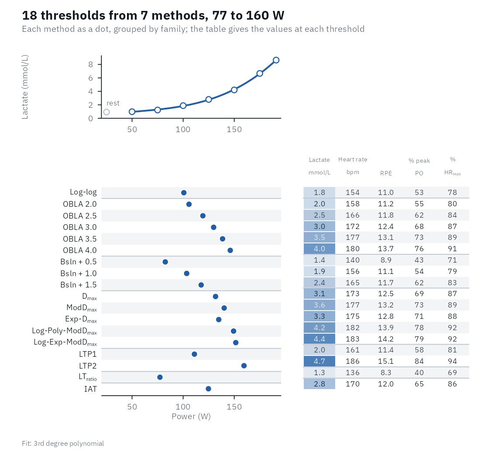
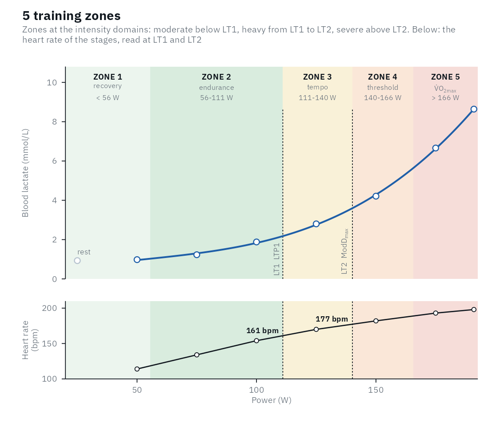
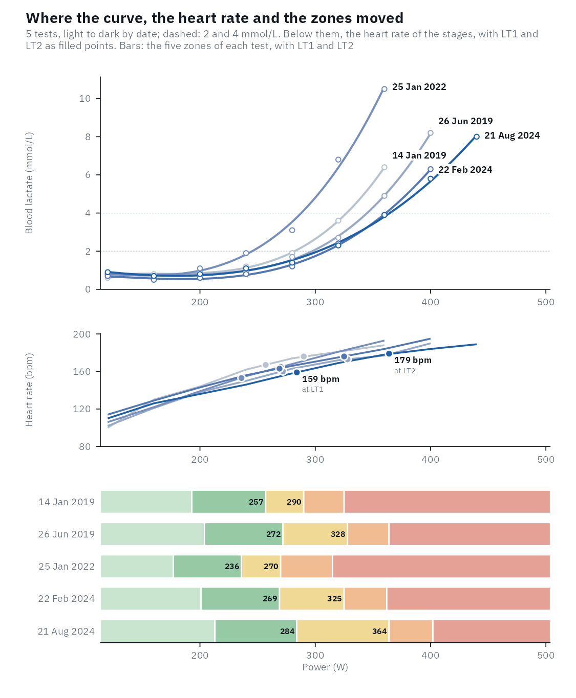
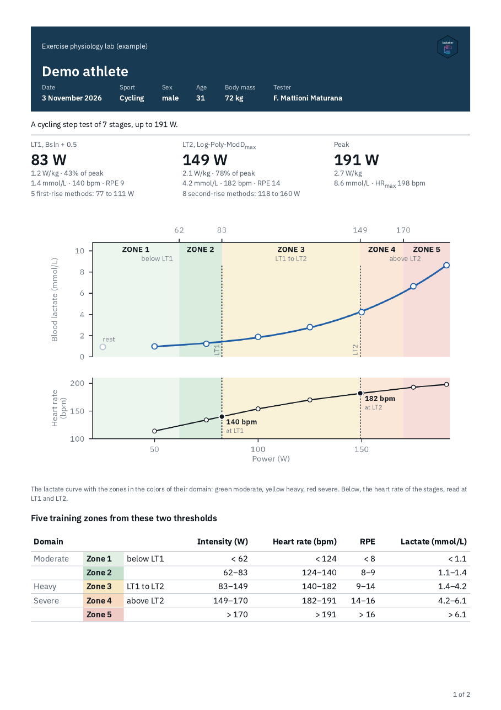
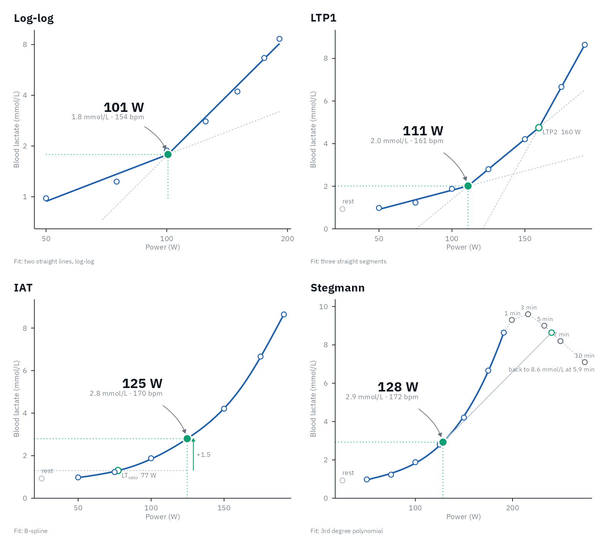
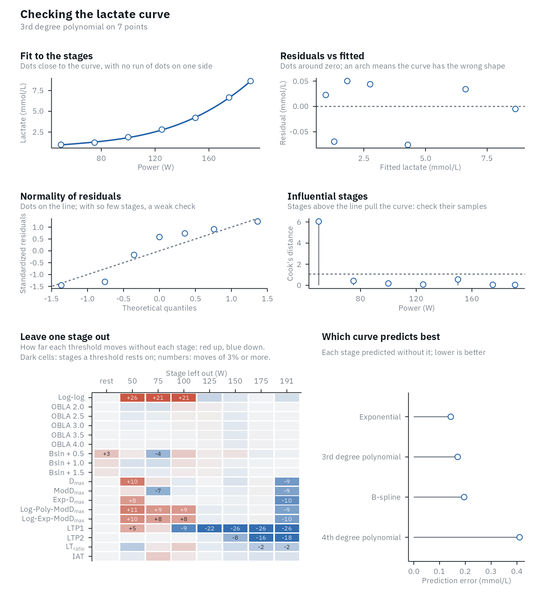

<!-- README.md is generated from README.Rmd. Please edit that file -->

<div align="center">

<a href="https://fmmattioni.github.io/lactater/"></a>

<!-- badges: start -->

[](https://CRAN.R-project.org/package=lactater)
[](https://github.com/fmmattioni/lactater/actions/workflows/R-CMD-check.yaml)
[](https://app.codecov.io/gh/fmmattioni/lactater)
[](https://lifecycle.r-lib.org/articles/stages.html#stable)
[](https://CRAN.R-project.org/package=lactater)
[](https://CRAN.R-project.org/package=lactater)
<!-- badges: end -->

</div>

**lactater** takes the lactate samples of a step incremental test and
gives you the thresholds, how sure they are, what to double-check, the
training zones they make, how they changed since the last test, and a
report for the athlete. It computes the methods sport scientists use,
each as its original paper defined it: Log-log, OBLA, Bsln+, the
D<sub>max</sub> family, the lactate turn points, LT<sub>ratio</sub>, and
the individual anaerobic thresholds of Dickhuth and of Stegmann. It is
written for teaching too: every function and article says what the
evidence behind it is.

## What it does

| To | Use | You get |
|----|----|----|
| Estimate the thresholds | `lactate_threshold()` | every method at once, with heart rate, RPE and pace at each threshold |
| Know how sure each one is | `ci = TRUE` | bootstrap intervals for the noise of the samples |
| Check the data and the fit | `lactate_checks()`, `lactate_diagnostics()`, `lactate_fit_quality()` | what to double-check, residuals, influential stages, how much each threshold rests on one stage |
| Make training zones | `lactate_zones()` | three or five zones from LT1 and LT2 (Bsln + 0.5 and Log-Poly-ModDmax unless you choose others), with intensity, pace, heart rate, RPE and lactate |
| Compare two tests | `compare_tests()`, `curve_shift()`, `curve_shape()` | each change against the noise of the method, and how far and how the curve moved |
| Measure your own noise | `lactate_reliability()` | the test-retest typical error of each threshold from your repeated tests, for `compare_tests()` |
| Follow a series of tests | `lactate_trend()` | the curves and zones of up to five tests, and a trend for longer series |
| Compare athletes | `relative_thresholds()` | thresholds per kg and as a percentage of peak intensity and heart rate |
| Compare with the population | `reference_percentiles()` | the percentile of power at 3 mmol/L and at baseline + 1 mmol/L among German adults of the same age and sex (cycling, general population) |
| Count training | `training_load()` | time in each zone and the polarization index |
| Predict a race | `predict_performance()`, `calibrate_performance()` | race time or time-trial power with a 95% range, from published equations or your own |
| Report the test | `test_report()`, `report_start()` | a web page and PDF for the athlete or the coach |
| Record a test | the [web form](https://fmmattioni.github.io/lactater/step-test-form.html), `read_recording()`, `recording_sheet()` | a form that saves itself and downloads an .xlsx lactater reads; a printable sheet and a CSV template |
| Check the MLSS | `lactate_mlss()` | the maximal lactate steady state from constant-load bouts, and how far each threshold lies from it |
| Analyze a sprint test | `vlamax()` | the maximal lactate accumulation rate (V̇La<sub>max</sub>) |
| Practice | `lactate_tests`, `demo_data` | 16 real and simulated tests across sports and fitness levels |

## The charts

Every result has a plot, made to explain itself. Click a chart for its
help page; the method plots, the diagnostics, the comparisons, the
training load and the race prediction have their own.

<table>

<tr>

<td width="50%" valign="top">

<a href="https://fmmattioni.github.io/lactater/reference/autoplot.lactate_thresholds.html"></a><br><b>One
test, every method</b>: each threshold on one axis, grouped by family,
with its values. <code>autoplot(results)</code>
</td>

<td width="50%" valign="top">

<a href="https://fmmattioni.github.io/lactater/reference/lactate_zones.html"></a><br><b>Training
zones</b>: three or five, colored by intensity domain, with the heart
rate at LT1 and LT2. <code>autoplot(lactate_zones(…))</code>
</td>

</tr>

<tr>

<td width="50%" valign="top">

<a href="https://fmmattioni.github.io/lactater/reference/lactate_trend.html"></a><br><b>Up
to five tests</b>: where the curve, the heart rate and the zones moved,
by date. <code>autoplot(lactate_trend(…))</code>
</td>

<td width="50%" valign="top">

<a href="https://fmmattioni.github.io/lactater/report-example.html"></a><br><b>A
report for the athlete</b>: the whole test on two A4 pages, as a web
page and PDF. <code>test_report(results)</code>
</td>

</tr>

<tr>

<td width="50%" valign="top">

<a href="https://fmmattioni.github.io/lactater/articles/methods.html"></a><br><b>Each
method, as its paper defined it</b>: what it fitted, the stages, and the
threshold with its lactate and heart rate. <code>autoplot(results,
method = “LTP1”)</code>
</td>

<td width="50%" valign="top">

<a href="https://fmmattioni.github.io/lactater/reference/lactate_diagnostics.html"></a><br><b>Checking
the curve</b>: residuals, influential stages, and how far each threshold
moves without each stage.
<code>autoplot(lactate_diagnostics(results))</code>
</td>

</tr>

</table>

## Installation

``` r
install.packages("lactater")

# development version
# install.packages("pak")
pak::pak("fmmattioni/lactater")
```

## Get started

One row per stage: intensity, lactate and, if you have them, heart rate
and RPE; the resting sample is the row with intensity 0.
`lactate_threshold()` estimates every method at once, `autoplot()` shows
how they agree, and `lactate_zones()` turns the two you choose into
training zones:

``` r
results <- lactate_threshold(demo_data, intensity, lactate, heart_rate, plot = FALSE)
results
#> # Lactate thresholds: cycling, 3rd degree polynomial, 7 stages + rest
#>    method_category method           fitting         intensity lactate heart_rate
#>    <fct>           <fct>            <chr>               <dbl>   <dbl>      <dbl>
#>  1 Log-log         Log-log          3rd degree pol…       101     1.8        154
#>  2 OBLA            OBLA 2.0         3rd degree pol…       106     2          158
#>  3 OBLA            OBLA 2.5         3rd degree pol…       119     2.5        166
#>  4 OBLA            OBLA 3.0         3rd degree pol…       130     3          172
#>  5 OBLA            OBLA 3.5         3rd degree pol…       139     3.5        177
#>  6 OBLA            OBLA 4.0         3rd degree pol…       146     4          180
#>  7 Bsln+           Bsln + 0.5       3rd degree pol…        83     1.4        140
#>  8 Bsln+           Bsln + 1.0       3rd degree pol…       103     1.9        156
#>  9 Bsln+           Bsln + 1.5       3rd degree pol…       118     2.4        165
#> 10 Dmax            Dmax             3rd degree pol…       132     3.1        173
#> 11 Dmax            ModDmax          3rd degree pol…       140     3.6        177
#> 12 Dmax            Exp-Dmax         Exponential (d…       135     3.3        175
#> 13 Dmax            Log-Poly-ModDmax 3rd degree pol…       149     4.2        182
#> 14 Dmax            Log-Exp-ModDmax  Exponential (d…       152     4.4        183
#> 15 LTP             LTP1             3rd degree pol…       111     2          161
#> 16 LTP             LTP2             3rd degree pol…       160     4.7        186
#> 17 LTratio         LTratio          B-Spline (defa…        77     1.3        136
#> 18 IAT             IAT              B-Spline (defa…       125     2.8        170

lactate_zones(results, model = 5)
#> # A tibble: 5 × 9
#>   zone   domain  description intensity_from intensity_to lactate_from lactate_to
#>   <chr>  <chr>   <chr>                <dbl>        <dbl>        <dbl>      <dbl>
#> 1 Zone 1 modera… recovery                NA           62         NA          1.1
#> 2 Zone 2 modera… endurance               62           83          1.1        1.4
#> 3 Zone 3 heavy   tempo                   83          149          1.4        4.2
#> 4 Zone 4 severe  threshold              149          170          4.2        6.1
#> 5 Zone 5 severe  VO2max                 170           NA          6.1       NA  
#> # ℹ 2 more variables: heart_rate_from <dbl>, heart_rate_to <dbl>
```

Add `ci = TRUE` for bootstrap intervals, `lactate_checks()` for what to
double-check, `compare_tests()` for a second test and `test_report()`
for a web page and PDF for the athlete (see [a
cyclist](https://fmmattioni.github.io/lactater/report-example.html) and
[a
runner](https://fmmattioni.github.io/lactater/report-running-example.html)).
The [web
form](https://fmmattioni.github.io/lactater/step-test-form.html) records
a test and downloads an .xlsx that `read_recording()` reads, and the
[cheatsheet](https://fmmattioni.github.io/lactater/lactater-cheatsheet.pdf)
puts the whole package on two pages. [Get
started](https://fmmattioni.github.io/lactater/articles/lactater.html)
walks through all of it.

## Learn more

- [Get
  started](https://fmmattioni.github.io/lactater/articles/lactater.html):
  the whole workflow, task by task.
- [Best practices for a step
  test](https://fmmattioni.github.io/lactater/articles/best-practices.html):
  how to run a test, as a checklist with sources.
- [The methods and the
  evidence](https://fmmattioni.github.io/lactater/articles/methods.html)
  and [Checking the
  analysis](https://fmmattioni.github.io/lactater/articles/checking.html):
  how each method is computed, what the studies say, and how to check a
  result.
- [Training
  zones](https://fmmattioni.github.io/lactater/articles/zones.html),
  [training
  load](https://fmmattioni.github.io/lactater/articles/training-load.html),
  [comparing
  tests](https://fmmattioni.github.io/lactater/articles/compare.html)
  and [predicting
  performance](https://fmmattioni.github.io/lactater/articles/performance.html):
  what to do with the thresholds.
- [Beyond the step
  test](https://fmmattioni.github.io/lactater/articles/beyond-the-step-test.html)
  and [the example
  data](https://fmmattioni.github.io/lactater/articles/example-data.html).

**lactater** 1.0 fixed several calculations of earlier versions; see
[what
changed](https://fmmattioni.github.io/lactater/articles/whats-new.html).
