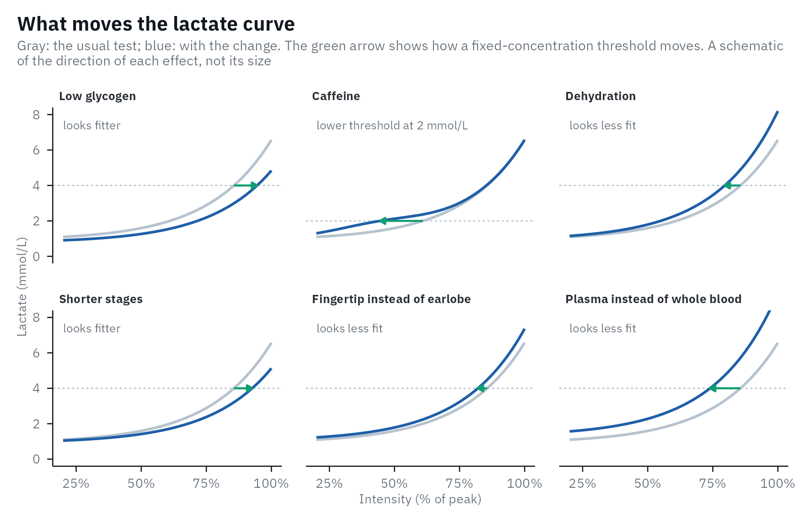

# Best practices for a step test

A threshold is only as good as the test behind it. From any table of
numbers lactater computes 18 thresholds by default (20 for running, with
Keul and Simon), two more on request (LTP1-Poly-ModD_(max), and Stegmann
with recovery samples), and as many fixed or baseline-plus targets as
you set. But it cannot tell whether the athlete came to the test with
empty glycogen stores, or whether the lactate was sampled from the
fingertip in one test and the earlobe in the next. This article collects
what the literature says about running a step test and analyzing it, as
a checklist.

#### Before

- Same diet for 24-48 h
- A recovery day before
- Same caffeine, same time of day

#### Protocol

- Stages of 3 min or more
- 2-3 stages below the first rise
- To exhaustion

#### Sample

- Last 30 s of each stage
- Same site and sample type
- A calibrated analyzer

#### Record

- Heart rate and RPE every stage
- Room, ergometer, protocol
- Diet and training

#### Analyze

- Methods chosen beforehand
- Check the curve
- Report how sure you are

Read each point with its evidence in mind. Few come from guidelines:
most come from single studies in small groups, often of trained men, and
some from expert reviews. The last column of each table says which: a
guideline, a meta-analysis, a review, single studies (with how many
people), or no study we found.

## What moves the curve

Most of the advice below exists because something other than fitness
moves the lactate curve, and with it every threshold. This sketch shows
the direction of each effect in the studies cited below, not its size:



## Before the test: the same athlete every time

The aim is that the only thing that differs between two tests is
fitness.

|  | What to do | What the studies found | Evidence |
|----|----|----|----|
| Diet and glycogen | Keep the diet of the 24 to 48 h before the test the same for every test, and avoid exercise that empties the glycogen stores. | Low glycogen lowers lactate at every intensity and moves the curve to the right, which looks like better endurance ([Faude et al., 2009](https://doi.org/10.2165/00007256-200939060-00003)). In 6 trained men, a low-carbohydrate diet with training put the 2 and 4 mmol/L thresholds at higher workloads than a high-carbohydrate diet after 3 days without training, yet after the high-carbohydrate diet they rode longer at 65% of their maximal workload, 49 against 23 min ([Maassen & Busse, 1989](https://doi.org/10.1007/BF00637384)). | Review; 1 study, n = 6 |
| Training before the test | Plan at least one day of full recovery before each test, and test at the same time of day in a room at the same temperature. | No study tested the rest day itself. In the reliability study of [Pallarés et al. (2016)](https://doi.org/10.1371/journal.pone.0163389), 14 trained male cyclists had 24 h of full recovery before every test, and were tested between 16:00 and 19:00 at 21-24 °C; the fixed and baseline thresholds varied by about 3% between tests. | No study found |
| Caffeine | Keep caffeine habits the same. | In 8 men, 5 mg/kg of caffeine raised lactate at submaximal intensities and lowered the threshold at 2 mmol/L, from an oxygen uptake of 2.71 to 2.13 L/min, while the breakpoint, the 1 mmol/L rise and the 4 mmol/L thresholds did not change ([Gaesser & Rich, 1985](https://doi.org/10.1055/s-2008-1025841)). | 1 study, n = 8 |
| Hydration | Start every test equally hydrated. | In a meta-analysis of studies that dehydrated adults before exercise, by 3.6% of body mass on average, the oxygen uptake at the lactate threshold was 4.4% lower (95% CI 1.7-7.1%; [Deshayes et al., 2020](https://doi.org/10.1007/s40279-019-01223-5)). In 7 moderately trained women, losing 2.6% of body mass moved the Log-log threshold from 72% to 66% of V̇O_(2max) ([Moquin & Mazzeo, 2000](https://doi.org/10.1097/00005768-200002000-00021)). | Meta-analysis |
| Time of day | Test at the same time of day, ideally when the athlete usually trains. | In 11 endurance-trained men tested on a rowing ergometer at six times of day, the power at the D_(max) threshold did not change, but the oxygen uptake and heart rate at it followed a circadian rhythm; the authors advise testing at the time the athlete usually trains ([Forsyth & Reilly, 2004](https://doi.org/10.1007/s00421-004-1059-8)). | 1 study, n = 11 |
| Warm-up and familiarization | Use the same light warm-up every time, and let a new athlete do one familiarization test. | [Pallarés et al. (2016)](https://doi.org/10.1371/journal.pone.0163389) began with a familiarization test, followed by 48 h of rest, “to minimize the bias of progressive learning on test reliability”. | No study found |

## The protocol

|  | What to do | What the studies found | Evidence |
|----|----|----|----|
| Stage duration | Use stages of at least 3 min, and keep the protocol identical between tests of the same athlete: [`compare_tests()`](https://fmmattioni.github.io/lactater/reference/compare_tests.md) notes when it differs. | Shorter stages put the thresholds at higher intensities, and stages of at least 3 min have been recommended ([Bentley et al., 2007](https://doi.org/10.2165/00007256-200737070-00002); [Jamnick et al., 2020](https://doi.org/10.1007/s40279-020-01322-8)). [Jamnick et al. (2018)](https://doi.org/10.1371/journal.pone.0199794) compared stages of 1 to 10 min in 17 trained men. On a treadmill, 5-min stages put the 4 mmol/L threshold 0.1 m/s lower than 3-min stages, and closer to the MLSS; the authors still proposed 3 min, to keep the test short (Heck et al., 1982). | Reviews; 1 study |
| Number of stages | Plan for six or more. lactater needs at least five for Log-log and six for two lactate turn points. | No guideline sets a number. Six or more is common: [Grant et al. (2002)](https://doi.org/10.1007/s00421-002-0608-2) used at least six 4-min stages. | No study found |
| Start and increment | Start low enough for two or three stages below the first rise in lactate. | The methods for LT1 need those stages, and D_(max) depends on where the test starts and ends ([Jamnick et al., 2020](https://doi.org/10.1007/s40279-020-01322-8)). | Review |
| End of the test | Go to exhaustion when you use methods that rely on the last stage (the D_(max) family and LTP2). If the athlete stopped during the last stage, record the time completed: `last_stage_duration` time-weights its intensity ([Kuipers et al., 2003](https://doi.org/10.1055/s-2003-42020)). Or leave the stage out with `max_intensity`. | These methods change with the final lactate ([Bentley et al., 2007](https://doi.org/10.2165/00007256-200737070-00002); [Jamnick et al., 2020](https://doi.org/10.1007/s40279-020-01322-8)). | Reviews |
| Treadmill grade | Whatever the grade, keep it the same; 1% mimics running outdoors. | A 1% grade matched the energy cost of outdoor running at 10.5 to 18 km/h in 9 trained male runners ([Jones & Doust, 1996](https://doi.org/10.1080/02640419608727717)). | 1 study, n = 9 |
| Pauses for sampling | Keep pauses short, and the same between tests. | Pausing 1 min instead of 30 s put the 4 mmol/L threshold 0.07 m/s higher on average, in 9 people running 3.5-min stages; the authors proposed 30 s (Heck et al., 1982), which [Dickhuth et al. (1999)](https://doi.org/10.1055/s-2007-971105) also used. | 1 study, n = 9 |

## Taking the sample

|  | What to do | What the studies found | Evidence |
|----|----|----|----|
| Timing | Sample in the last 30 s of each stage. | Most studies do ([Goodwin et al., 2007](https://doi.org/10.1177/193229680700100414); [Morton et al., 2012](https://doi.org/10.1136/bjsm.2010.076380); [Forsyth & Reilly, 2004](https://doi.org/10.1007/s00421-004-1059-8)). | Review |
| Site | Use the same site in every test. | In 312 trained people, on a cycle ergometer and a treadmill, finger values were higher than earlobe and venous values, which agreed with each other; the authors preferred the earlobe, as less affected by lactate from the arms and easier to sample ([Dassonville et al., 1998](https://pubmed.ncbi.nlm.nih.gov/9638031/)). Fingertip and earlobe differed by 9.2% on average in cycling, with 95% of differences between -25% and +59% ([Moran et al., 2012](https://doi.org/10.1519/JSC.0b013e318225f395)). The fingertip read 0.66 mmol/L higher than the earlobe on average, and 0.86 mmol/L between 4 and 8 mmol/L, in double poling on a ski ergometer in 40 university students ([Zhong et al., 2025](https://doi.org/10.1007/s00421-024-05585-1)). After two 4-min bouts of ergometer rowing, plasma lactate from the fingertip, toe and earlobe did not differ significantly in 9 athletes, 4 of them club rowers, although the fingertip read highest ([Forsyth & Farrally, 2000](https://doi.org/10.1136/bjsm.34.1.35)). | 4 studies |
| Skin preparation and hygiene | Wear gloves, clean the site with 70% alcohol and let it dry in the air, wipe away the first drop of blood, do not squeeze hard, and put the lancet straight into a sharps container. | As the [World Health Organization (2010)](https://www.ncbi.nlm.nih.gov/books/NBK138654/) advises. No study we found measured how much sweat on the skin changes a sample; drying the site is the usual advice. | Guideline |
| Sample type | Never mix sample types between tests, and report which one you used (`sample` in [`lactate_threshold()`](https://fmmattioni.github.io/lactater/reference/lactate_threshold.md)). | Plasma lactate was about 50% higher than lactate in red blood cells, and capillary and venous whole blood also differed, in 10 healthy men ([Foxdal et al., 1990](https://doi.org/10.1007/BF00357603)); whole-blood lactate is about 70% of plasma lactate, depending on the hematocrit ([Goodwin et al., 2007](https://doi.org/10.1177/193229680700100414)). The fixed concentrations of OBLA, Bsln+ and IAT were defined on blood, so [`lactate_checks()`](https://fmmattioni.github.io/lactater/reference/lactate_checks.md) warns when `sample` says otherwise. | Review |
| Analyzer | Calibrate it as the manufacturer says, test each athlete on the same device, and do not compare tests run on different analyzers. | The typical error of three portable analyzers was 0.4 to 1.0 mmol/L depending on the device ([Tanner et al., 2010](https://doi.org/10.1007/s00421-010-1379-9)), and all three read lower than a laboratory analyzer. Six hand-held analyzers all read lower than a laboratory analyzer, most at the highest concentrations, which “would overestimate the ability of the athlete” ([Bonaventura et al., 2015](https://pmc.ncbi.nlm.nih.gov/articles/PMC4306774/)). With four current hand-held analyzers the direction depended on the device: against a laboratory analyzer they read 10% lower to 42% higher, and a second laboratory analyzer read 32% lower; at 3 mmol/L their 95% prediction intervals were 0.6 to 0.9 mmol/L wide (venous blood; [Mentzoni et al., 2024](https://doi.org/10.1007/s00421-024-05572-6)). | 3 studies |

## What else to record

|  | What to do | What the studies found | Evidence |
|----|----|----|----|
| Heart rate and RPE | Record both at the end of every stage, in the same window as the blood sample. For RPE, read the standard instructions before the test, ask how hard the effort feels (not pain), and ask at the same moment of every stage. | In a reliability study of 16 male athletes, RPE and heart rate were taken in the last 15 s of each 3-min stage ([Lamb et al., 1999](https://doi.org/10.1136/bjsm.33.5.336)). | 1 study |
| Expect them to vary | Use heart rate and RPE at a threshold as a rough guide, not a target. | The test-retest limits of agreement of RPE widened as intensity rose, from 0.88 ± 2.02 units at the first stage to -0.13 ± 2.94 at the fourth, in 16 male athletes ([Lamb et al., 1999](https://doi.org/10.1136/bjsm.33.5.336)). In 20 men and 16 women, heart rate and RPE at the thresholds reproduced poorly between two tests ([Grant et al., 2002](https://doi.org/10.1007/s00421-002-0608-2)). In 2,560 adults (median age 28) on treadmills or cycle ergometers, RPE was 10.8 at the last intensity before lactate began to rise, 13.6 at 1.5 mmol/L above it (Dickhuth’s individual anaerobic threshold) and 14.1 at 4 mmol/L ([Scherr et al., 2013](https://doi.org/10.1007/s00421-012-2421-x)). | 3 studies |
| The conditions | Room temperature and humidity, the ergometer and its settings, the athlete’s diet and training in the days before. | No study is needed for this one: without it, you cannot tell later why two tests differ. | No study needed |

The [recording
sheet](https://fmmattioni.github.io/lactater/step-test-sheet.pdf) has a
place for all of this; the [web
form](https://fmmattioni.github.io/lactater/step-test-form.md) has the
same fields to fill in during the test and downloads a file that
[`read_recording()`](https://fmmattioni.github.io/lactater/reference/read_recording.md)
reads; and
[`recording_sheet()`](https://fmmattioni.github.io/lactater/reference/recording_sheet.md)
copies both, with a CSV template in the columns lactater reads, into
your folder. Give lactater the columns with `heart_rate_column`,
`rpe_column` and `rpe_scale` (`"6-20"` or `"CR10"`). Here is a simulated
test with heart rate and RPE (the RPE of the simulated tests in
`lactate_tests` is simulated too):

``` r

client <- lactate_tests |>
  filter(test == "untrained") |>
  select(intensity, lactate, heart_rate, rpe)
client
#> # A tibble: 10 × 4
#>    intensity lactate heart_rate   rpe
#>        <dbl>   <dbl>      <dbl> <dbl>
#>  1         0     0.9         70     6
#>  2        50     1          120     9
#>  3        75     1.3        127     9
#>  4       100     1.3        135    10
#>  5       125     1.7        148    11
#>  6       150     2.2        150    11
#>  7       175     3          163    11
#>  8       200     4.1        170    14
#>  9       225     6.4        180    16
#> 10       250     9          187    20

results <- client |>
  lactate_threshold(
    intensity, lactate, heart_rate,
    rpe_column = rpe, rpe_scale = "6-20", sample = "blood", plot = FALSE
  )

results |>
  filter(method %in% c("Log-log", "LTP1", "LTP2", "OBLA 4.0")) |>
  select(method, intensity, heart_rate, rpe)
#> Warning: Unknown or uninitialised column: `method_category`.
#> # Lactate thresholds: cycling, 3rd degree polynomial, 9 stages + rest
#> # LT1:                98 W (Bsln + 0.5)
#> # LT2:                202 W (Log-Poly-ModDmax)
#>   method   intensity heart_rate   rpe
#>   <fct>        <dbl>      <dbl> <dbl>
#> 1 Log-log        148        150  11  
#> 2 OBLA 4.0       195        169  13.4
#> 3 LTP1           140        149  11  
#> 4 LTP2           204        172  14.3
```

## Analyzing the test

|  | What to do | What the studies found | Evidence |
|----|----|----|----|
| Choose beforehand | Choose the methods and the curve before you look at the data, and report them. [The methods article](https://fmmattioni.github.io/lactater/articles/methods.md) summarizes the evidence for each method. | Two methods can put the threshold of the same athlete about 30% apart ([Jamnick et al., 2020](https://doi.org/10.1007/s40279-020-01322-8)), and no curve fit is generally accepted ([Faude et al., 2009](https://doi.org/10.2165/00007256-200939060-00003)). | Reviews |
| Look before you trust | Plot the test, read [`lactate_checks()`](https://fmmattioni.github.io/lactater/reference/lactate_checks.md), and check how well the curve follows the stages and how much each threshold rests on one stage with [`lactate_diagnostics()`](https://fmmattioni.github.io/lactater/reference/lactate_diagnostics.md) (see [Checking the analysis](https://fmmattioni.github.io/lactater/articles/checking.md)). | A table of numbers hides a lactate dip, a final plateau or a single bad sample. | No study needed |
| Report how sure you are | `ci = TRUE` adds bootstrap intervals for the noise of the samples. | The precision of a threshold should be known before a change is called real ([Bentley et al., 2007](https://doi.org/10.2165/00007256-200737070-00002)). | Review |
| Know your noise | Measure the typical error on your athletes with your protocol, and give it to [`compare_tests()`](https://fmmattioni.github.io/lactater/reference/compare_tests.md) as `cv`. | The typical error is the standard deviation of the test-retest differences divided by the square root of 2, best given as a coefficient of variation ([Hopkins, 2000](https://doi.org/10.2165/00007256-200030010-00001)). It depends on the method and the study: D_(max) had a standard error of measurement of 2.5 W (on a quadratic fit) against 9 to 25 W for other markers in 11 fit adults tested at least six times ([Morton et al., 2012](https://doi.org/10.1136/bjsm.2010.076380)), but a coefficient of variation of 10.3% against about 3% for the fixed and baseline methods in 14 trained cyclists ([Pallarés et al., 2016](https://doi.org/10.1371/journal.pone.0163389)). | Review |
| Compare like with like | Keep the protocol, the site, the sample type, the analyzer, the methods and the curve the same between tests of the same athlete. See [Comparing tests](https://fmmattioni.github.io/lactater/articles/compare.md). | Each of them moves the curve on its own (see the sketch above). | No study needed |

## A checklist for your report

|  |  | Report |
|----|----|----|
| ☐ | Who | Sport, sex, age, training status. |
| ☐ | Before the test | Diet, training, caffeine, time of day. |
| ☐ | The protocol | Ergometer, start, increment, stage duration, pauses, how the test ended. |
| ☐ | The sample | Site, timing within the stage, sample type, analyzer. |
| ☐ | The analysis | The methods and how they are defined (for the D_(max) family, where the line starts and ends), the fitted curve, whether the resting sample was used, the software and its version (`packageVersion("lactater")`). |
| ☐ | The uncertainty | Bootstrap intervals, and the typical error used to judge changes. |

## References

Bentley DJ, Newell J, Bishop D. Incremental exercise test design and
analysis: implications for performance diagnostics in endurance
athletes. Sports Med. 2007;37(7):575-86.
[doi:10.2165/00007256-200737070-00002](https://doi.org/10.2165/00007256-200737070-00002)

Bonaventura JM, Sharpe K, Knight E, Fuller KL, Tanner RK, Gore CJ.
Reliability and accuracy of six hand-held blood lactate analysers. J
Sports Sci Med. 2015;14:203-14.
[PMCID:PMC4306774](https://pmc.ncbi.nlm.nih.gov/articles/PMC4306774/)

Dassonville J, Beillot J, Lessard Y, et al. Blood lactate concentrations
during exercise: effect of sampling site and exercise mode. J Sports Med
Phys Fitness. 1998;38(1):39-46.
[PMID:9638031](https://pubmed.ncbi.nlm.nih.gov/9638031/)

Deshayes TA, Jeker D, Goulet EDB. Impact of pre-exercise hypohydration
on aerobic exercise performance, peak oxygen consumption and oxygen
consumption at lactate threshold: a systematic review with
meta-analysis. Sports Med. 2020;50(3):581-96.
[doi:10.1007/s40279-019-01223-5](https://doi.org/10.1007/s40279-019-01223-5)

Dickhuth HH, Yin L, Niess A, et al. Ventilatory, lactate-derived and
catecholamine thresholds during incremental treadmill running:
relationship and reproducibility. Int J Sports Med. 1999;20(2):122-7.
[doi:10.1055/s-2007-971105](https://doi.org/10.1055/s-2007-971105)

Faude O, Kindermann W, Meyer T. Lactate threshold concepts: how valid
are they? Sports Med. 2009;39(6):469-90.
[doi:10.2165/00007256-200939060-00003](https://doi.org/10.2165/00007256-200939060-00003)

Forsyth JJ, Farrally MR. A comparison of lactate concentration in plasma
collected from the toe, ear, and fingertip after a simulated rowing
exercise. Br J Sports Med. 2000;34(1):35-8.
[doi:10.1136/bjsm.34.1.35](https://doi.org/10.1136/bjsm.34.1.35)

Forsyth JJ, Reilly T. Circadian rhythms in blood lactate concentration
during incremental ergometer rowing. Eur J Appl Physiol.
2004;92(1-2):69-74.
[doi:10.1007/s00421-004-1059-8](https://doi.org/10.1007/s00421-004-1059-8)

Foxdal P, Sjodin B, Rudstam H, Ostman C, Ostman B, Hedenstierna GC.
Lactate concentration differences in plasma, whole blood, capillary
finger blood and erythrocytes during submaximal graded exercise in
humans. Eur J Appl Physiol. 1990;61(3-4):218-22.
[doi:10.1007/BF00357603](https://doi.org/10.1007/BF00357603)

Gaesser GA, Rich RG. Influence of caffeine on blood lactate response
during incremental exercise. Int J Sports Med. 1985;6(4):207-11.
[doi:10.1055/s-2008-1025841](https://doi.org/10.1055/s-2008-1025841)

Goodwin ML, Harris JE, Hernández A, Gladden LB. Blood lactate
measurements and analysis during exercise: a guide for clinicians. J
Diabetes Sci Technol. 2007;1(4):558-69.
[doi:10.1177/193229680700100414](https://doi.org/10.1177/193229680700100414)

Grant S, McMillan K, Newell J, et al. Reproducibility of the blood
lactate threshold, 4 mmol/l marker, heart rate and ratings of perceived
exertion during incremental treadmill exercise in humans. Eur J Appl
Physiol. 2002;87(2):159-66.
[doi:10.1007/s00421-002-0608-2](https://doi.org/10.1007/s00421-002-0608-2)

Heck H, Mader A, Liesen H, Hollmann W. Vorschlag zur Standardisierung
leistungsdiagnostischer Untersuchungen auf dem Laufband. Dtsch Z
Sportmed. 1982;33(9):304-7.

Hopkins WG. Measures of reliability in sports medicine and science.
Sports Med. 2000;30(1):1-15.
[doi:10.2165/00007256-200030010-00001](https://doi.org/10.2165/00007256-200030010-00001)

Jamnick NA, Botella J, Pyne DB, Bishop DJ. Manipulating graded exercise
test variables affects the validity of the lactate threshold and
V̇O_(2peak). PLOS ONE. 2018;13(7):e0199794.
[doi:10.1371/journal.pone.0199794](https://doi.org/10.1371/journal.pone.0199794)

Jamnick NA, Pettitt RW, Granata C, Pyne DB, Bishop DJ. An examination
and critique of current methods to determine exercise intensity. Sports
Med. 2020;50(10):1729-56.
[doi:10.1007/s40279-020-01322-8](https://doi.org/10.1007/s40279-020-01322-8)

Jones AM, Doust JH. A 1% treadmill grade most accurately reflects the
energetic cost of outdoor running. J Sports Sci. 1996;14(4):321-7.
[doi:10.1080/02640419608727717](https://doi.org/10.1080/02640419608727717)

Lamb KL, Eston RG, Corns D. Reliability of ratings of perceived exertion
during progressive treadmill exercise. Br J Sports Med.
1999;33(5):336-9.
[doi:10.1136/bjsm.33.5.336](https://doi.org/10.1136/bjsm.33.5.336)

Maassen N, Busse MW. The relationship between lactic acid and work load:
a measure for endurance capacity or an indicator of carbohydrate
deficiency? Eur J Appl Physiol Occup Physiol. 1989;58(7):728-37.
[doi:10.1007/BF00637384](https://doi.org/10.1007/BF00637384)

Mentzoni F, Skaugen M, Eythorsdottir I, Roterud S, Johansen ES,
Losnegard T. Precision and accuracy of four handheld blood lactate
analyzers across low to high exercise intensities. Eur J Appl Physiol.
2024;124(12):3781-8.
[doi:10.1007/s00421-024-05572-6](https://doi.org/10.1007/s00421-024-05572-6)

Moquin A, Mazzeo RS. Effect of mild dehydration on the lactate threshold
in women. Med Sci Sports Exerc. 2000;32(2):396-402.
[doi:10.1097/00005768-200002000-00021](https://doi.org/10.1097/00005768-200002000-00021)

Moran P, Pritchard J, Ansley L, Howatson G. The influence of blood
lactate sample site on exercise prescription. J Strength Cond Res.
2012;26(2):563-7.
[doi:10.1519/JSC.0b013e318225f395](https://doi.org/10.1519/JSC.0b013e318225f395)

Morton RH, Stannard SR, Kay B. Low reproducibility of many lactate
markers during incremental cycle exercise. Br J Sports Med.
2012;46(1):64-9.
[doi:10.1136/bjsm.2010.076380](https://doi.org/10.1136/bjsm.2010.076380)

Pallarés JG, Morán-Navarro R, Ortega JF, Fernández-Elías VE,
Mora-Rodriguez R. Validity and reliability of ventilatory and blood
lactate thresholds in well-trained cyclists. PLOS ONE.
2016;11(9):e0163389.
[doi:10.1371/journal.pone.0163389](https://doi.org/10.1371/journal.pone.0163389)

Scherr J, Wolfarth B, Christle JW, Pressler A, Wagenpfeil S, Halle M.
Associations between Borg’s rating of perceived exertion and
physiological measures of exercise intensity. Eur J Appl Physiol.
2013;113(1):147-55.
[doi:10.1007/s00421-012-2421-x](https://doi.org/10.1007/s00421-012-2421-x)

Tanner RK, Fuller KL, Ross ML. Evaluation of three portable blood
lactate analysers: Lactate Pro, Lactate Scout and Lactate Plus. Eur J
Appl Physiol. 2010;109(3):551-9.
[doi:10.1007/s00421-010-1379-9](https://doi.org/10.1007/s00421-010-1379-9)

World Health Organization. Practical guidance on capillary sampling
(finger and heel-prick). In: WHO guidelines on drawing blood: best
practices in phlebotomy. Geneva: WHO; 2010.
<https://www.ncbi.nlm.nih.gov/books/NBK138654/>

Zhong F, Chen Z, Gu Z, Wang X, Holmberg HC, Li Y. Comparison of lactate
measurements from earlobe and fingertip capillary blood using Biosen
S-Line and lactate scout analyzers. Eur J Appl Physiol.
2025;125(1):145-56.
[doi:10.1007/s00421-024-05585-1](https://doi.org/10.1007/s00421-024-05585-1)
