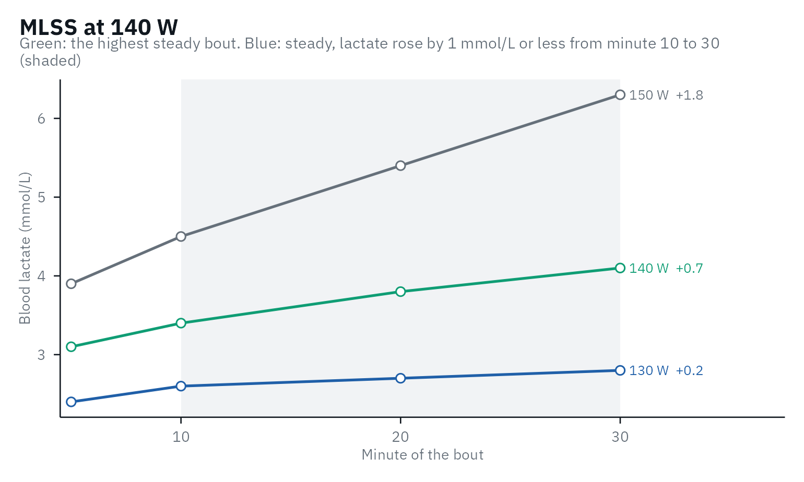

# Beyond the step test: MLSS and VLamax

A step test estimates two things it cannot measure directly. Its second
threshold is meant to find the maximal lactate steady state (MLSS),
which only constant-load bouts can confirm, and where its curve lies
depends partly on the maximal lactate accumulation rate (V̇La_(max)),
which comes from a short sprint. This article covers both tests.

## The maximal lactate steady state (MLSS)

The MLSS is the highest constant intensity at which blood lactate stays
steady. The idea comes from German sports medicine in the 1970s. Mader
et al. (1976) proposed 4.0 mmol/L in a step test as the mark of the
transition from aerobic to partly anaerobic metabolism: below it, they
wrote, lactate stays constant or falls when the load is held, and above
about 5 mmol/L it keeps rising. To test it, Heck and co-workers had men
of varying fitness run on a treadmill at several constant speeds near
that point, each run a 3-min warm-up and 25 min at the speed, with
earlobe lactate every 5 min, and took the highest speed at which lactate
stayed steady. They called it “maximales Laktatgleichgewicht” in 1982
(Heck et al., 1982; [Heck & Wackerhage,
2024](https://doi.org/10.1186/s13102-024-00827-3)), and in English, in
1985, the maximal lactate steady state: the speed at which lactate does
not rise by “any more than 1 mmol/l during the last 20 min”. In their 16
men it lay at 4.0 mmol/L on average, as Mader had predicted, but from
3.1 to 5.5 mmol/L between athletes ([Heck et al.,
1985](https://doi.org/10.1055/s-2008-1025824)). Heck himself stresses
that it is the highest steady state of blood lactate, which need not be
that of metabolism as a whole (Heck & Wackerhage, 2024), a point the
studies below return to.

### Measuring it

The test has changed little since. Comparing the criteria in use on 26
men, [Beneke (2003)](https://doi.org/10.1007/s00421-002-0783-1)
recommended constant-load bouts of at least 30 min, on separate days,
with a rise of no more than 1.0 mmol/L after the 10th minute. The MLSS
then lies between the highest steady bout and the next one up, so the
closer the bouts, the more precise the result.
[`lactate_mlss()`](https://fmmattioni.github.io/lactater/reference/lactate_mlss.md)
applies this rule to a table of bouts, one row per sample, with lactate
sampled at or around minutes 10 and 30, and, given the result of a step
test of the same athlete, it also tells how far each threshold lies from
the MLSS:

``` r

bouts <- data.frame(
  intensity = rep(c(130, 140, 150), each = 4),
  time = rep(c(5, 10, 20, 30), 3),
  lactate = c(2.4, 2.6, 2.7, 2.8, 3.1, 3.4, 3.8, 4.1, 3.9, 4.5, 5.4, 6.3)
)
step_test <- lactate_threshold(demo_data, intensity, lactate, plot = FALSE)
mlss <- lactate_mlss(bouts, step_test)
mlss
#> 3 constant-load bouts, steady when lactate rose by 1 mmol/L or less from minute 10 to 30.
#> MLSS at 140 W: the next bout (150 W) was not steady.
#> Closest thresholds: ModDmax (+0 W), OBLA 3.5 (-1 W), Exp-Dmax (-5 W).
autoplot(mlss)
```



Which threshold lands closest depends on the protocol and the athletes:
in the studies reviewed in [The methods and the
evidence](https://fmmattioni.github.io/lactater/articles/methods.html#what-the-evidence-says),
the gap of a method ranged from about 2 to 49 W. Collected over a group
of your own athletes, the gaps in `mlss$thresholds` answer the question
for your protocol.

### The MLSS and the critical power

Whether the MLSS marks the boundary between the heavy and the severe
domains has mostly been tested against the critical power (CP). When
[Keir et al. (2015)](https://doi.org/10.1249/MSS.0000000000000613)
measured both in 12 men, they found the same power (223 and 226 W), and
both matched in oxygen uptake the respiratory compensation point (RCP)
and the deoxyhemoglobin breakpoint of a ramp test, even though those two
came at a higher power in the ramp (262 and 273 W). [Mattioni Maturana
et al. (2016)](https://doi.org/10.1139/apnm-2016-0248), in contrast,
found the MLSS of 13 healthy young adults (233 W) 17 to 20 W below CP,
whether CP came from five time-to-exhaustion trials or from a 3-min
all-out test, and the two CP estimates agreed poorly with each other
(limits of agreement -39 to 31 W). Asked to ride 30 min at the highest
power they thought sustainable, the same participants chose 233 W, which
matched their MLSS within 20 W either way, while CP overestimated it by
20 W ([Mattioni Maturana et al.,
2017](https://doi.org/10.1016/j.jsams.2016.11.023)).

Much of this disagreement comes from how each is determined. [Iannetta
et al. (2022)](https://doi.org/10.1249/MSS.0000000000002831) compared
several CP models and several windows for the lactate rise with the
highest steady oxygen uptake of 10 men cycling, 243 W on average. With
the rise judged from minute 15 or 20, the MLSS lay 2 W above it on
average, against 8 W below from minute 10, and the best CP models 1 to 5
W above. Every method still missed it in some participants: at the MLSS
from minute 15 or 20, oxygen uptake was steady in 7 of the 10, against 9
from minute 10. `lactate_mlss(from = 20)` uses such a later window.
Across 10 studies, CP lay 12 W above the MLSS on average, with 95%
limits of agreement from -19 to 44 W ([Micheli et al.,
2025](https://doi.org/10.7717/peerj.19060)), and [Jones et al.
(2019)](https://doi.org/10.14814/phy2.14098) argue that CP, rather than
the MLSS as usually measured, marks the maximal metabolic steady state.

Where several 30-min bouts are not practical, a ramp test with gas
exchange offers a shortcut. [Iannetta et al.
(2018)](https://doi.org/10.1016/j.jsams.2018.05.004) built an equation
in 60 people from the RCP (in W/kg), the peak oxygen uptake and body
mass, and it predicted the MLSS of 29 new participants with a standard
error of 5 W. The RCP has to be found first: [Keir et
al. (2022)](https://doi.org/10.1007/s40279-021-01581-z) explain how to
identify it and the first threshold from gas exchange, and their
[Exercise Thresholds App](https://www.exercisethresholds.com/) does it
on your own data.

## The maximal lactate accumulation rate (V̇La_(max))

V̇La_(max) comes from its own test, a short all-out sprint, not from the
step test:

\dot{V}\text{La}\_{\text{max}} = \frac{\text{La}\_{\text{peak}} -
\text{La}\_{\text{pre}}}{t\_{\text{test}} - t\_{\text{alactic}}}

Take a lactate sample before the sprint and every minute for several
minutes after it; the highest value is the peak.
[`vlamax()`](https://fmmattioni.github.io/lactater/reference/vlamax.md)
does the arithmetic:

``` r

vlamax(lactate_pre = 1.1, lactate_post = c(8.9, 10.4, 10.9, 10.6, 10.1), test_duration = 15)
#> # A tibble: 1 × 5
#>   vlamax vlapeak lactate_peak delta_lactate glycolytic_time
#>    <dbl>   <dbl>        <dbl>         <dbl>           <dbl>
#> 1  0.852   0.653         10.9           9.8            11.5
```

The alactic time is the part of the sprint assumed to be covered by
phosphocreatine. In 50 cyclists, fixing it at 3.5 s gave the most
reliable V̇La_(max) (ICC 0.91, CV 3.1%), while estimating it from the
power curve did not (CV 12-26%); a 1-s change in it can change V̇La_(max)
by up to 26% ([Meixner et al.,
2024](https://doi.org/10.14814/phy2.16086)). Protocols differ widely
between studies ([Langley et al.,
2025](https://doi.org/10.28985/1425.jsc.09)), and whether V̇La_(max)
measures the maximal glycolytic rate is still debated: in 11 cyclists it
added little beyond the power of the sprint itself ([Clark & Macdermid,
2025](https://doi.org/10.1080/02701367.2025.2481176)). Compare V̇La_(max)
only within the same protocol, ergometer and analyzer.

[`vlamax()`](https://fmmattioni.github.io/lactater/reference/vlamax.md)
assumes a 15-s sprint by default, as in Meixner et al. (2024) and most
cycling studies. A review of 60 studies recommends a sport-specific
all-out sprint of 10-12 s with lactate sampled every minute for 10 min,
calls the rate from 15 s or longer a peak rather than a maximal rate,
and found the use of V̇La_(max) to predict performances of 1 min or
longer inconclusive ([Quittmann,
2026](https://doi.org/10.1007/s00421-025-06022-7)). Give `test_duration`
the length of your sprint.

[`vlamax()`](https://fmmattioni.github.io/lactater/reference/vlamax.md)
also returns vLa_(peak), the same rise divided by the whole sprint, with
no alactic time, so it is lower than V̇La_(max). [Wackerhage et
al. (2025)](https://doi.org/10.1007/s40279-025-02259-6) proposed it, by
analogy with V̇O_(2peak), partly because the alactic-time correction is
error-prone. In 182 cyclists and triathletes, both gave similar
associations with the lactate thresholds ([Röhrs et al.,
2026](https://doi.org/10.1007/s00421-026-06444-x)).

## What the step test shows

Commercial software estimates V̇La_(max) from submaximal bouts by fitting
Mader’s model of energy metabolism to the lactate values. The only open
description of the method we found is a preprint of 9 people, who did
four separate bouts with rest in between rather than a step test. Their
V̇La_(max) was never compared with a sprint, and the authors note that
the same power at the maximal lactate steady state may come from
different mixes of V̇O_(2max) and V̇La_(max) ([Suttmeyer et al.,
2023](https://doi.org/10.51224/SRXIV.269)). The review above found that
simulation approaches do not yet support predictions for an individual
athlete (Quittmann, 2026). Measure V̇La_(max) with a sprint.

What the step test can show is its effect. At the same V̇O_(2max),
Mader’s model predicts that a higher V̇La_(max) shifts the lactate curve
to the left (Wackerhage et al., 2025). In 50 cyclists, adding vLa_(peak)
to V̇O_(2max) and sex explained 6 to 20 percentage points more of the
variance in threshold power ([Meixner et al.,
2026](https://doi.org/10.1007/s00421-026-06270-1)); in 182 cyclists and
triathletes it added about 5 points beyond V̇O_(2max) and efficiency
(Röhrs et al., 2026). In both, a higher rate went with a lower
threshold. So a curve that moved left while V̇O_(2max) stayed the same
may reflect a higher glycolytic rate, not only lost endurance (see
[`curve_shape()`](https://fmmattioni.github.io/lactater/reference/curve_shape.md)).

## References

Beneke R. Methodological aspects of maximal lactate steady state -
implications for performance testing. Eur J Appl Physiol.
2003;89(1):95-9.
[doi:10.1007/s00421-002-0783-1](https://doi.org/10.1007/s00421-002-0783-1)

Clark B, Macdermid PW. V̇La_(max) correlates strongly with glycolytic
performance. Res Q Exerc Sport. 2025:1-8.
[doi:10.1080/02701367.2025.2481176](https://doi.org/10.1080/02701367.2025.2481176)

Heck H, Mader A, Hess G, Mücke S, Müller R, Hollmann W. Justification of
the 4-mmol/l lactate threshold. Int J Sports Med. 1985;6(3):117-30.
[doi:10.1055/s-2008-1025824](https://doi.org/10.1055/s-2008-1025824)

Heck H, Mader A, Liesen H, Hollmann W. Vorschlag zur Standardisierung
leistungsdiagnostischer Untersuchungen auf dem Laufband. Dtsch Z
Sportmed. 1982;33(9):304-7.

Heck H, Wackerhage H. The origin of the maximal lactate steady state
(MLSS). BMC Sports Sci Med Rehabil. 2024;16:36.
[doi:10.1186/s13102-024-00827-3](https://doi.org/10.1186/s13102-024-00827-3)

Iannetta D, Fontana FY, Maturana FM, Inglis EC, Pogliaghi S, Keir DA,
Murias JM. An equation to predict the maximal lactate steady state from
ramp-incremental exercise test data in cycling. J Sci Med Sport.
2018;21(12):1274-80.
[doi:10.1016/j.jsams.2018.05.004](https://doi.org/10.1016/j.jsams.2018.05.004)

Iannetta D, Ingram CP, Keir DA, Murias JM. Methodological reconciliation
of CP and MLSS and their agreement with the maximal metabolic steady
state. Med Sci Sports Exerc. 2022;54(4):622-32.
[doi:10.1249/MSS.0000000000002831](https://doi.org/10.1249/MSS.0000000000002831)

Jones AM, Burnley M, Black MI, Poole DC, Vanhatalo A. The maximal
metabolic steady state: redefining the ‘gold standard’. Physiol
Rep. 2019;7(10):e14098.
[doi:10.14814/phy2.14098](https://doi.org/10.14814/phy2.14098)

Keir DA, Fontana FY, Robertson TC, Murias JM, Paterson DH, Kowalchuk JM,
Pogliaghi S. Exercise intensity thresholds: identifying the boundaries
of sustainable performance. Med Sci Sports Exerc. 2015;47(9):1932-40.
[doi:10.1249/MSS.0000000000000613](https://doi.org/10.1249/MSS.0000000000000613)

Keir DA, Iannetta D, Mattioni Maturana F, Kowalchuk JM, Murias JM.
Identification of non-invasive exercise thresholds: methods, strategies,
and an online app. Sports Med. 2022;52:237-55.
[doi:10.1007/s40279-021-01581-z](https://doi.org/10.1007/s40279-021-01581-z)

Langley J, Haase R, Nitzsche N, Porter M. Methodological approaches in
testing maximal lactate accumulation rate - vLamax: a systematic review.
J Sci Cycling. 2025;14(1):9.
[doi:10.28985/1425.jsc.09](https://doi.org/10.28985/1425.jsc.09)

Mader A, et al. Zur Beurteilung der sportartspezifischen
Ausdauerleistungsfähigkeit im Labor. Sportarzt Sportmed.
1976;27(4):80-8.

Mattioni Maturana F, Keir DA, McLay KM, Murias JM. Can measures of
critical power precisely estimate the maximal metabolic steady-state?
Appl Physiol Nutr Metab. 2016;41(11):1197-203.
[doi:10.1139/apnm-2016-0248](https://doi.org/10.1139/apnm-2016-0248)

Mattioni Maturana F, Keir DA, McLay KM, Murias JM. Critical power
testing or self-selected cycling: which one is the best predictor of
maximal metabolic steady-state? J Sci Med Sport. 2017;20(8):795-9.
[doi:10.1016/j.jsams.2016.11.023](https://doi.org/10.1016/j.jsams.2016.11.023)

Meixner B, Nusser V, Koehler K, Sablain M, Boone J, Sperlich B.
Reliability of power output, maximal rate of capillary blood lactate
accumulation, and phosphagen contribution time following 15-s sprint
cycling in amateur cyclists. Physiol Rep. 2024;12(10):e16086.
[doi:10.14814/phy2.16086](https://doi.org/10.14814/phy2.16086)

Meixner B, Leo P, Sperlich B. Maximal glycolytic flux modulates
metabolic thresholds independent of maximal oxygen uptake. Eur J Appl
Physiol. 2026;126(9):4903-18.
[doi:10.1007/s00421-026-06270-1](https://doi.org/10.1007/s00421-026-06270-1)

Micheli L, Lucertini F, Grossi T, Pogliaghi S, Keir DA, Ferri Marini C.
Analysis of the factors influencing the proximity and agreement between
critical power and maximal lactate steady state: a systematic review and
meta-analyses. PeerJ. 2025;13:e19060.
[doi:10.7717/peerj.19060](https://doi.org/10.7717/peerj.19060)

Quittmann OJ. Maximal lactate accumulation rate (ċLa_(max)): current
evidence and future directions for exercise testing and training. Eur J
Appl Physiol. 2026;126(1):1-36.
[doi:10.1007/s00421-025-06022-7](https://doi.org/10.1007/s00421-025-06022-7)

Röhrs D, Wagner CM, Reer R, Keiner M. Lactate accumulation rate is
associated with lactate turnpoints in cyclists and triathletes: a
comparison of vLa_(peak) and vLa_(max,blood). Eur J Appl Physiol. 2026.
[doi:10.1007/s00421-026-06444-x](https://doi.org/10.1007/s00421-026-06444-x)

Suttmeyer J, Theodoropoulos M, Guillaume A, Schäfer R. Estimation of
endurance performance markers using a metabolic model in cycling: a
pilot study. SportRxiv preprint, not peer reviewed. 2023.
[doi:10.51224/SRXIV.269](https://doi.org/10.51224/SRXIV.269)

Wackerhage H, Kabasakalis A, Seiler S, Heck H. Is the vLa_(max) for
glycolysis what the V̇O_(2max) is for oxidative phosphorylation? Sports
Med. 2025;55(8):1853-66.
[doi:10.1007/s40279-025-02259-6](https://doi.org/10.1007/s40279-025-02259-6)
