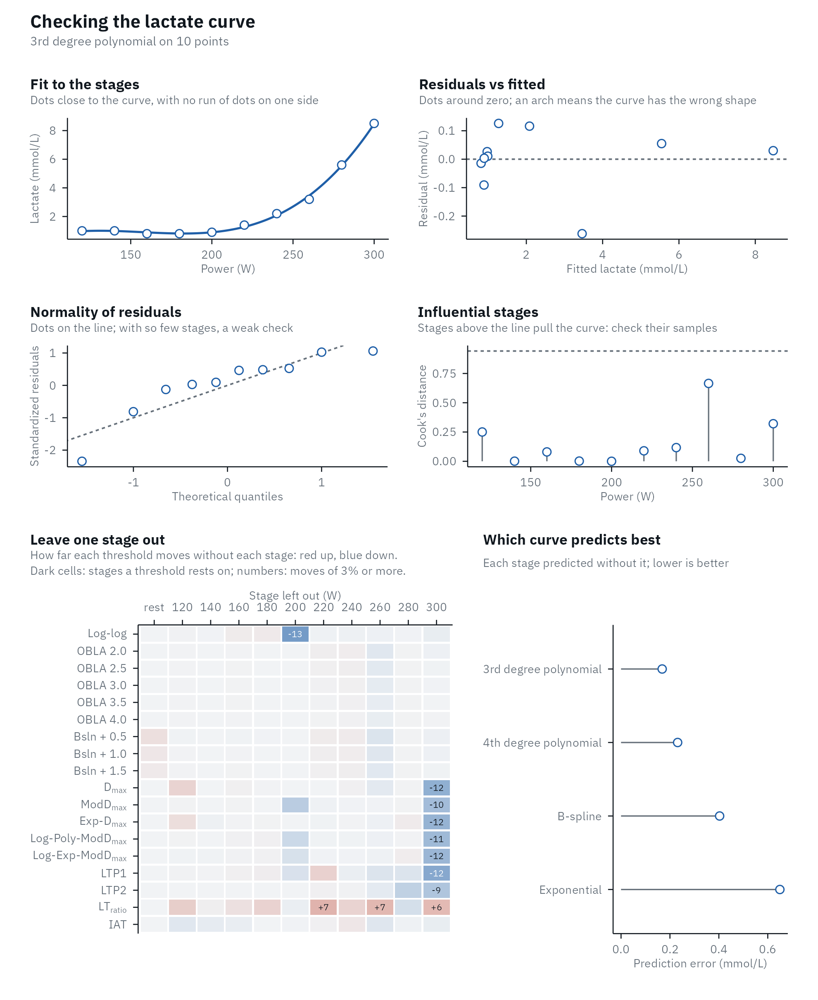
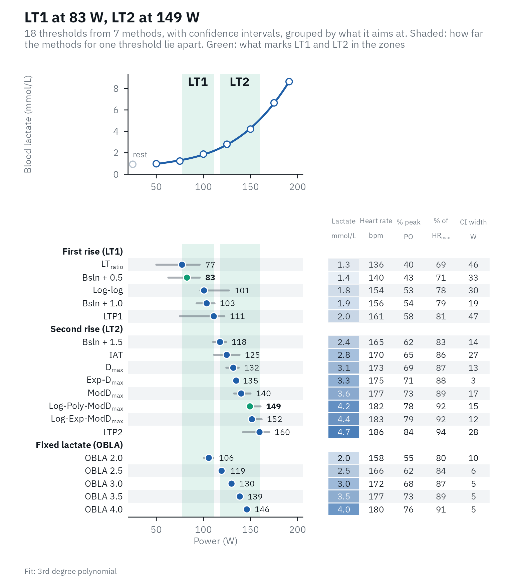

# Checking the analysis

A step test gives 6 to 10 stages, each a lactate sample with an analyzer
error of a few percent, and every threshold is read off a curve fitted
to them. Before trusting a number, ask three questions:

1.  **Is the test sound?** A missing resting sample, a lactate dip, a
    last stage that was not completed.
2.  **Does the curve follow the stages?** Regression diagnostics,
    adapted to so few points.
3.  **How sure is each threshold?** How much it moves without one stage,
    and its bootstrap interval.

## Is the test sound?

[`lactate_checks()`](https://fmmattioni.github.io/lactater/reference/lactate_checks.md)
lists what is easy to miss in a table of numbers. The printed results
say how many checks need attention.

``` r

library(lactater)
library(dplyr)

plateau <- tibble(
  intensity = c(0, 100, 150, 200, 250, 300, 350, 400),
  lactate = c(1.0, 1.1, 1.3, 2.0, 3.4, 5.2, 6.4, 6.4)
)
plateau_results <- lactate_threshold(plateau, intensity, lactate, plot = FALSE)
plateau_results
#> # Lactate thresholds: cycling, 3rd degree polynomial, 7 stages + rest
#> # LT1:                176 W (Bsln + 0.5)
#> # LT2:                182 W (Log-Poly-ModDmax)
#> # Checks:             2 warnings, see lactate_checks()
#>    method_category method           fitting                    intensity lactate
#>    <fct>           <fct>            <chr>                          <dbl>   <dbl>
#>  1 Log-log         Log-log          3rd degree polynomial (us…       167     1.6
#>  2 OBLA            OBLA 2.0         3rd degree polynomial (us…       198     2  
#>  3 OBLA            OBLA 2.5         3rd degree polynomial (us…       216     2.5
#>  4 OBLA            OBLA 3.0         3rd degree polynomial (us…       232     3  
#>  5 OBLA            OBLA 3.5         3rd degree polynomial (us…       248     3.5
#>  6 OBLA            OBLA 4.0         3rd degree polynomial (us…       263     4  
#>  7 Bsln+           Bsln + 0.5       3rd degree polynomial (us…       176     1.5
#>  8 Bsln+           Bsln + 1.0       3rd degree polynomial (us…       198     2  
#>  9 Bsln+           Bsln + 1.5       3rd degree polynomial (us…       216     2.5
#> 10 Dmax            Dmax             3rd degree polynomial (de…       169     1.4
#> 11 Dmax            ModDmax          3rd degree polynomial (de…       177     1.5
#> 12 Dmax            Exp-Dmax         Exponential (default)            253     3.7
#> 13 Dmax            Log-Poly-ModDmax 3rd degree polynomial (de…       182     1.6
#> 14 Dmax            Log-Exp-ModDmax  Exponential (default)             NA    NA  
#> 15 LTP             LTP1             3rd degree polynomial (us…       185     1.4
#> 16 LTP             LTP2             3rd degree polynomial (us…       340     6.4
#> 17 LTratio         LTratio          B-Spline (default)               156     1.4
#> 18 IAT             IAT              B-Spline (default)               234     2.9
lactate_checks(plateau_results)
#> 10 checks: 6 passed, 2 notes, 2 warnings
#> ℹ Stages             7 stages: the LTP fit has 6 parameters, so 1 degree of freedom is left and LTP can move a lot with one stage (at least 8 stages are better); the fitted curves rest on few points too.
#> ✔ Resting sample     Present.
#> ⚠ Thresholds found   Not found within the tested range: Log-Exp-ModDmax.
#> ✔ Edge of the range  No threshold sits at the first or last stage.
#> ✔ Early lactate dip  No early dip.
#> ℹ Final stage        Lactate did not rise in the last stage (incomplete stage or plateau); consider `max_intensity`.
#> ✔ Peak lactate       6.4 mmol/L.
#> ✔ Sample type        blood lactate.
#> ✔ LT1                Within 10% of peak (5 methods, LTratio 156 to Bsln + 1.0 198).
#> ⚠ LT2                43% of peak apart (7 methods, Dmax 169 to LTP2 340): the choice of LT2 decides the zones, so look at the overview before choosing.
```

Here lactate did not rise in the last stage. If that stage was not
completed, leave it out:

``` r

lactate_threshold(plateau, intensity, lactate, method = "Dmax", plot = FALSE, max_intensity = 350)
#> # Lactate thresholds: cycling, 3rd degree polynomial, 6 stages + rest
#> # LT2:                222 W (Log-Poly-ModDmax)
#>   method_category method           fitting                     intensity lactate
#>   <fct>           <fct>            <chr>                           <dbl>   <dbl>
#> 1 Dmax            Dmax             3rd degree polynomial (def…       186     1.8
#> 2 Dmax            ModDmax          3rd degree polynomial (def…       206     2.2
#> 3 Dmax            Exp-Dmax         Exponential (default)             238     3.1
#> 4 Dmax            Log-Poly-ModDmax 3rd degree polynomial (def…       222     2.7
#> 5 Dmax            Log-Exp-ModDmax  Exponential (default)             265     3.8
```

## Does the curve follow the stages?

[`lactate_diagnostics()`](https://fmmattioni.github.io/lactater/reference/lactate_diagnostics.md)
checks the fitted curve the way a regression model is checked, with the
adjustments that 6 to 10 points need, and prints a summary. Here is a
trained female cyclist from `lactate_tests`:

``` r

female <- lactate_tests |>
  filter(test == "cycling_female") |>
  lactate_threshold(intensity, lactate, plot = FALSE)
diagnostics <- lactate_diagnostics(female)
diagnostics
#> Lactate curve: 3rd degree polynomial on 10 points; residual SD 0.14 mmol/L.
#> No stage has a Cook's distance above 0.94 (the median of F(4, 6)).
#> Most sensitive to single stages: Log-log (jackknife SE 12 W), Dmax (jackknife SE 12 W), LTP1 (jackknife SE 12 W).
#> Best-predicting curve: 3rd degree polynomial, which missed each stage by 0.17 mmol/L on average when fitted without it (root-mean-square leave-one-out error).
```

``` r

autoplot(diagnostics)
```



Each panel answers one question, and its subtitle says what to look for.

**Fit to the stages.** The curve with the measured stages, and a dashed
line from each stage to the curve (the residual). Look for runs of
stages on the same side of the curve, not for single stages a little off
it: with an analyzer error of 2 to 4% ([Bonaventura et al.,
2015](https://pmc.ncbi.nlm.nih.gov/articles/PMC4306774/)), a residual of
0.1 to 0.2 mmol/L is expected.

**Residuals vs fitted.** The residuals against the fitted lactate. They
should scatter around zero with no pattern. An arch (positive at both
ends and negative in the middle, or the reverse) means the shape of the
curve is wrong for this test: an exponential, for example, cannot follow
stages that stay flat or dip at the start. A fan that widens to the
right is expected, because analyzer error grows with lactate
([Bonaventura et al.,
2015](https://pmc.ncbi.nlm.nih.gov/articles/PMC4306774/)).

**Normality of residuals.** The standardized residuals (each residual
divided by its standard error) against the values a normal distribution
would give. They should follow the line. With 6 to 10 points, no test
can tell much: in a simulation of cubic fits to 6, 8 and 10 stages, a
Shapiro-Wilk test rejected normality in under 2% of runs, even when the
errors were heavy-tailed or skewed (code below). A check that “passes”
means “could not tell”, not “fine”. Look for one point far from the
others instead.

**Influential stages.** How much each stage pulls the curve, as Cook’s
distance: how far all the fitted values would move if that stage were
left out ([Cook, 1977](https://doi.org/10.2307/1268249)). Two things are
special with so few stages:

- The first and last stages always have a high *leverage* (the potential
  to pull the curve), by design: leverage depends only on where the
  stages are along the intensity axis, and the ends have no neighbors on
  one side. For a cubic on 10 stages, the end stages here have a
  leverage of 0.82 and the inner ones 0.24 to 0.33. Because the curve
  bends towards a high-leverage stage, its residual looks small exactly
  when it matters most, which is why Cook’s distance combines the
  residual with the leverage.
- The usual cut-offs fail. The rule “leverage above 2p/n” (p, the number
  of curve terms; [Hoaglin & Welsch,
  1978](https://doi.org/10.1080/00031305.1978.10479237)) gives 2 x 4 / 8
  = 1 for a cubic on 8 stages, a value leverage can never exceed, so it
  flags nothing. lactater flags a stage when its Cook’s distance is
  above the median of the F(p, n - p) distribution, which adapts to n
  and p ([Cook, 1977](https://doi.org/10.2307/1268249)).

**Leave one stage out.** Every threshold computed again without each
stage in turn (a jackknife; [Efron,
1982](https://doi.org/10.1137/1.9781611970319)). A grid has one row per
method and one column per stage left out, red where the threshold rises
without that stage and blue where it falls, darker the further it moves,
with the move written where it is 3% of the threshold or more, about the
day-to-day variation of a threshold ([Heuberger et al.,
2018](https://doi.org/10.1371/journal.pone.0206846)). A pale row means
the threshold does not rest on any single stage; a dark cell names the
stage it rests on; a dark column is a stage that many thresholds rest
on, which is worth a second look at its sample. Dropping the first or
last stage changes where the D_(max) line starts or ends, so dark cells
there are expected for the D_(max) family. The jackknife standard error,
`sqrt((n - 1) / n * sum((theta_i - mean(theta_i))^2))`, summarizes the
spread for each method:

``` r

diagnostics$jackknife |>
  arrange(desc(jackknife_se)) |>
  slice_head(n = 5)
#> # A tibble: 5 × 5
#>   method          intensity lowest highest jackknife_se
#>   <chr>               <dbl>  <dbl>   <dbl>        <dbl>
#> 1 Log-log              199.   186.    201.         12.0
#> 2 Dmax                 231.   219.    236.         12.0
#> 3 LTP1                 208.   196.    212.         11.8
#> 4 Exp-Dmax             242.   230.    245.         11.3
#> 5 Log-Exp-ModDmax      260.   248.    261.         11.1
```

**Which curve predicts best.** Each stage predicted by the curve fitted
without it. The printed summary gives the prediction error of the best
curve: the root-mean-square difference, in mmol/L, between each measured
stage and its prediction from the curve fitted without it. More on this
below.

### When one stage drives the curve

In this trained cyclist, lactate falls after the first stage, probably
after a hard warm-up:

``` r

dip <- lactate_tests |>
  filter(test == "cycling_early_dip") |>
  lactate_threshold(intensity, lactate, plot = FALSE)
dip_diagnostics <- lactate_diagnostics(dip)
dip_diagnostics
#> Lactate curve: 3rd degree polynomial on 8 points; residual SD 0.09 mmol/L.
#> Influential stage(s): 120 W (Cook's distance 4.90), 400 W (Cook's distance 1.07).
#> Most sensitive to single stages: LTP1 (jackknife SE 71 W), Log-log (jackknife SE 43 W), LTP2 (jackknife SE 40 W).
#> Best-predicting curve: 3rd degree polynomial, which missed each stage by 0.19 mmol/L on average when fitted without it (root-mean-square leave-one-out error).
```

The first stage has a Cook’s distance of 4.9, five times the cut-off: it
pulls the fitted curve. Without it, Log-log moves by 34 W, while OBLA
2.0, read off the curve higher up, barely moves:

``` r

dip_diagnostics$leave_one_out |>
  filter(method %in% c("Log-log", "OBLA 2.0"), stage == 120)
#> # A tibble: 2 × 4
#>   method   stage intensity change
#>   <chr>    <dbl>     <dbl>  <dbl>
#> 1 Log-log    120      272. 33.6  
#> 2 OBLA 2.0   120      291. -0.206
```

That does not make the stage wrong: the dip is real physiology, and
deleting a measurement to get a nicer curve is not a check. It means
that the first-rise thresholds of this test should be read with care,
and that the next test needs a lighter warm-up. The summary also names
LTP1 as the most sensitive threshold, for another reason: with 8 stages,
each of the three straight segments of LTP holds only a few stages, and
leaving out the 320 W stage moves LTP1 by 69 W:

``` r

dip_diagnostics$leave_one_out |>
  filter(method == "LTP1")
#> # A tibble: 9 × 4
#>   method stage intensity  change
#>   <chr>  <dbl>     <dbl>   <dbl>
#> 1 LTP1       0      259.   0    
#> 2 LTP1     120      264.   5.34 
#> 3 LTP1     160      259.   0.264
#> 4 LTP1     200      263.   3.50 
#> 5 LTP1     240      247. -12.0  
#> 6 LTP1     280      221. -38.5  
#> 7 LTP1     320      190. -68.6  
#> 8 LTP1     360      210. -49.6  
#> 9 LTP1     400      210. -49.6
```

## Which curve?

[`lactate_fit_quality()`](https://fmmattioni.github.io/lactater/reference/lactate_fit_quality.md)
fits every curve to the same points. A curve with more parameters always
follows the points more closely, so the RMSE (the typical distance
between the curve and the stages) always favors it. The prediction error
does not: each stage is predicted by the curve fitted without it
(leave-one-out cross-validation), which punishes a curve that bends to
follow single points.

The elite rider in `lactate_tests` shows the difference:

``` r

elite <- lactate_tests |>
  filter(test == "cycling_elite") |>
  lactate_threshold(intensity, lactate, plot = FALSE)

lactate_fit_quality(elite) |>
  select(fit, parameters, rmse, prediction_error)
#> # A tibble: 4 × 4
#>   fit                   parameters   rmse prediction_error
#>   <chr>                      <int>  <dbl>            <dbl>
#> 1 3rd degree polynomial          4 0.172             0.410
#> 2 4th degree polynomial          5 0.137             0.733
#> 3 B-spline                       5 0.0424            0.534
#> 4 Exponential                    3 0.264             1.29
```

The B-spline follows the stages most closely (the lowest RMSE), but
predicts a left-out stage worse than the 3rd degree polynomial: it
follows the noise as well as the curve. The runner is the opposite case:
the polynomial cannot follow the flat first stages, and the spline and
4th degree polynomial predict better.

``` r

runner <- lactate_tests |>
  filter(test == "running") |>
  lactate_threshold(intensity, lactate, sport = "running", plot = FALSE)

lactate_fit_quality(runner) |>
  select(fit, parameters, rmse, prediction_error)
#> # A tibble: 4 × 4
#>   fit                   parameters   rmse prediction_error
#>   <chr>                      <int>  <dbl>            <dbl>
#> 1 3rd degree polynomial          4 0.159             0.543
#> 2 4th degree polynomial          5 0.0863            0.261
#> 3 B-spline                       5 0.0615            0.256
#> 4 Exponential                    3 0.162             0.582
```

Choose the curve before you look at the thresholds, use the prediction
error as a guide rather than a rule, and keep the same curve between
tests of the same athlete. Some methods fix their curve anyway:
Exp-D_(max) and Log-Exp-ModD_(max) use the exponential, LT_(ratio) and
IAT the B-spline, and Log-log and LTP the measured stages.

## How sure is a threshold?

The jackknife shows how much a threshold rests on single stages.
`ci = TRUE` asks a different question: how much does it move with the
scatter of this test? Every replicate keeps the fitted curve and gives
each stage its own residual with a random sign, a wild bootstrap ([Wu,
1986](https://doi.org/10.1214/aos/1176350142); [Davidson & Flachaire,
2008](https://doi.org/10.1016/j.jeconom.2008.08.003)), because the error
of a lactate sample grows with its concentration. The residuals are
widened for the few degrees of freedom a step test leaves, and every
method is run again. The interval is the middle 95% of the replicate
thresholds. The overview plot draws it as a line on each row.

``` r

set.seed(1)
with_ci <- demo_data |>
  lactate_threshold(intensity, lactate, heart_rate, plot = FALSE, ci = TRUE, n_boot = 300)

with_ci |>
  select(method, intensity, intensity_low, intensity_high)
#> Warning: Unknown or uninitialised column: `method_category`.
#> # Lactate thresholds: cycling, 3rd degree polynomial, 7 stages + rest
#> # LT1:                83 W (Bsln + 0.5)
#> # LT2:                149 W (Log-Poly-ModDmax)
#>    method           intensity intensity_low intensity_high
#>    <fct>                <dbl>         <dbl>          <dbl>
#>  1 Log-log                101            96            128
#>  2 OBLA 2.0               106           100            111
#>  3 OBLA 2.5               119           116            123
#>  4 OBLA 3.0               130           127            133
#>  5 OBLA 3.5               139           136            142
#>  6 OBLA 4.0               146           143            149
#>  7 Bsln + 0.5              83            62             97
#>  8 Bsln + 1.0             103            92            112
#>  9 Bsln + 1.5             118           110            125
#> 10 Dmax                   132           124            138
#> 11 ModDmax                140           132            150
#> 12 Exp-Dmax               135           133            137
#> 13 Log-Poly-ModDmax       149           145            161
#> 14 Log-Exp-ModDmax        152           149            162
#> 15 LTP1                   111            75            123
#> 16 LTP2                   160           142            171
#> 17 LTratio                 77            50             97
#> 18 IAT                    125           111            139
autoplot(with_ci)
```



Thresholds read off the fitted curve at a fixed concentration (OBLA)
move little. Breakpoint methods (Log-log, LTP) move a lot, because a
breakpoint between two stages can jump to the neighboring interval.

An interval need not be centered on its threshold. It is the middle 95%
of the replicates, not the threshold plus or minus a standard error, so
it keeps the shape of their spread. Here Log-log is 101 W with an
interval of 96 to 128 W, because in some replicates its breakpoint jumps
to the next stage up; LT_(ratio), at 77 W, reaches down to 50 W, because
the lactate / intensity ratio is nearly flat around its minimum; OBLA
3.0 sits in the middle of its narrow interval. A lopsided interval says
in which direction a threshold is fragile. The intervals cover the
scatter of the samples only: not errors that are the same in every
sample, such as analyzer bias or the sampling site, nor the day-to-day
variation of the athlete, which is larger (see
[`compare_tests()`](https://fmmattioni.github.io/lactater/reference/compare_tests.md)).

How often, then, does a 95% interval hold the true threshold? A
simulation of 150 tests of 8 stages from a known curve
(`data-raw/bootstrap_coverage.R` in the package source) answers it. With
an analyzer error of 0.1 mmol/L plus 4%, the interval held the true
threshold in 93% of tests for Bsln + 1.0, 94% for Exp-D_(max) and 84%
for OBLA 4.0; with a constant error of 0.25 mmol/L, in 93%, 97% and 91%.
OBLA falls short because a 3rd degree polynomial cannot follow the true
curve exactly, and the interval does not include that error of about 1.5
W. An ordinary residual bootstrap, which moves the residuals between
stages, did worse: 67% for OBLA 4.0 and 81% for Exp-D_(max) with the
error that grows with lactate.

## The simulation of normality tests

The code behind the “under 2%” above (4,000 runs per cell; takes a few
seconds)

``` r

set.seed(1)
rejected <- function(n, errors, runs = 4000) {
  x <- seq_len(n)
  truth <- 1 + 0.05 * exp(0.6 * x)
  mean(replicate(runs, {
    y <- truth + 0.3 * errors(n)
    stats::shapiro.test(stats::rstandard(stats::lm(y ~ poly(x, 3))))$p.value < 0.05
  }))
}
error_types <- list(normal = rnorm, heavy_tailed = function(n) rt(n, 3), skewed = function(n) rexp(n) - 1)
tidyr::expand_grid(errors = names(error_types), stages = c(6, 8, 10)) |>
  mutate(rejected = purrr::map2_dbl(errors, stages, \(e, n) rejected(n, error_types[[e]]))) |>
  tidyr::pivot_wider(names_from = errors, values_from = rejected)
```

## References

Bonaventura JM, Sharpe K, Knight E, Fuller KL, Tanner RK, Gore CJ.
Reliability and accuracy of six hand-held blood lactate analysers. J
Sports Sci Med. 2015;14:203-14.
[PMCID:PMC4306774](https://pmc.ncbi.nlm.nih.gov/articles/PMC4306774/)

Cook RD. Detection of influential observation in linear regression.
Technometrics. 1977;19(1):15-8.
[doi:10.2307/1268249](https://doi.org/10.2307/1268249)

Davidson R, Flachaire E. The wild bootstrap, tamed at last. Journal of
Econometrics. 2008;146(1):162-9.
[doi:10.1016/j.jeconom.2008.08.003](https://doi.org/10.1016/j.jeconom.2008.08.003)

Efron B. The Jackknife, the Bootstrap and Other Resampling Plans.
Philadelphia: SIAM; 1982.
[doi:10.1137/1.9781611970319](https://doi.org/10.1137/1.9781611970319)

Heuberger JAAC, Gal P, Stuurman FE, de Muinck Keizer WAS, Mejia Miranda
Y, Cohen AF. Repeatability and predictive value of lactate threshold
concepts in endurance sports. PLOS ONE. 2018;13(11):e0206846.
[doi:10.1371/journal.pone.0206846](https://doi.org/10.1371/journal.pone.0206846)

Hoaglin DC, Welsch RE. The hat matrix in regression and ANOVA. Am Stat.
1978;32(1):17-22.
[doi:10.1080/00031305.1978.10479237](https://doi.org/10.1080/00031305.1978.10479237)

Wu CFJ. Jackknife, bootstrap and other resampling methods in regression
analysis. Ann Stat. 1986;14(4):1261-95.
[doi:10.1214/aos/1176350142](https://doi.org/10.1214/aos/1176350142)
