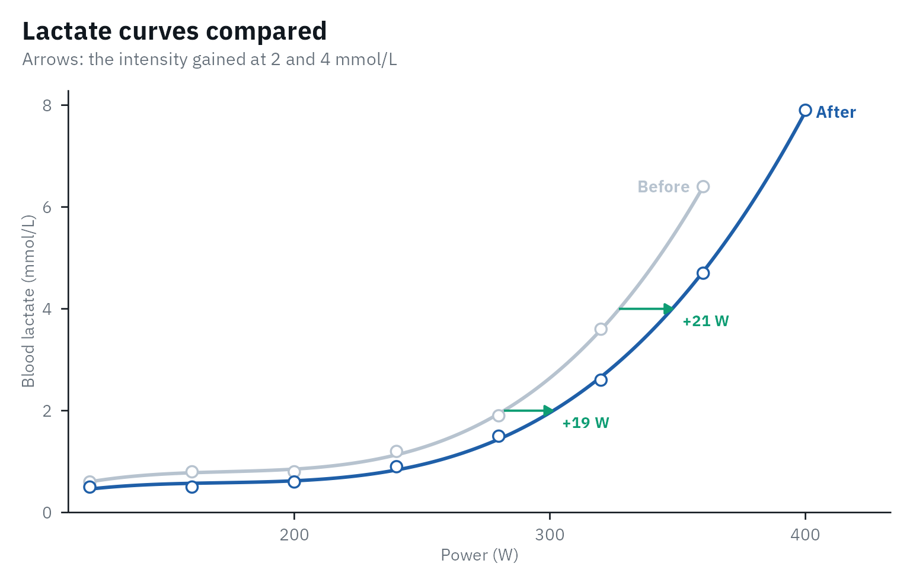
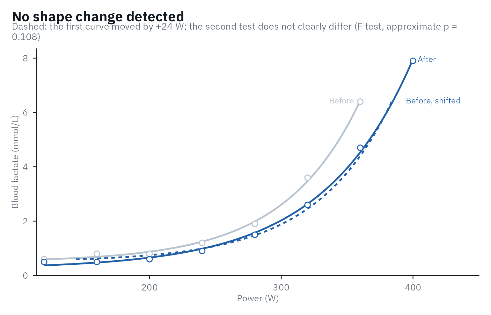
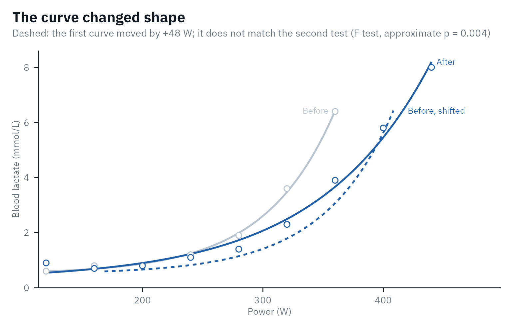
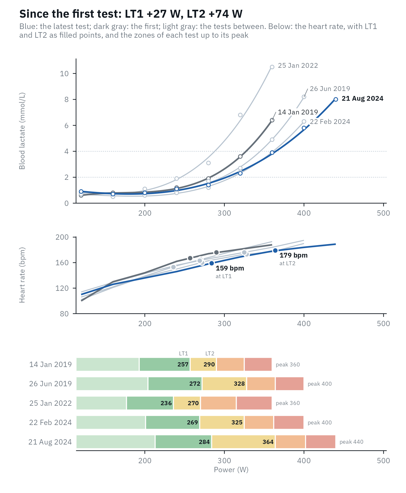

# Comparing tests

A step test is most useful the second time: did the athlete improve, by
how much, and is that more than the noise of the test? This article uses
the six tests of one trained cyclist in `lactate_tests` (real data from
Trinity College Dublin, CC BY 4.0), over five and a half years.

``` r

library(lactater)
library(dplyr)

series <- lactate_tests |>
  filter(athlete == "cyclist_series")
series |>
  distinct(test, day)
#> # A tibble: 6 × 2
#>   test               day
#>   <chr>            <int>
#> 1 cycling_series_1     0
#> 2 cycling_series_2    58
#> 3 cycling_series_3   163
#> 4 cycling_series_4  1107
#> 5 cycling_series_5  1865
#> 6 cycling_series_6  2046

analyse <- function(d) {
  series |>
    filter(day == d) |>
    lactate_threshold(intensity, lactate, heart_rate, plot = FALSE)
}
before <- analyse(0)
after <- analyse(58)
```

Before comparing, check both tests on their own (see [Checking the
analysis](https://fmmattioni.github.io/lactater/articles/checking.md)),
and make sure they were run the same way: the same protocol, sampling
site, sample type and analyzer (see [Best
practices](https://fmmattioni.github.io/lactater/articles/best-practices.md)).

## Is the change real?

A threshold moves between two tests even when fitness does not, through
day-to-day variation and the error of the analyzer and the method.
[`compare_tests()`](https://fmmattioni.github.io/lactater/reference/compare_tests.md)
gives every change an interval from the test-retest variation of the
method ([Hopkins,
2000](https://doi.org/10.2165/00007256-200030010-00001); [Swinton et
al., 2018](https://doi.org/10.3389/fnut.2018.00041)), and three columns
to read it by: the `noise` (what two tests of that method usually differ
by when nothing changed), the `ratio` of the change to it, and a
`verdict`, “beyond the noise” when the whole interval is on one side of
zero, or of the smallest worthwhile change you set with `swc`. There is
no agreed level for that interval: 90% is the default, 95% the classic
choice, and narrower ones are defended for decisions in practice
(Swinton et al., 2018); set it with `level`. At 90%, an unchanged
threshold is called a gain in 5% of comparisons and a loss in 5%: a
one-sided test for a gain at 5%, which [Sainani
(2018)](https://doi.org/10.1249/MSS.0000000000001645) recommends in
place of graded terms. “Within the noise” does not mean that nothing
changed. With a `cv` of 4% to 5%, a threshold has to move by about 10%
to lie beyond the noise, so one pair of tests rarely settles it, and a
series of tests says more (below). lactater does not turn the interval
into “likely” or “very likely”: those terms read it as the probability
of a true change, which it is not ([Lohse et al.,
2020](https://doi.org/10.1371/journal.pone.0235318)).

Read the verdict of the LT1 and LT2 you chose in
[`lactate_threshold()`](https://fmmattioni.github.io/lactater/reference/lactate_threshold.md),
which the header gives, and choose `level` and `swc` before you look.
Every method has its own verdict, and with 18 of them some lie beyond
the noise by chance: in 157 pairs of consecutive tests of the cyclists
of Heuberger et al. (2018), each method did in 6% to 15% of pairs, but
at least one of them in 50%. [Sainani & Chamari
(2022)](https://doi.org/10.1123/ijspp.2022-0023) ask for the outcome to
be named beforehand when many are tested: here, that is the pair you
chose.

``` r

comparison <- compare_tests(before, after)
comparison |>
  select(method, before, after, change, change_low, change_high, cv, noise, ratio, verdict)
#> # Tests compared: cycling, 18 methods; noise: what two tests differ by when
#> #   nothing changed; verdict at 90%
#> # LT1:            257 to 268 W (+10, 0.3 x the noise of 30 W: within the
#> #   noise), by Bsln + 0.5
#> # LT2:            304 to 326 W (+22, 0.9 x the noise of 24 W: within the
#> #   noise), by Log-Poly-ModDmax
#>    method   before after change change_low change_high    cv noise ratio verdict
#>    <fct>     <dbl> <dbl>  <dbl>      <dbl>       <dbl> <dbl> <dbl> <dbl> <chr>  
#>  1 Log-log     239   236     -3        -46          41   7.8    26  -0.1 within…
#>  2 OBLA 2.0    282   301     19        -31          70   7.7    31   0.6 within…
#>  3 OBLA 2.5    296   316     19        -17          55   5.2    22   0.9 within…
#>  4 OBLA 3.0    308   328     20        -13          53   4.6    20   1   within…
#>  5 OBLA 3.5    318   338     20        -15          56   4.8    22   0.9 within…
#>  6 OBLA 4.0    327   348     21        -13          54   4.4    20   1   within…
#>  7 Bsln + …    257   268     10        -39          59   8.2    30   0.3 within…
#>  8 Bsln + …    279   291     12        -20          45   5      20   0.6 within…
#>  9 Bsln + …    294   307     14        -17          44   4.5    19   0.7 within…
#> 10 Dmax        270   291     22        -15          59   5.9    22   1   within…
#> 11 ModDmax     290   327     36          2          71   5.1    21   1.7 beyond…
#> 12 Exp-Dmax    277   303     26         -2          53   4.3    17   1.5 within…
#> 13 Log-Pol…    304   326     22        -17          61   5.5    24   0.9 within…
#> 14 Log-Exp…    309   333     24        -11          59   4.9    21   1.1 within…
#> 15 LTP1        222   257     35        -20          90  10.6    33   1.1 within…
#> 16 LTP2        301   341     40         -2          82   6      26   1.6 within…
#> 17 LTratio     192   180    -12        -54          30   9.4    25  -0.5 within…
#> 18 IAT         294   304     10        -20          40   4.4    18   0.5 within…
```

The default test-retest variation of each method (the `cv` column) is
lactater’s own calculation on the open data of [Heuberger et
al. (2018)](https://doi.org/10.1371/journal.pone.0206846): the five step
tests of each of 47 trained male cyclists, about two weeks apart,
analyzed with
[`lactate_reliability()`](https://fmmattioni.github.io/lactater/reference/lactate_reliability.md).
It is about 4% to 6% for the thresholds aimed at LT2 and 8% to 11% for
Bsln + 0.5, Log-log, LT_(ratio) and LTP1, so a first-rise threshold has
to move about twice as far before the change is clear. These defaults
are on the careful side: the published values are lower (3.4% to 4.3%
for D_(max), IAT, 4 mmol/L and ModD_(max) in the placebo riders of the
same study; 3.4% to 3.7% for Bsln+ in a ramp test, [Pallares et al.,
2016](https://doi.org/10.1371/journal.pone.0163389)), and
[`?compare_tests`](https://fmmattioni.github.io/lactater/reference/compare_tests.md)
lists both, to give the published ones with `cv` if you prefer them. The
best `cv` is still the one of your own athletes with your own protocol:
measure it with
[`lactate_reliability()`](https://fmmattioni.github.io/lactater/reference/lactate_reliability.md).
The defaults come from cyclists and are used for every sport, and the
notes say so when the tests are not cycling. For running, no open
test-retest data were found to compute them the same way. Published
typical errors are about 0.3 to 0.8 km/h (2% to 6%) in 22 trained men
([Cerezuela-Espejo et al.,
2018](https://doi.org/10.3389/fphys.2018.01320), from the SDs of their
differences) and 0.4 to 1.4 km/h in 19 healthy, untrained people ([Gavin
et al., 2014](https://doi.org/10.1016/j.jsams.2013.08.006)), close to
the cycling defaults. `attr(comparison, "notes")` lists what could make
two tests hard to compare: a different protocol, sample type or resting
sample, or a fall in peak lactate, which also moves the curve to the
right.

## How far did the curve move?

Thresholds are single points; the whole curve tells more.
[`curve_shift()`](https://fmmattioni.github.io/lactater/reference/curve_shift.md)
gives the intensity gained at each lactate, and the lactate saved at the
intensities you choose.

``` r

curve_shift(before, after, intensity = c(250, 300))
#> # A tibble: 8 × 8
#>   lactate intensity_before intensity_after shift intensity lactate_before
#>     <dbl>            <dbl>           <dbl> <dbl>     <dbl>          <dbl>
#> 1     1.5              262             283    20        NA           NA  
#> 2     2                282             301    19        NA           NA  
#> 3     2.5              296             316    19        NA           NA  
#> 4     3                308             328    20        NA           NA  
#> 5     3.5              318             338    20        NA           NA  
#> 6     4                327             348    21        NA           NA  
#> 7    NA                 NA              NA    NA       250            1.3
#> 8    NA                 NA              NA    NA       300            2.6
#> # ℹ 2 more variables: lactate_after <dbl>, lactate_change <dbl>
autoplot(comparison)
```



## Did the curve shift, or change its shape?

Training can move the whole curve to the right, or change its shape: a
later or a gentler rise.
[`curve_shape()`](https://fmmattioni.github.io/lactater/reference/curve_shape.md)
fits both tests with the exponential plus constant,
`lactate = a + b * exp(c * intensity)` ([Hughson et al.,
1987](https://doi.org/10.1152/jappl.1987.62.5.1975)), twice: once with
one shape for both tests, the second moved sideways by a shift, and once
with a shape for each test. An extra-sum-of-squares F test ([Motulsky &
Ransnas, 1987](https://doi.org/10.1096/fasebj.1.5.3315805)) and AICc
([Hurvich & Tsai, 1989](https://doi.org/10.1093/biomet/76.2.297))
compare the two fits, and the shift comes with a confidence interval.

``` r

shape <- curve_shape(before, after)
shape
#> Shift only vs free shape: F(2, 9) = 2.88, approximate p = 0.108; AICc -49.7 vs -43.8.
#> No shape change detected: one curve shifted by +24 W (95% CI 21 to 28) describes both tests, but with fewer than 8 stages the test finds few changes of shape.
#> Peak lactate 6.4 -> 7.9 mmol/L. A shift can also come from low glycogen or overreaching, not only fitness.
autoplot(shape)
```



In the first 58 days the curve moved by about 24 W, and one shape
describes both tests. Five and a half years later, it is a different
story:

``` r

later <- curve_shape(before, analyse(2046))
later
#> Shift only vs free shape: F(2, 10) = 10.41, approximate p = 0.004; AICc -19.8 vs -25.8.
#> The shape changed: a shift alone (+48 W) does not describe both tests.
#> Peak lactate 6.4 -> 8.0 mmol/L.
autoplot(later)
```



Read the result with care:

- **Little power.** “No shape change detected” is not proof that the
  shape is the same. In simulated tests of a trained cyclist, a baseline
  0.5 mmol/L higher was found in 96% of pairs with 8 stages per test,
  but in 20% with 6.
- **An approximate p-value.** The F test is exact only for models that
  are linear in their parameters ([Motulsky & Ransnas,
  1987](https://doi.org/10.1096/fasebj.1.5.3315805)); here it fell below
  0.05 in 8% to 10% of simulated pairs with no change of shape. The
  verdict also asks AICc, and was wrong in 1% to 6%.
- **A shift is not always fitness.** In this model, a shift to the right
  is the same as a proportional fall of lactate above baseline. Better
  endurance, low glycogen stores and overreaching can all produce it
  ([Maassen & Busse, 1989](https://doi.org/10.1007/BF00637384); [Faude
  et al., 2009](https://doi.org/10.2165/00007256-200939060-00003)), so
  check the peak lactate, the diet before the test and the performance
  too.
- **The curve must fit.** The exponential cannot follow an early lactate
  dip; check both tests with
  [`lactate_diagnostics()`](https://fmmattioni.github.io/lactater/reference/lactate_diagnostics.md)
  first.

## A series of tests

For up to five tests, the plot of
[`lactate_trend()`](https://fmmattioni.github.io/lactater/reference/lactate_trend.md)
shows where the curve moved and what that did to the training zones:
every lactate curve, the latest in blue and the first in dark gray,
above the five zones of each test from the LT1 and LT2 you choose. `day`
takes the date of each test, or the days since the first. The test dates
are not in `lactate_tests`, so this example starts on a made-up date,
with five of the six tests:

``` r

days <- c(0, 163, 1107, 1865, 2046)
tests <- purrr::map(days, analyse)
trend <- lactate_trend(!!!tests, day = as.Date("2019-01-14") + days)
autoplot(trend, lt1 = "Bsln + 0.5", lt2 = "ModDmax")
```



The curve did not move in a straight line: in the third test, three
years in, both thresholds sat below those of the first test, with a
higher peak lactate at the same peak power.
[`lactate_trend()`](https://fmmattioni.github.io/lactater/reference/lactate_trend.md)
also fits a straight line to each threshold, with its 90% interval (set
it with `level`), to show the direction without reading too much into
one test:

``` r

trend |>
  filter(method %in% c("Bsln + 0.5", "ModDmax", "OBLA 4.0", "IAT"))
#> # A tibble: 4 × 7
#>   method     tests per_30_days   low  high first  last
#>   <fct>      <int>       <dbl> <dbl> <dbl> <dbl> <dbl>
#> 1 OBLA 4.0       5         0.4  -0.8   1.6   323   351
#> 2 Bsln + 0.5     5         0.2  -0.6   0.9   257   270
#> 3 ModDmax        5         0.6  -0.8   2     295   335
#> 4 IAT            5         0.2  -0.8   1.2   291   306
```

For longer series, such as monitoring over a season, the plot shows each
threshold over time instead (`view = "thresholds"`, the default above
five tests): each test as a dot, against a gray band for the noise of
the method around the first test, where 90% of test-to-test changes fall
when nothing changed ([Hopkins,
2000](https://doi.org/10.2165/00007256-200030010-00001)). Every test is
one more look: with nothing changed, at least one dot falls outside the
band in 24% of series with three later tests and in 43% with eight, so
one dark dot in a long series is weak evidence, and the trend line is
the answer for the series.

To report a series to the athlete or the coach, give
[`test_report()`](https://fmmattioni.github.io/lactater/reference/test_report.md)
two to five tests and their dates: the report starts with the progress,
then describes the latest test ([see an
example](https://fmmattioni.github.io/lactater/report-series-example.html)).

## Comparing athletes

Per kg of body mass, and as a percentage of the highest intensity and
heart rate of the test:

``` r

body_mass <- series |>
  filter(day == 58) |>
  pull(body_mass) |>
  first()

relative_thresholds(after, body_mass = body_mass) |>
  filter(method %in% c("Log-log", "ModDmax", "IAT")) |>
  select(method, intensity, intensity_per_kg, percent_peak, percent_peak_heart_rate)
#> Warning: Unknown or uninitialised column: `method_category`.
#> # Lactate thresholds: cycling, 3rd degree polynomial, 8 stages + rest
#> # LT1:                268 W (Bsln + 0.5)
#> # LT2:                326 W (Log-Poly-ModDmax)
#>   method  intensity intensity_per_kg percent_peak percent_peak_heart_rate
#>   <fct>       <dbl>            <dbl>        <dbl>                   <dbl>
#> 1 Log-log       236             2.89         59                      79.6
#> 2 ModDmax       327             4            81.6                    90.8
#> 3 IAT           304             3.73         76                      88.3
```

A fixed lactate concentration falls at a similar percentage of peak
power in trained and untrained people ([Maassen & Busse,
1989](https://doi.org/10.1007/BF00637384)), so a percentage of peak does
not rank fitness on its own.

### Against the population

For people who are not athletes, such as clients, patients and students,
[`reference_percentiles()`](https://fmmattioni.github.io/lactater/reference/reference_percentiles.md)
places the power at 3 mmol/L and at 1 mmol/L above the resting lactate
on the percentiles of the German population of the same age and sex:
5,190 people aged 14 to 64 from two national health surveys, whose
thresholds were computed with lactater ([Fiedler et al.,
2025](https://doi.org/10.1080/02640414.2025.2517913)). It gives the
percentile and the standing in plain words, such as “top 25%”. Here the
demo test, for a man of 31 and 72 kg:

``` r

demo <- lactate_threshold(demo_data, intensity, lactate, heart_rate, plot = FALSE)
reference_percentiles(demo, age = 31, sex = "male", body_mass = 72)
#> # Reference percentiles: men aged 31 in Germany (Fiedler et al., 2025)
#> # Reference test:        cycle ergometer, +25 W every 2 min, earlobe blood;
#> #   general population, not athletes
#>   method      value unit  percentile standing  
#>   <chr>       <dbl> <chr>      <dbl> <chr>     
#> 1 OBLA 3.0   130    W             53 upper half
#> 2 Bsln + 1.0 105    W             41 lower half
#> 3 OBLA 3.0     1.8  W/kg          76 top 25%   
#> 4 Bsln + 1.0   1.45 W/kg          63 upper half
```

The reference tests started at 25 W and added 25 W every 2 min, with
earlobe blood. Percentiles only transfer between tests run the same way:
shorter stages put the thresholds at higher intensities ([Bentley et
al., 2007](https://doi.org/10.2165/00007256-200737070-00002)), so the
3-min stages of `demo_data` make this man look a little weaker than he
would on the reference protocol. Trained cyclists land above the 97.5th
percentile, so use these values for the general population, not to rank
athletes.
[`report_reference()`](https://fmmattioni.github.io/lactater/reference/report_start.md)
adds this comparison to a test report.

## References

Bentley DJ, Newell J, Bishop D. Incremental exercise test design and
analysis: implications for performance diagnostics in endurance
athletes. Sports Med. 2007;37(7):575-86.
[doi:10.2165/00007256-200737070-00002](https://doi.org/10.2165/00007256-200737070-00002)

Cerezuela-Espejo V, Courel-Ibáñez J, Morán-Navarro R, Martínez-Cava A,
Pallarés JG. The relationship between lactate and ventilatory thresholds
in runners: validity and reliability of exercise test performance
parameters. Front Physiol. 2018;9:1320.
[doi:10.3389/fphys.2018.01320](https://doi.org/10.3389/fphys.2018.01320)

Faude O, Kindermann W, Meyer T. Lactate threshold concepts: how valid
are they? Sports Med. 2009;39(6):469-90.
[doi:10.2165/00007256-200939060-00003](https://doi.org/10.2165/00007256-200939060-00003)

Fiedler J, Thron M, Altmann S, Härtel S, Barsch F, Schlenker L, Krug S,
Bös K, Woll A. Reference standards for power at the lactate threshold 2
for cycle ergometry throughout the lifespan in Germany. J Sports Sci.
2025;43(16):1654-64.
[doi:10.1080/02640414.2025.2517913](https://doi.org/10.1080/02640414.2025.2517913)

Gavin JP, Willems MET, Myers SD. Reproducibility of lactate markers
during 4 and 8 min stage incremental running: a pilot study. J Sci Med
Sport. 2014;17(6):635-9.
[doi:10.1016/j.jsams.2013.08.006](https://doi.org/10.1016/j.jsams.2013.08.006)

Heuberger JAAC, Gal P, Stuurman FE, de Muinck Keizer WAS, Mejia Miranda
Y, Cohen AF. Repeatability and predictive value of lactate threshold
concepts in endurance sports. PLOS ONE. 2018;13(11):e0206846.
[doi:10.1371/journal.pone.0206846](https://doi.org/10.1371/journal.pone.0206846)

Hopkins WG. Measures of reliability in sports medicine and science.
Sports Med. 2000;30(1):1-15.
[doi:10.2165/00007256-200030010-00001](https://doi.org/10.2165/00007256-200030010-00001)

Hurvich CM, Tsai CL. Regression and time series model selection in small
samples. Biometrika. 1989;76(2):297-307.
[doi:10.1093/biomet/76.2.297](https://doi.org/10.1093/biomet/76.2.297)

Hughson RL, Weisiger KH, Swanson GD. Blood lactate concentration
increases as a continuous function in progressive exercise. J Appl
Physiol. 1987;62(5):1975-81.
[doi:10.1152/jappl.1987.62.5.1975](https://doi.org/10.1152/jappl.1987.62.5.1975)

Maassen N, Busse MW. The relationship between lactic acid and work load:
a measure for endurance capacity or an indicator of carbohydrate
deficiency? Eur J Appl Physiol Occup Physiol. 1989;58(7):728-37.
[doi:10.1007/BF00637384](https://doi.org/10.1007/BF00637384)

Motulsky HJ, Ransnas LA. Fitting curves to data using nonlinear
regression: a practical and nonmathematical review. FASEB J.
1987;1(5):365-74.
[doi:10.1096/fasebj.1.5.3315805](https://doi.org/10.1096/fasebj.1.5.3315805)

Pallares JG, Moran-Navarro R, Ortega JF, Fernandez-Elias VE,
Mora-Rodriguez R. Validity and reliability of ventilatory and blood
lactate thresholds in well-trained cyclists. PLOS ONE.
2016;11(9):e0163389.
[doi:10.1371/journal.pone.0163389](https://doi.org/10.1371/journal.pone.0163389)

Sainani KL. The problem with “magnitude-based inference”. Med Sci Sports
Exerc. 2018;50(10):2166-76.
[doi:10.1249/MSS.0000000000001645](https://doi.org/10.1249/MSS.0000000000001645)

Sainani KL, Chamari K. Wish list for improving the quality of statistics
in sport science. Int J Sports Physiol Perform. 2022;17(5):673-4.
[doi:10.1123/ijspp.2022-0023](https://doi.org/10.1123/ijspp.2022-0023)

Swinton PA, Hemingway BS, Saunders B, Gualano B, Dolan E. A statistical
framework to interpret individual response to intervention: paving the
way for personalized nutrition and exercise prescription. Front Nutr.
2018;5:41.
[doi:10.3389/fnut.2018.00041](https://doi.org/10.3389/fnut.2018.00041)
