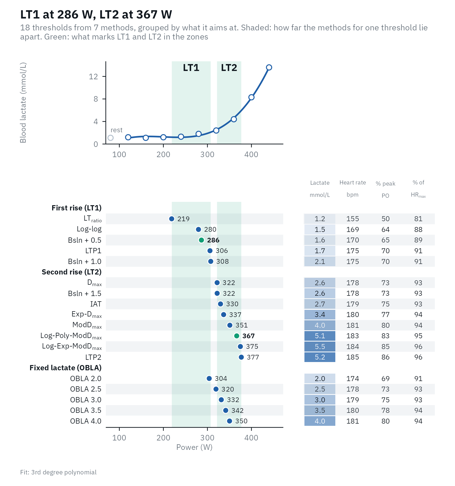
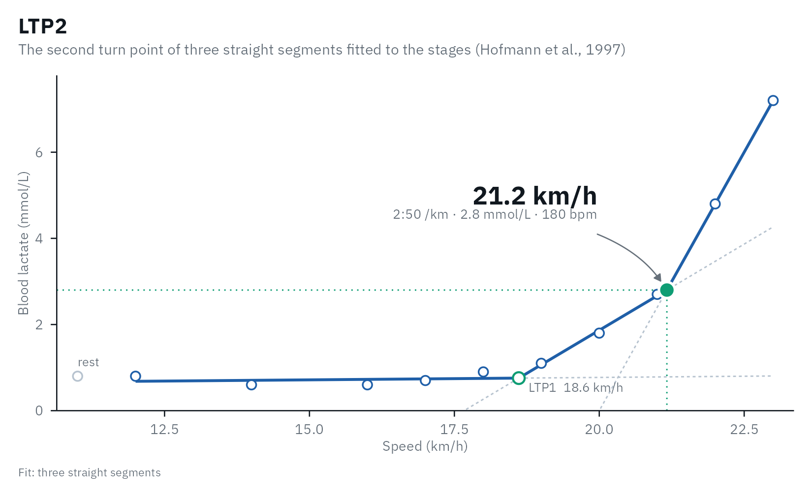
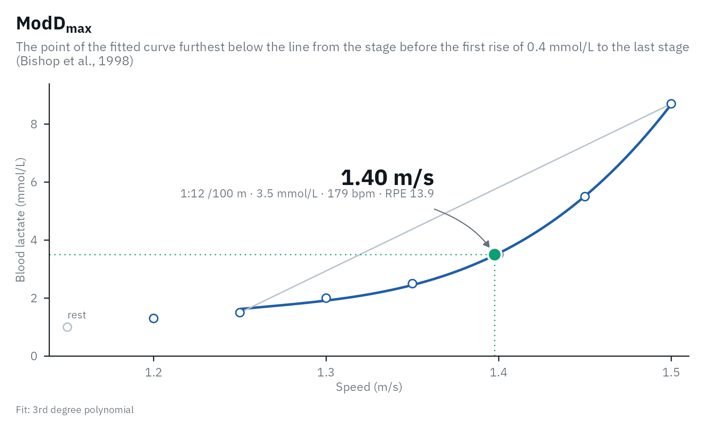
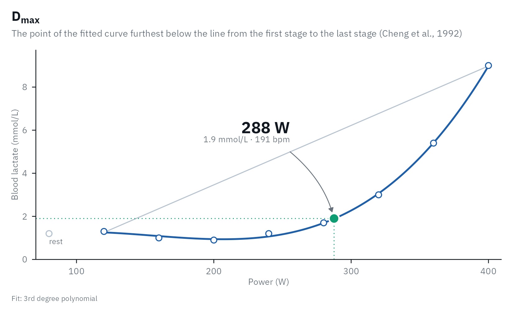

# The example data

`lactate_tests` holds 16 incremental step tests, one row per stage, so
you can try every part of lactater on data that looks like what you will
collect. Twelve are real tests from two open datasets (Trinity College
Dublin, and [Heuberger et al.,
2018](https://doi.org/10.1371/journal.pone.0206846); both CC BY 4.0);
four are simulated where no open data exists. This article walks through
them: what each sport looks like, and the cases that need care.

``` r

library(lactater)
library(dplyr)
library(gt)

lactate_tests |>
  distinct(sport, test, description, source) |>
  gt(groupname_col = "sport") |>
  cols_label(test = "Test", description = "Description", source = "Source") |>
  tab_style(cell_text(font = "IBM Plex Mono", size = px(13)), cells_body(columns = test)) |>
  gt_lactater() |>
  tab_options(row_group.text_transform = "capitalize")
```

| Test | Description | Source |
|----|----|----|
| cycling |  |  |
| cycling_elite | Elite male cyclist, 6.6 W/kg at peak (3-min stages) | Trinity College Dublin (CC BY 4.0) |
| cycling_female | Trained female cyclist, 5.0 W/kg at peak (3-min stages) | Trinity College Dublin (CC BY 4.0) |
| cycling_early_dip | Trained male cyclist whose lactate dips after the first stage (3-min stages) | Trinity College Dublin (CC BY 4.0) |
| cycling_series_1 | Trained male cyclist, test 1 of 6 (3-min stages) | Trinity College Dublin (CC BY 4.0) |
| cycling_series_2 | Trained male cyclist, test 2 of 6 (3-min stages) | Trinity College Dublin (CC BY 4.0) |
| cycling_series_3 | Trained male cyclist, test 3 of 6 (3-min stages) | Trinity College Dublin (CC BY 4.0) |
| cycling_series_4 | Trained male cyclist, test 4 of 6 (3-min stages) | Trinity College Dublin (CC BY 4.0) |
| cycling_series_5 | Trained male cyclist, test 5 of 6 (3-min stages) | Trinity College Dublin (CC BY 4.0) |
| cycling_series_6 | Trained male cyclist, test 6 of 6 (3-min stages) | Trinity College Dublin (CC BY 4.0) |
| cycling_5min_no_rest | Well-trained male cyclist, 5-min steps, no resting sample | Heuberger et al. 2018 (CC BY 4.0) |
| untrained | Simulated untrained man, fitness client (3-min stages) | simulated |
| submaximal | Simulated submaximal test, stopped at about 3 mmol/L | simulated |
| running |  |  |
| running | Trained male runner, treadmill at 0% grade (3-min stages) | Trinity College Dublin (CC BY 4.0) |
| running_recreational | Simulated recreational male runner, treadmill at 2% grade, 3-min stages of +2 km/h | simulated |
| rowing |  |  |
| rowing | Trained male rower, 3 min work + 1 min rest per stage | Trinity College Dublin (CC BY 4.0) |
| swimming |  |  |
| swimming | Simulated elite female swimmer, 7 x 200 m step test | simulated |

A small helper analyses one test, with heart rate and RPE when they were
recorded (the RPE of the four simulated tests is simulated too):

``` r

analyse <- function(name, ...) {
  one <- lactate_tests |>
    filter(test == name)
  hr <- if (!anyNA(one$heart_rate)) "heart_rate"
  rating <- if (!anyNA(one$rpe)) "rpe"
  one |>
    lactate_threshold(
      intensity, lactate, heart_rate_column = hr, rpe_column = rating, sport = first(one$sport), plot = FALSE, ...
    )
}
```

## How far apart do the methods land?

Every method answers a slightly different question, so on the same test
they land at different intensities. Here, for each test, the lowest and
highest threshold as a percentage of the highest intensity of the test:

``` r

spread <- lactate_tests |>
  distinct(test, sport) |>
  mutate(thresholds = purrr::map(test, \(name) {
    analyse(name, ltp_breakpoints = if (name == "submaximal") 1 else 2) |>
      relative_thresholds() |>
      select(method, percent_peak)
  })) |>
  tidyr::unnest(thresholds) |>
  summarise(
    thresholds = sum(!is.na(percent_peak)),
    lowest = round(min(percent_peak, na.rm = TRUE)),
    highest = round(max(percent_peak, na.rm = TRUE)),
    .by = c(test, sport)
  )
spread
#> # A tibble: 16 × 5
#>    test                 sport    thresholds lowest highest
#>    <chr>                <chr>         <int>  <dbl>   <dbl>
#>  1 cycling_elite        cycling          18     50      86
#>  2 cycling_female       cycling          18     58      89
#>  3 cycling_early_dip    cycling          18     52      85
#>  4 cycling_series_1     cycling          18     53      91
#>  5 cycling_series_2     cycling          18     45      87
#>  6 cycling_series_3     cycling          18     50      86
#>  7 cycling_series_4     cycling          18     49      81
#>  8 cycling_series_5     cycling          18     51      90
#>  9 cycling_series_6     cycling          18     50      83
#> 10 running              running          20     68      94
#> 11 rowing               rowing           18     42      85
#> 12 cycling_5min_no_rest cycling          18     63      90
#> 13 swimming             swimming         18     80      96
#> 14 untrained            cycling          18     39      82
#> 15 submaximal           cycling          15     58     100
#> 16 running_recreational running          20     42      88
```

In every test the thresholds span a wide part of the intensity range,
from the first rise of lactate to the methods aimed at the maximal
lactate steady state. That is why a threshold means little without the
name of its method, and why [Training
zones](https://fmmattioni.github.io/lactater/articles/zones.md) asks you
to choose LT1 and LT2.

## Cycling: an elite and a trained rider

Power in watts, 3-min stages. The elite rider reached 440 W, 6.6 W/kg;
the trained female rider 300 W, 5.0 W/kg. Same methods, very different
curves.

``` r

elite <- analyse("cycling_elite")
autoplot(elite)
```



Per kg of body mass, and as a percentage of the highest power, the two
riders can be compared:

``` r

female <- analyse("cycling_female")
body_mass <- function(name) {
  lactate_tests |>
    filter(test == name) |>
    pull(body_mass) |>
    first()
}

bind_rows(
  cycling_elite = relative_thresholds(elite, body_mass("cycling_elite")),
  cycling_female = relative_thresholds(female, body_mass("cycling_female")),
  .id = "rider"
) |>
  filter(method %in% c("LTP1", "LTP2")) |>
  select(rider, method, intensity, intensity_per_kg, percent_peak)
#> Warning: Unknown or uninitialised column: `method_category`.
#> # Lactate thresholds: cycling, 3rd degree polynomial, 9 stages + rest
#> # LT1:                286 W (Bsln + 0.5)
#> # LT2:                367 W (Log-Poly-ModDmax)
#>   rider          method intensity intensity_per_kg percent_peak
#>   <chr>          <fct>      <dbl>            <dbl>        <dbl>
#> 1 cycling_elite  LTP1         306             4.56         69.5
#> 2 cycling_elite  LTP2         377             5.63         85.7
#> 3 cycling_female LTP1         208             3.43         69.2
#> 4 cycling_female LTP2         265             4.37         88.2
```

## Running: speed and pace

Treadmill speed in km/h at 0% grade. lactater adds the pace (s/km) and
shows it as minutes per km in the plots.

``` r

running <- analyse("running")
running |>
  filter(method %in% c("Log-log", "OBLA 4.0", "LTP2")) |>
  select(method, intensity, pace, lactate, heart_rate)
#> Warning: Unknown or uninitialised column: `method_category`.
#> # Lactate thresholds: running, 3rd degree polynomial, 10 stages + rest
#> # LT1:                19.4 km/h (Bsln + 0.5)
#> # LT2:                20.7 km/h (Log-Poly-ModDmax)
#>   method   intensity  pace lactate heart_rate
#>   <fct>        <dbl> <dbl>   <dbl>      <dbl>
#> 1 Log-log       17.9  201.     0.7        157
#> 2 OBLA 4.0      21.6  167.     4          182
#> 3 LTP2          21.2  170.     2.8        180
autoplot(running, "LTP2")
```



`running_recreational` is a simulated recreational runner tested on the
protocol of [Roecker et al.
(1998)](https://doi.org/10.1097/00005768-199810000-00014) (2% grade, +2
km/h every 3 min from 6 km/h), so
[`predict_performance()`](https://fmmattioni.github.io/lactater/reference/predict_performance.md)
applies their race-time equations as published.

## Rowing: power and the 500 m split

Ergometer power in watts, with 1 min of rest between 3-min stages. The
`pace` column is the Concept2 split (s/500 m), from
`watts = 2.80 / pace^3` with pace in s/m.

``` r

rowing <- analyse("rowing")
rowing |>
  filter(method %in% c("Log-log", "ModDmax", "IAT")) |>
  select(method, intensity, pace, lactate)
#> Warning: Unknown or uninitialised column: `method_category`.
#> # Lactate thresholds: rowing, 3rd degree polynomial, 8 stages + rest
#> # LT1:                203 W (Bsln + 0.5)
#> # LT2:                309 W (Log-Poly-ModDmax)
#>   method  intensity  pace lactate
#>   <fct>       <dbl> <dbl>   <dbl>
#> 1 Log-log       201  120.     1  
#> 2 ModDmax       294  106      3.6
#> 3 IAT           258  111.     2.3
```

## Swimming: speed in m/s (simulated)

A 7 x 200 m step test, +0.05 m/s per step. Speeds are shown to 0.01 m/s,
and the pace per 100 m.

``` r

swimming <- analyse("swimming")
swimming |>
  filter(method %in% c("Log-log", "ModDmax", "IAT")) |>
  select(method, intensity, pace, heart_rate, rpe)
#> Warning: Unknown or uninitialised column: `method_category`.
#> # Lactate thresholds: swimming, 3rd degree polynomial, 7 stages + rest
#> # LT1:                1.23 m/s (Bsln + 0.5)
#> # LT2:                1.43 m/s (Log-Poly-ModDmax)
#>   method  intensity  pace heart_rate   rpe
#>   <fct>       <dbl> <dbl>      <dbl> <dbl>
#> 1 Log-log      1.36  73.7        179  12.2
#> 2 ModDmax      1.4   71.5        179  13.9
#> 3 IAT          1.37  73.2        179  12.7
autoplot(swimming, "ModDmax")
```



## Cases that need care

### An early lactate dip

Lactate can fall after the first stage, when the warm-up was hard or
short.
[`lactate_checks()`](https://fmmattioni.github.io/lactater/reference/lactate_checks.md)
flags it, because it shapes D_(max) and the baseline of Bsln+.

``` r

dip <- analyse("cycling_early_dip")
lactate_checks(dip)
#> 10 checks: 9 passed, 1 note, 0 warnings
#> ✔ Stages             8 stages.
#> ✔ Resting sample     Present.
#> ✔ Thresholds found   All thresholds were found.
#> ✔ Edge of the range  No threshold sits at the first or last stage.
#> ℹ Early lactate dip  The first stage is 0.4 mmol/L above the lowest later stage; it shapes Dmax and Bsln+. Check warm-up and sampling.
#> ✔ Final stage        Lactate rose in the last stage.
#> ✔ Peak lactate       9.0 mmol/L.
#> ✔ Sample type        blood lactate.
#> ✔ LT1                Within 22% of peak (5 methods, LTratio 208 to Bsln + 1.0 298).
#> ✔ LT2                Within 13% of peak (8 methods, Dmax 288 to LTP2 341).
autoplot(dip, "Dmax")
```



### No resting sample, 5-min steps

The [Heuberger et
al. (2018)](https://doi.org/10.1371/journal.pone.0206846) test starts at
175 W with no resting sample. Bsln+ then uses the first stage as its
baseline, and
[`lactate_checks()`](https://fmmattioni.github.io/lactater/reference/lactate_checks.md)
says so.

``` r

no_rest <- analyse("cycling_5min_no_rest")
lactate_checks(no_rest) |>
  filter(check == "Resting sample")
#> 1 check: 0 passed, 1 note, 0 warnings
#> ℹ Resting sample  No resting sample (intensity 0): Bsln+ uses the first stage as the baseline.
```

### A submaximal test

The simulated client stopped at about 3 mmol/L, before the second turn
point. Fitting two turn points would invent one; `ltp_breakpoints = 1`
fits only LTP1, and
[`lactate_checks()`](https://fmmattioni.github.io/lactater/reference/lactate_checks.md)
suggests it when peak lactate stays low.

``` r

lactate_checks(analyse("submaximal")) |>
  filter(check %in% c("Thresholds found", "Peak lactate"))
#> 2 checks: 0 passed, 0 notes, 2 warnings
#> ⚠ Thresholds found  Not found within the tested range: OBLA 3.5, OBLA 4.0.
#> ⚠ Peak lactate      Peak lactate was 3.0 mmol/L, below the ~4 mmol/L where LTP2 usually sits: the test may have stopped before LTP2. If it was submaximal, use `ltp_breakpoints = 1`.

submaximal <- analyse("submaximal", ltp_breakpoints = 1)
submaximal |>
  filter(method %in% c("LTP1", "LTP2", "OBLA 4.0")) |>
  select(method, intensity, lactate)
#> Warning: Unknown or uninitialised column: `method_category`.
#> # Lactate thresholds: cycling, 3rd degree polynomial, 6 stages + rest
#> # LT1:                101 W (Bsln + 0.5)
#> # LT2:                144 W (Log-Poly-ModDmax)
#> # Checks:             1 warning, see lactate_checks()
#>   method   intensity lactate
#>   <fct>        <dbl>   <dbl>
#> 1 OBLA 4.0        NA     4  
#> 2 LTP1           135     1.7
#> 3 LTP2            NA    NA
```

## One athlete over five and a half years

The six `cycling_series` tests come from one rider. See [Comparing
tests](https://fmmattioni.github.io/lactater/articles/compare.md) for
how to tell a real change from noise.

``` r

lactate_tests |>
  filter(athlete == "cyclist_series") |>
  lactate_threshold(intensity, lactate, method = "LTP", plot = FALSE, .by = "day") |>
  select(day, method, intensity, lactate)
#> # A tibble: 12 × 4
#>      day method intensity lactate
#>    <int> <fct>      <dbl>   <dbl>
#>  1     0 LTP1         222     0.9
#>  2     0 LTP2         301     2.3
#>  3    58 LTP1         257     0.9
#>  4    58 LTP2         341     3.2
#>  5   163 LTP1         248     0.9
#>  6   163 LTP2         339     3.2
#>  7  1107 LTP1         178     0.7
#>  8  1107 LTP2         274     2.6
#>  9  1865 LTP1         264     0.7
#> 10  1865 LTP2         350     3.3
#> 11  2046 LTP1         263     1  
#> 12  2046 LTP2         337     2.7
```

## References

Heuberger JAAC, Gal P, Stuurman FE, de Muinck Keizer WAS, Mejia Miranda
Y, Cohen AF. Repeatability and predictive value of lactate threshold
concepts in endurance sports. PLOS ONE. 2018;13(11):e0206846.
[doi:10.1371/journal.pone.0206846](https://doi.org/10.1371/journal.pone.0206846)

Trinity College Dublin graded exercise test data. Zenodo.
[doi:10.5281/zenodo.10841412](https://doi.org/10.5281/zenodo.10841412)
