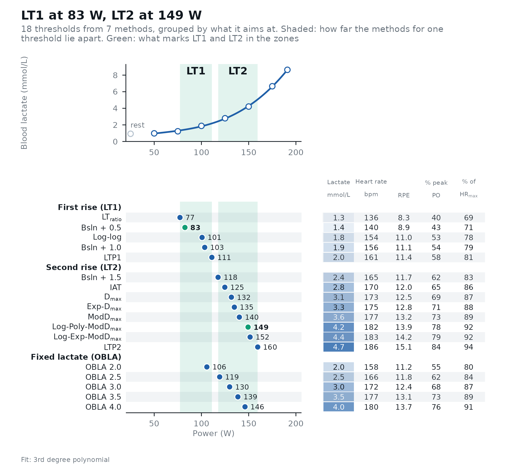
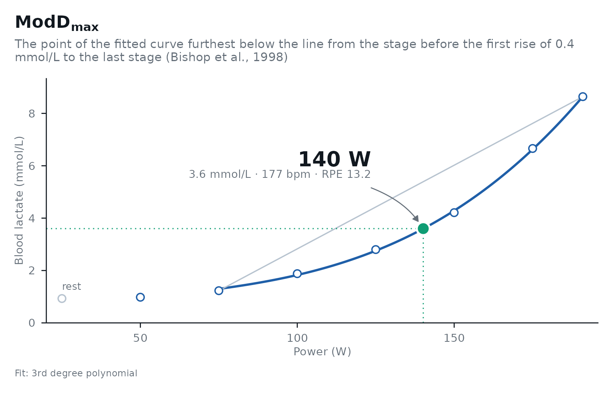
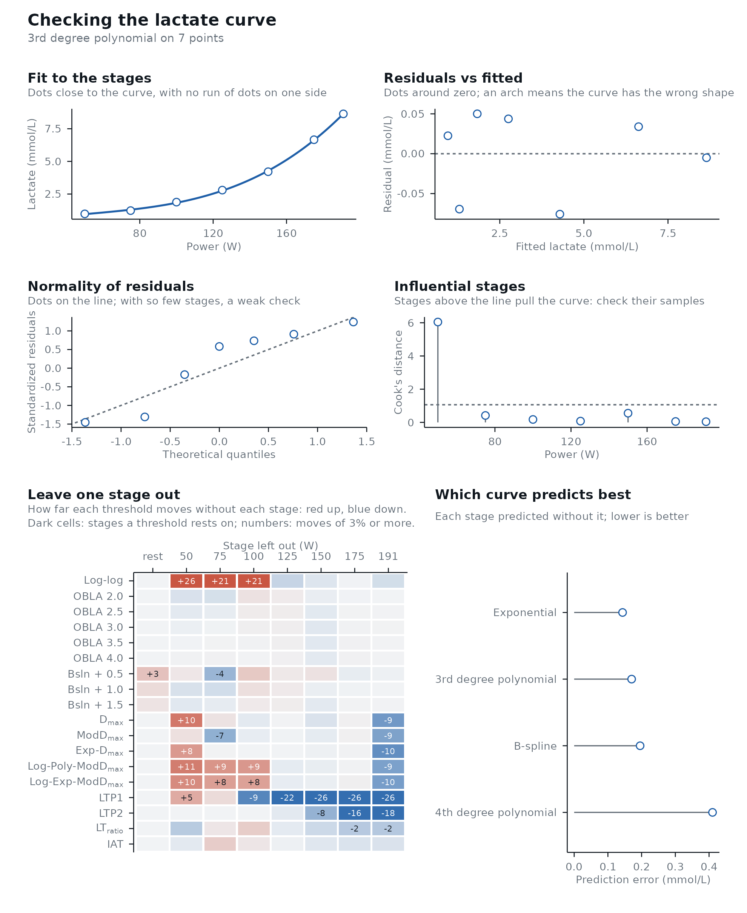
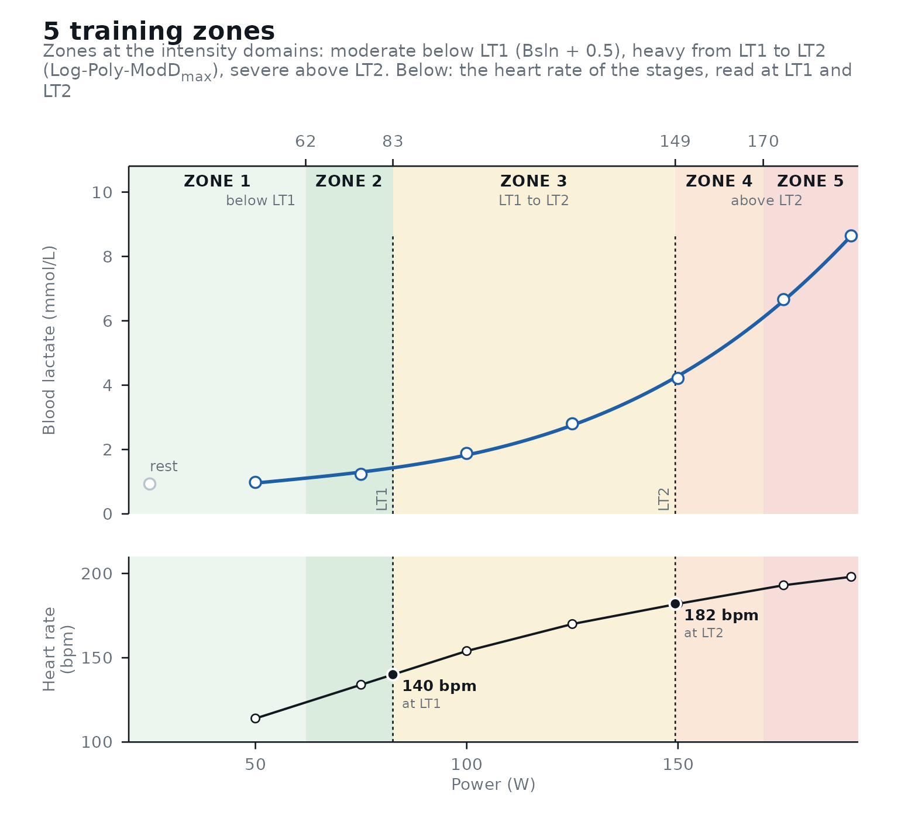

# Get started with lactater

``` r

library(lactater)
library(dplyr)
```

lactater turns the stages of a step test into lactate thresholds, checks
them, and puts them to use. Find what you want to do, and the function
that does it:

| You want to | Use | Read more |
|----|----|----|
| Before the test |  |  |
| Record every test the same way | The web form, [`read_recording()`](https://fmmattioni.github.io/lactater/reference/read_recording.md), [`recording_sheet()`](https://fmmattioni.github.io/lactater/reference/recording_sheet.md) | [Best practices](https://fmmattioni.github.io/lactater/articles/best-practices.html) |
| Analyze it |  |  |
| Estimate every threshold | [`lactate_threshold()`](https://fmmattioni.github.io/lactater/reference/lactate_threshold.md) | [The methods and the evidence](https://fmmattioni.github.io/lactater/articles/methods.html) |
| See how the methods agree | [`autoplot()`](https://ggplot2.tidyverse.org/reference/autoplot.html) |  |
| Check the data and the curve | [`lactate_checks()`](https://fmmattioni.github.io/lactater/reference/lactate_checks.md), [`lactate_diagnostics()`](https://fmmattioni.github.io/lactater/reference/lactate_diagnostics.md) | [Checking the analysis](https://fmmattioni.github.io/lactater/articles/checking.html) |
| Know how sure each threshold is | `ci = TRUE` | [Checking the analysis](https://fmmattioni.github.io/lactater/articles/checking.html) |
| Use it |  |  |
| Build three or five training zones | [`lactate_zones()`](https://fmmattioni.github.io/lactater/reference/lactate_zones.md) | [Training zones](https://fmmattioni.github.io/lactater/articles/zones.html) |
| Count the training in each zone | [`training_load()`](https://fmmattioni.github.io/lactater/reference/training_load.md) | [Training load](https://fmmattioni.github.io/lactater/articles/training-load.html) |
| Predict race performance | [`predict_performance()`](https://fmmattioni.github.io/lactater/reference/predict_performance.md), [`calibrate_performance()`](https://fmmattioni.github.io/lactater/reference/calibrate_performance.md) | [Predicting performance](https://fmmattioni.github.io/lactater/articles/performance.html) |
| Compare two tests, or follow a series | [`compare_tests()`](https://fmmattioni.github.io/lactater/reference/compare_tests.md), [`curve_shape()`](https://fmmattioni.github.io/lactater/reference/curve_shape.md), [`lactate_trend()`](https://fmmattioni.github.io/lactater/reference/lactate_trend.md) | [Comparing tests](https://fmmattioni.github.io/lactater/articles/compare.html) |
| Compare with the population of the same age and sex | [`reference_percentiles()`](https://fmmattioni.github.io/lactater/reference/reference_percentiles.md) | [Comparing tests](https://fmmattioni.github.io/lactater/articles/compare.html) |
| Share it |  |  |
| Report the test to an athlete or a coach | [`test_report()`](https://fmmattioni.github.io/lactater/reference/test_report.md) |  |
| A table for a paper | [`lactate_report()`](https://fmmattioni.github.io/lactater/reference/lactate_report.md) |  |

## Your data

One row per stage of a step test: the intensity (power in W, or speed),
the lactate measured at the end of the stage and, if you have them, the
heart rate and the rating of perceived exertion (RPE). A resting sample,
if you took one, is the row with intensity 0.

``` r

demo_data
#> # A tibble: 8 × 6
#>    step length intensity lactate heart_rate   rpe
#>   <int>  <int>     <int>   <dbl>      <int> <int>
#> 1     0      0         0    0.93         96     6
#> 2     1      3        50    0.98        114     7
#> 3     2      3        75    1.23        134     8
#> 4     3      3       100    1.88        154    11
#> 5     4      3       125    2.8         170    12
#> 6     5      3       150    4.21        182    14
#> 7     6      3       175    6.66        193    17
#> 8     7      2       191    8.64        198    19
```

Your own test comes in with `read.csv("test.csv")` in those columns, or
with
[`read_recording()`](https://fmmattioni.github.io/lactater/reference/read_recording.md)
from the .xlsx of the [web
form](https://fmmattioni.github.io/lactater/step-test-form.html). Rows
with a missing lactate (a missed sample) are dropped with a warning. If
the last stage was not completed, give the minutes completed in
`last_stage_duration` (with `stage_duration`) and its intensity is
time-weighted for you: 2 of 3 min at 200 W after 175 W count as 191.7 W
(`demo_data` already has its 2-min last stage at 191 W).
[`read_recording()`](https://fmmattioni.github.io/lactater/reference/read_recording.md)
does the same from the form’s time in the last stage. Or leave the stage
out with `max_intensity`. How to collect data that does the methods
justice is in [Best practices for a step
test](https://fmmattioni.github.io/lactater/articles/best-practices.html).

## Estimate the thresholds

``` r

results <- lactate_threshold(
  demo_data,
  intensity_column = intensity,
  lactate_column = lactate,
  heart_rate_column = heart_rate,
  rpe_column = rpe,
  plot = FALSE
)
results
#> # Lactate thresholds: cycling, 3rd degree polynomial, 7 stages + rest
#> # LT1:                83 W (Bsln + 0.5)
#> # LT2:                149 W (Log-Poly-ModDmax)
#>    method_category method           fitting   intensity lactate heart_rate   rpe
#>    <fct>           <fct>            <chr>         <dbl>   <dbl>      <dbl> <dbl>
#>  1 Log-log         Log-log          3rd degr…       101     1.8        154  11  
#>  2 OBLA            OBLA 2.0         3rd degr…       106     2          158  11.2
#>  3 OBLA            OBLA 2.5         3rd degr…       119     2.5        166  11.8
#>  4 OBLA            OBLA 3.0         3rd degr…       130     3          172  12.4
#>  5 OBLA            OBLA 3.5         3rd degr…       139     3.5        177  13.1
#>  6 OBLA            OBLA 4.0         3rd degr…       146     4          180  13.7
#>  7 Bsln+           Bsln + 0.5       3rd degr…        83     1.4        140   8.9
#>  8 Bsln+           Bsln + 1.0       3rd degr…       103     1.9        156  11.1
#>  9 Bsln+           Bsln + 1.5       3rd degr…       118     2.4        165  11.7
#> 10 Dmax            Dmax             3rd degr…       132     3.1        173  12.5
#> 11 Dmax            ModDmax          3rd degr…       140     3.6        177  13.2
#> 12 Dmax            Exp-Dmax         Exponent…       135     3.3        175  12.8
#> 13 Dmax            Log-Poly-ModDmax 3rd degr…       149     4.2        182  13.9
#> 14 Dmax            Log-Exp-ModDmax  Exponent…       152     4.4        183  14.2
#> 15 LTP             LTP1             3rd degr…       111     2          161  11.4
#> 16 LTP             LTP2             3rd degr…       160     4.7        186  15.1
#> 17 LTratio         LTratio          B-Spline…        77     1.3        136   8.3
#> 18 IAT             IAT              B-Spline…       125     2.8        170  12
```

The column arguments can also go by position, as in the calls below:
`lactate_threshold(demo_data, intensity, lactate, heart_rate)`. Every
method runs by default; pick some with `method`,
e.g. `method = c("Dmax", "LTP")`, and set `sport` for running, swimming
or rowing. `rpe_column` gives the RPE at each threshold (add
`rpe_scale = "CR10"` for the 0-10 scale; the RPE of `demo_data` is
simulated).

Two of these thresholds are what training needs. LT1 is the first rise
of lactate above resting values, the top of the moderate intensity
domain; LT2 is the second, abrupt rise, the top of the heavy domain. The
methods aim at one of them or at a fixed lactate value, the three
categories of [Faude et
al. (2009)](https://doi.org/10.2165/00007256-200939060-00003): the first
rise (Log-log, Bsln + 0.5 and 1.0, LT_(ratio), LTP1), the second rise or
the maximal lactate steady state (Bsln + 1.5, the D_(max) family, LTP2,
IAT, Stegmann, and Keul and Simon for running), and fixed values (OBLA).
[`autoplot()`](https://ggplot2.tidyverse.org/reference/autoplot.html)
groups them this way, and [The methods and the
evidence](https://fmmattioni.github.io/lactater/articles/methods.html)
says which to trust. A threshold is `NA` when its method found nothing
in the tested range: the Log-log lines crossing outside the stages, a
D_(max) curve never below its line, LTP2 in a test that stopped early.
[`lactate_checks()`](https://fmmattioni.github.io/lactater/reference/lactate_checks.md)
names them and says what to do.

## Look at them

The overview puts every threshold on the same intensity axis as the
curve, one row per method, with a table of the values at each threshold:

``` r

autoplot(results)
```



Or look at one method in detail:

``` r

autoplot(results, method = "ModDmax")
```



## Check the analysis

[`lactate_checks()`](https://fmmattioni.github.io/lactater/reference/lactate_checks.md)
flags what is easy to miss in a table of numbers, and
[`lactate_diagnostics()`](https://fmmattioni.github.io/lactater/reference/lactate_diagnostics.md)
checks the fitted curve and how much each threshold rests on single
stages:

``` r

lactate_checks(results)
#> 10 checks: 9 passed, 1 note, 0 warnings
#> ℹ Stages             7 stages: the LTP fit has 6 parameters, so 1 degree of freedom is left and LTP can move a lot with one stage (at least 8 stages are better); the fitted curves rest on few points too.
#> ✔ Resting sample     Present.
#> ✔ Thresholds found   All thresholds were found.
#> ✔ Edge of the range  No threshold sits at the first or last stage.
#> ✔ Early lactate dip  No early dip.
#> ✔ Final stage        Lactate rose in the last stage.
#> ✔ Peak lactate       8.6 mmol/L.
#> ✔ Sample type        blood lactate.
#> ✔ LT1                Within 18% of peak (5 methods, LTratio 77 to LTP1 111).
#> ✔ LT2                Within 22% of peak (8 methods, Bsln + 1.5 118 to LTP2 160).
diagnostics <- lactate_diagnostics(results)
diagnostics
#> Lactate curve: 3rd degree polynomial on 7 points; residual SD 0.07 mmol/L.
#> Influential stage(s): 50 W (Cook's distance 6.05).
#> Most sensitive to single stages: LTP1 (jackknife SE 31 W), Log-log (jackknife SE 29 W), LTP2 (jackknife SE 18 W).
#> Best-predicting curve: Exponential, which missed each stage by 0.14 mmol/L on average when fitted without it (root-mean-square leave-one-out error).
```

``` r

autoplot(diagnostics)
```



## How sure are we?

With 6 to 10 stages, a threshold reported to 0.1 W is false precision.
`ci = TRUE` adds bootstrap confidence intervals (this takes a few
seconds; use more replicates than this for real work):

``` r

set.seed(2024)
with_ci <- demo_data |>
  lactate_threshold(
    intensity, lactate, heart_rate,
    method = c("OBLA", "Dmax", "LTP"), plot = FALSE, ci = TRUE, n_boot = 200
  )

with_ci |>
  select(method, intensity, intensity_low, intensity_high)
#> Warning: Unknown or uninitialised column: `method_category`.
#> # Lactate thresholds: cycling, 3rd degree polynomial, 7 stages + rest
#> # LT2:                149 W (Log-Poly-ModDmax)
#>    method           intensity intensity_low intensity_high
#>    <fct>                <dbl>         <dbl>          <dbl>
#>  1 OBLA 2.0               106           100            110
#>  2 OBLA 2.5               119           116            123
#>  3 OBLA 3.0               130           127            133
#>  4 OBLA 3.5               139           136            141
#>  5 OBLA 4.0               146           143            149
#>  6 Dmax                   132           124            138
#>  7 ModDmax                140           132            151
#>  8 Exp-Dmax               135           133            137
#>  9 Log-Poly-ModDmax       149           146            161
#> 10 Log-Exp-ModDmax        152           150            162
#> 11 LTP1                   111            75            123
#> 12 LTP2                   160           140            171
```

## Training zones

By default LT1 is Bsln + 0.5 and LT2 Log-Poly-ModD_(max), the pair with
the best evidence for each boundary ([Training
zones](https://fmmattioni.github.io/lactater/articles/zones.html) says
why); choose others with `lt1` and `lt2`, and three or five zones with
`model`:

``` r

zones <- lactate_zones(results, model = 5)
zones
#> # A tibble: 5 × 11
#>   zone   domain  description intensity_from intensity_to lactate_from lactate_to
#>   <chr>  <chr>   <chr>                <dbl>        <dbl>        <dbl>      <dbl>
#> 1 Zone 1 modera… below LT1               NA           62         NA          1.1
#> 2 Zone 2 modera… below LT1               62           83          1.1        1.4
#> 3 Zone 3 heavy   LT1 to LT2              83          149          1.4        4.2
#> 4 Zone 4 severe  above LT2              149          170          4.2        6.1
#> 5 Zone 5 severe  above LT2              170           NA          6.1       NA  
#> # ℹ 4 more variables: heart_rate_from <dbl>, heart_rate_to <dbl>,
#> #   rpe_from <dbl>, rpe_to <dbl>
autoplot(zones)
```



## A table for your report

``` r

lactate_report(results)
```

| Lactate thresholds |  |  |  |  |
|----|----|----|----|----|
| Cycling · 3rd degree polynomial fit · 7 stages + rest |  |  |  |  |
| Method | Intensity (W) | Lactate (mmol/L) | Heart rate (bpm) | RPE (6-20) |
| Log-log |  |  |  |  |
| Log-log | 101 | 1.8 | 154 | 11.0 |
| OBLA |  |  |  |  |
| OBLA 2.0 | 106 | 2.0 | 158 | 11.2 |
| OBLA 2.5 | 119 | 2.5 | 166 | 11.8 |
| OBLA 3.0 | 130 | 3.0 | 172 | 12.4 |
| OBLA 3.5 | 139 | 3.5 | 177 | 13.1 |
| OBLA 4.0 | 146 | 4.0 | 180 | 13.7 |
| Bsln+ |  |  |  |  |
| Bsln + 0.5 | 83 | 1.4 | 140 | 8.9 |
| Bsln + 1.0 | 103 | 1.9 | 156 | 11.1 |
| Bsln + 1.5 | 118 | 2.4 | 165 | 11.7 |
| D_(max) |  |  |  |  |
| D_(max) | 132 | 3.1 | 173 | 12.5 |
| ModD_(max) | 140 | 3.6 | 177 | 13.2 |
| Exp-D_(max) | 135 | 3.3 | 175 | 12.8 |
| Log-Poly-ModD_(max) | 149 | 4.2 | 182 | 13.9 |
| Log-Exp-ModD_(max) | 152 | 4.4 | 183 | 14.2 |
| LTP |  |  |  |  |
| LTP1 | 111 | 2.0 | 161 | 11.4 |
| LTP2 | 160 | 4.7 | 186 | 15.1 |
| LT_(ratio) |  |  |  |  |
| LT_(ratio) | 77 | 1.3 | 136 | 8.3 |
| IAT |  |  |  |  |
| IAT | 125 | 2.8 | 170 | 12.0 |
| ℹ Stages: 7 stages: the LTP fit has 6 parameters, so 1 degree of freedom is left and LTP can move a lot with one stage (at least 8 stages are better); the fitted curves rest on few points too. |  |  |  |  |
| Made with lactater |  |  |  |  |

For the athlete or the coach,
[`test_report()`](https://fmmattioni.github.io/lactater/reference/test_report.md)
writes the whole test as one web page (and PDF): their details, LT1 and
LT2, the zones, every threshold, the predicted performance, the checks
and the stages (see [a
cyclist](https://fmmattioni.github.io/lactater/report-example.html) and
[a
runner](https://fmmattioni.github.io/lactater/report-running-example.html)).
Give it two to five tests of one athlete and their `dates`, and it
reports the progress over them ([see an
example](https://fmmattioni.github.io/lactater/report-series-example.html)).

## Many tests at once

Use `.by` with the columns that identify each test. `lactate_tests`
holds 16 tests across sports and fitness levels; here, the six tests of
one cyclist:

``` r

lactate_tests |>
  filter(athlete == "cyclist_series") |>
  lactate_threshold(intensity, lactate, method = "Dmax", dmax_methods = "ModDmax", plot = FALSE, .by = "day")
#> # A tibble: 6 × 6
#>     day method_category method  fitting                        intensity lactate
#>   <int> <fct>           <fct>   <chr>                              <dbl>   <dbl>
#> 1     0 Dmax            ModDmax 3rd degree polynomial (defaul…       290     2.3
#> 2    58 Dmax            ModDmax 3rd degree polynomial (defaul…       327     2.9
#> 3   163 Dmax            ModDmax 3rd degree polynomial (defaul…       328     3.1
#> 4  1107 Dmax            ModDmax 3rd degree polynomial (defaul…       270     3  
#> 5  1865 Dmax            ModDmax 3rd degree polynomial (defaul…       325     2.5
#> 6  2046 Dmax            ModDmax 3rd degree polynomial (defaul…       364     4
```

## Learn more

- [Best practices for a step
  test](https://fmmattioni.github.io/lactater/articles/best-practices.html):
  how to run a test, as a checklist with sources.
- [The methods and the
  evidence](https://fmmattioni.github.io/lactater/articles/methods.html):
  how each method is defined and what the evidence says.
- [Checking the
  analysis](https://fmmattioni.github.io/lactater/articles/checking.html):
  checks, regression diagnostics, and bootstrap intervals.
- [Training
  zones](https://fmmattioni.github.io/lactater/articles/zones.html):
  choosing LT1 and LT2, three and five zones.
- [Training
  load](https://fmmattioni.github.io/lactater/articles/training-load.html):
  time in zone and intensity distribution.
- [Comparing
  tests](https://fmmattioni.github.io/lactater/articles/compare.html):
  is a change real, did the curve shift or change shape, and trends.
- [Predicting
  performance](https://fmmattioni.github.io/lactater/articles/performance.html):
  race times from a step test, how sure they are, and your own equation.
- [Beyond the step
  test](https://fmmattioni.github.io/lactater/articles/beyond-the-step-test.html):
  the maximal lactate steady state from constant-load bouts, and the
  maximal lactate accumulation rate (V̇La_(max)) from a sprint test.
- [The example
  data](https://fmmattioni.github.io/lactater/articles/example-data.html):
  16 tests across sports.
