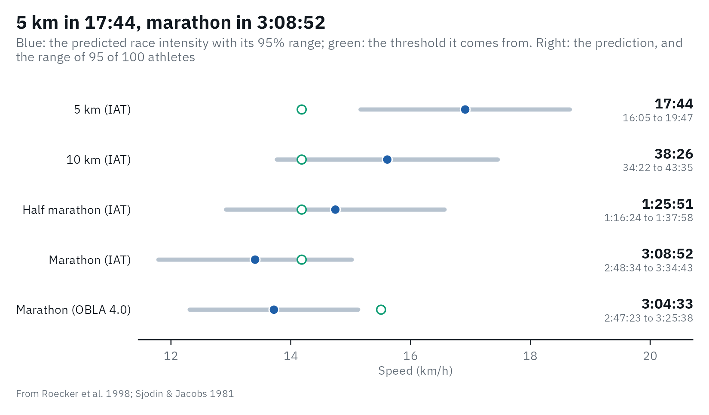
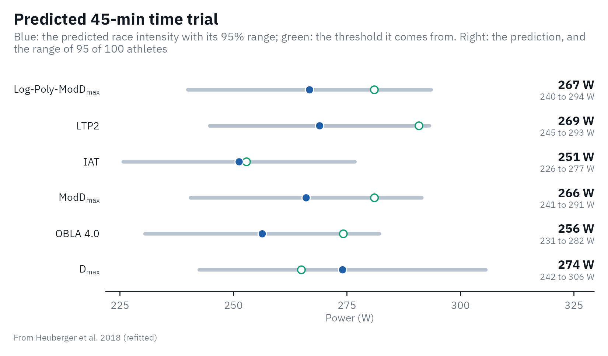
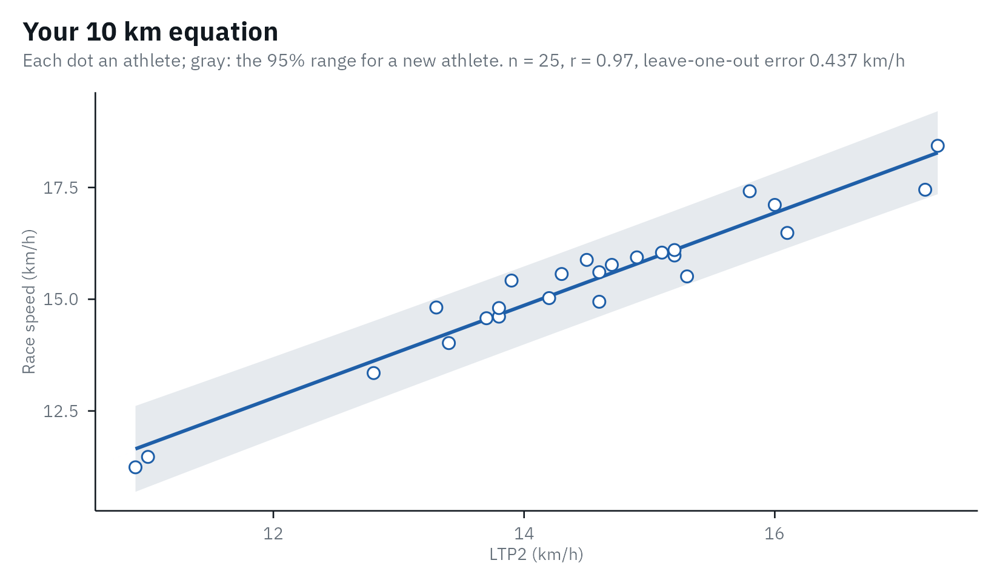

# Predicting performance

Coaches and athletes want to know what a step test means for the next
race. Lactate thresholds are among the strongest laboratory predictors
of endurance performance, but a prediction for one athlete is less
precise than the correlations suggest. This article shows what lactater
can predict, how sure the prediction is, and why the best equation is
the one you fit on your own athletes.

The short version:

- A step test predicts race speed to about +/- 10% in running (95%
  range) and time-trial power to about +/- 25 W in cycling, and only for
  tests run like those of the study the equation comes from.
- Every equation belongs to one threshold method: an equation fitted on
  IAT gives wrong numbers for LTP2.
- A recent race predicts the next one better than any step test
  ([Vickers & Vertosick,
  2016](https://doi.org/10.1186/s13102-016-0052-y)).

## Running: 5 km to the marathon

The largest study of race prediction from a step test followed 427
competitive runners (88 women) who raced within 2 months of a treadmill
test: 3-min stages, +2 km/h, a 2% grade, earlobe blood ([Roecker et al.,
1998](https://doi.org/10.1097/00005768-199810000-00014)). The speed at
the individual anaerobic threshold (IAT: the lowest lactate/speed
ratio + 1.5 mmol/L, lactater’s `IAT`) correlated with mean race speed
with r = 0.88 to 0.93, and each distance got its own straight line. A
smaller study of 18 male marathon runners related marathon speed to the
speed at 4 mmol/L ([Sjödin & Jacobs,
1981](https://doi.org/10.1055/s-2008-1034579)).

Here is a simulated runner tested with that protocol:

``` r

library(lactater)
library(dplyr)

runner <- tibble(
  intensity = c(0, 8, 10, 12, 14, 16, 18),
  lactate = c(1.0, 1.1, 1.2, 1.6, 2.6, 4.6, 8.0)
)
results <- lactate_threshold(runner, intensity, lactate, sport = "running", plot = FALSE)
prediction <- predict_performance(results)
prediction
#> # Predicted performance: running, with 95% prediction ranges
#> # LT2:                   Log-Poly-ModDmax has no equation here; these come from
#> #   IAT and OBLA 4.0
#> # Roecker et al. 1998:   427 competitive runners (88 women); treadmill at 2%
#> #   grade, 3-min stages, +2 km/h, earlobe hemolyzed whole blood; best race
#> #   within 2 months of the test
#> # Sjodin & Jacobs 1981:  18 male marathon runners; treadmill, 4-min stages, +1
#> #   to 2 km/h, fingertip blood; marathon 2 to 3 weeks after the test
#>   event        method threshold time  time_low time_high intensity intensity_low
#>   <chr>        <chr>      <dbl> <chr> <chr>    <chr>         <dbl>         <dbl>
#> 1 5 km         IAT         14.2 17:44 16:05    19:47          16.9          15.2
#> 2 10 km        IAT         14.2 38:26 34:22    43:35          15.6          13.8
#> 3 Half marath… IAT         14.2 1:25… 1:16:24  1:37:58        14.7          12.9
#> 4 Marathon     IAT         14.2 3:08… 2:48:34  3:34:43        13.4          11.8
#> 5 Marathon     OBLA …      15.5 3:04… 2:47:23  3:25:38        13.7          12.3
#> # ℹ 3 more variables: intensity_high <dbl>, extrapolated <lgl>, source <chr>
autoplot(prediction)
```



Each row gives the race time and the predicted mean race speed
(`intensity`), each with its 95% range. The header repeats the protocol
of each source study, so you can check that your test matches it.

Read the ranges before the times. Roecker et al. did not report the
error of their equations, so lactater derives it from their tables: the
SD of race speed times `sqrt(1 - r^2)`, about 5 to 6% of race speed,
which makes a 95% range of about +/- 10%. A predicted 3:09 marathon is
anything from about 2:49 to 3:35. Two more details matter: the equations
predict the *best* race of the 2 months after the test (the authors kept
the best result), and men and women were pooled.

The two marathon estimates come from different thresholds and different
studies, and they agree within a few minutes here. That will not always
be so; when they differ, the difference is part of the uncertainty.

## When the test was run differently

The runner in `lactate_tests` was tested on a treadmill at 0% grade,
with +1 km/h steps after 16 km/h:

``` r

tcd_results <- lactate_tests |>
  filter(test == "running") |>
  lactate_threshold(intensity, lactate, heart_rate, sport = "running", plot = FALSE)

tcd_prediction <- predict_performance(tcd_results, method = "IAT")
#> Warning: The steps of this test (+1 km/h) differ from those of Roecker et al.
#> 1998 (+2 km/h): the thresholds, and so the prediction, may shift.
#> Warning: IAT (20.4 km/h) is outside the range of Roecker et al. 1998 (10.0 to
#> 20.0 km/h): the prediction is an extrapolation.
tcd_prediction |>
  select(event, threshold, intensity, time)
#> Warning: Unknown or uninitialised column: `method`.
#> Warning: Unknown or uninitialised column: `method`.
#> # Predicted performance: running, with 95% prediction ranges
#> # LT2:                   Log-Poly-ModDmax has no equation here; these come from
#> # Roecker et al. 1998:   427 competitive runners (88 women); treadmill at 2%
#> #   grade, 3-min stages, +2 km/h, earlobe hemolyzed whole blood; best race
#> #   within 2 months of the test
#>   event         threshold intensity time   
#>   <chr>             <dbl>     <dbl> <chr>  
#> 1 5 km               20.4      23.4 12:50  
#> 2 10 km              20.4      22.2 27:02  
#> 3 Half marathon      20.4      22.4 56:23  
#> 4 Marathon           20.4      20.3 2:04:45
```

A marathon in about 2:05 is close to the world record, for a runner
described as trained. lactater warns twice: the steps differ from the
source protocol, and the IAT (20.4 km/h) lies above the runners Roecker
et al. studied (about 10 to 20 km/h). Both matter:

- **The protocol moves the threshold.** Running on the flat costs less
  than at a 2% grade, so the same lactate appears at a higher speed.
  Smaller steps also move it: 1 instead of 2 km/h raised the speed at an
  individual anaerobic threshold by 6% ([Coen et al.,
  2001](https://doi.org/10.1055/s-2001-11332)), and 6- instead of 3-min
  stages lowered the speed at 4 mmol/L from 14.4 to 12.9 km/h ([Kuipers
  et al., 2003](https://doi.org/10.1055/s-2003-42020)).
- **Outside the sample, a straight line is a guess.** At an IAT this
  high, the half-marathon equation even predicts a faster speed than the
  10 km one.

lactater can read the steps from the data, but not the stage duration,
the treadmill grade or the blood sample: compare them with the protocol
in the header yourself.

## Cycling: the 45-min time trial

For cycling, lactater fits its own equations on the open data of
[Heuberger et al. (2018)](https://doi.org/10.1371/journal.pone.0206846):
48 well-trained men, 5-min stages of +25 W from 175 W, venous blood, and
a 45-min time trial a week after the test
(`data-raw/performance_cycling.R`). Because the thresholds come from
lactater itself, any of six methods can be used:

``` r

cyclist_results <- lactate_tests |>
  filter(test == "cycling_5min_no_rest") |>
  lactate_threshold(intensity, lactate, plot = FALSE)

cyclist_prediction <- predict_performance(cyclist_results)
cyclist_prediction
#> # Predicted performance:            cycling, with 95% prediction ranges
#> # LT2:                              Log-Poly-ModDmax, shown first; the others
#> #   are for comparison
#> # Heuberger et al. 2018 (refitted): 48 well-trained male cyclists; 5-min
#> #   stages, +25 W from 175 W, venous blood (Lactate Pro 2); 45-min time trial a
#> #   week after the test
#>   event     method threshold intensity intensity_low intensity_high extrapolated
#>   <chr>     <chr>      <dbl>     <dbl>         <dbl>          <dbl> <lgl>       
#> 1 45-min t… Log-P…       281       267           240            294 FALSE       
#> 2 45-min t… LTP2         291       269           245            293 FALSE       
#> 3 45-min t… IAT          253       251           226            276 FALSE       
#> 4 45-min t… ModDm…       281       266           241            291 FALSE       
#> 5 45-min t… OBLA …       274       256           230            282 FALSE       
#> 6 45-min t… Dmax         265       274           242            306 FALSE       
#> # ℹ 1 more variable: source <chr>
autoplot(cyclist_prediction)
```



This rider is one of the 48, so his prediction is not a fair test of the
equations. On the whole sample, the leave-one-out prediction errors
(each rider predicted by the equation fitted without him) were:

| Predictor | Riders | r | Leave-one-out error | Time-trial power, % of the predictor |
|----|----|----|----|----|
| LTP2 | 39 | 0.88 | 12.3 W | 92 +/- 5% |
| IAT | 39 | 0.87 | 12.5 W | 95 +/- 6% |
| ModD_(max) | 35 | 0.87 | 12.8 W | 94 +/- 4% |
| OBLA 4.0 | 33 | 0.84 | 12.9 W | 90 +/- 6% |
| Log-Poly-ModD_(max) | 38 | 0.86 | 13.8 W | 94 +/- 6% |
| D_(max) | 39 | 0.79 | 16.2 W | 104 +/- 7% |
| Peak power of the step test | 39 | 0.92 | 10.4 W | 82 +/- 3% |

The last row is the lesson: the highest power of the step test predicted
the time trial at least as well as any lactate threshold, as other
cycling studies found. A threshold is still the better guide to
training, because it marks an intensity domain; for predicting a race it
adds little.

## Your own equation

The published equations apply to tests run like those of their studies.
The most valid prediction comes from your own athletes: test them with
your protocol, collect a race result soon after each test, and fit the
line yourself. Any threshold, sport and protocol works. Here, 25
simulated runners of a lab that uses LTP2:

``` r

set.seed(2026)
lab <- tibble(athlete = 1:25, ltp2 = round(rnorm(25, 15, 1.6), 1)) |>
  mutate(time_10km = round(10000 / ((0.6 + 1.01 * ltp2 + rnorm(25, 0, 0.45)) / 3.6)))
lab
#> # A tibble: 25 × 3
#>    athlete  ltp2 time_10km
#>      <int> <dbl>     <dbl>
#>  1       1  15.8      2067
#>  2       2  13.3      2430
#>  3       3  15.2      2253
#>  4       4  14.9      2259
#>  5       5  13.9      2335
#>  6       6  11        3138
#>  7       7  13.8      2464
#>  8       8  13.4      2568
#>  9       9  15.2      2236
#> 10      10  14.2      2396
#> # ℹ 15 more rows

own <- calibrate_performance(
  lab, threshold = "ltp2", performance = "time_10km", method = "LTP2",
  sport = "running", distance = 10000, protocol = "our lab: 3-min stages, +1 km/h, 1% grade, earlobe"
)
own
#> # Performance equation: 10 km (running): intensity = 0.366 + 1.04 x LTP2, in
#> #   km/h
#> # Fit:                  n = 25, r = 0.97, leave-one-out prediction error 0.437
#> #   km/h
#> # Protocol:             our lab: 3-min stages, +1 km/h, 1% grade, earlobe
#>   event sport   distance method intercept slope sigma     n  mean    sd   low
#>   <chr> <chr>      <dbl> <chr>      <dbl> <dbl> <dbl> <int> <dbl> <dbl> <dbl>
#> 1 10 km running    10000 LTP2       0.366  1.04 0.413    25  14.5  1.54  10.9
#> # ℹ 10 more variables: high <dbl>, r <dbl>, loo_error <dbl>, step_low <dbl>,
#> #   step_high <dbl>, stage_minutes <dbl>, site <chr>, grade <dbl>,
#> #   source <chr>, protocol <chr>
autoplot(own)
```



The header gives the equation, its correlation and its leave-one-out
prediction error, the number that says how well it will predict a new
athlete.
[`predict_performance()`](https://fmmattioni.github.io/lactater/reference/predict_performance.md)
then uses your equation for new tests:

``` r

predict_performance(results, equation = own)
#> # Predicted performance: running, with 95% prediction ranges
#> # LT2:                   Log-Poly-ModDmax has no equation here; these come from
#> #   LTP2
#> # Your calibration:      our lab: 3-min stages, +1 km/h, 1% grade, earlobe
#>   event method threshold time  time_low time_high intensity intensity_low
#>   <chr> <chr>      <dbl> <chr> <chr>    <chr>         <dbl>         <dbl>
#> 1 10 km LTP2        15.2 37:20 35:25    39:29          16.1          15.2
#> # ℹ 3 more variables: intensity_high <dbl>, extrapolated <lgl>, source <chr>
```

With `distance`, race times are converted to the mean race intensity of
the sport: speed for running and swimming, and power for rowing (with
the Concept2 relation between power and pace). For a cycling time trial,
give the mean power directly. In practice, run
[`lactate_threshold()`](https://fmmattioni.github.io/lactater/reference/lactate_threshold.md)
with `.by` on all your tests, keep the rows of your threshold method,
and join the race results by athlete.

## Race pace as a share of the threshold

How fast are races run, relative to a threshold? The answer depends on
the threshold, the distance and the level of the athlete, which is why
it is shown here as a table to learn from, not as a predictor:

| Sport and race | Race intensity relative to the threshold | Population | Source |
|----|----|----|----|
| Running, 5 km | 117-120% of IAT | 427 competitive runners | [Roecker et al., 1998](https://doi.org/10.1097/00005768-199810000-00014) (equations at IAT 14-17 km/h) |
| Running, 10 km | 109-110% of IAT |  |  |
| Running, half marathon | 104-107% of IAT |  |  |
| Running, marathon | 94-97% of IAT |  |  |
| Running, marathon | 87 +/- 6% of the speed at 4 mmol/L (78-98%) | 18 men, 2:22 to 4:12 | [Sjödin & Jacobs, 1981](https://doi.org/10.1055/s-2008-1034579) |
| Running, marathon | about the speed at 2.5-3 mmol/L in a field test | 24 elite marathon runners | [Föhrenbach et al., 1987](https://doi.org/10.1055/s-2008-1025633) |
| Cycling, 45-min time trial | 92% of LTP2, 90% of OBLA 4.0, 104% of D_(max) | 48 well-trained men | [Heuberger et al., 2018](https://doi.org/10.1371/journal.pone.0206846) (refitted) |
| Rowing, 2000 m | speed at 4 mmol/L = 89% of race speed | 13 club rowers | [Cosgrove et al., 1999](https://doi.org/10.1080/026404199365407) |
| Swimming, 400 m | 109% of the speed at 4 mmol/L | 15 competitive swimmers | [Ribeiro et al., 1990](https://doi.org/10.1136/bjsm.24.3.196) |
| Swimming, 800-1500 m | 3.4% above the maximal lactate steady state | swimmers | [Hering & Stepan, 2021](https://doi.org/10.3389/fphys.2021.668123) |

In rowing, the power at 4 mmol/L is the threshold most often related to
2000 m performance, but maximal oxygen uptake or peak power often
predicted better ([Cosgrove et al.,
1999](https://doi.org/10.1080/026404199365407); [Kilbey et al.,
2025](https://doi.org/10.1186/s40798-024-00796-4)). For rowing and
swimming, lactater has no published equation to offer; calibrate your
own.

## A recent race is better

[Riegel (1981)](https://www.jstor.org/stable/27850427) described
world-record times with `T2 = T1 x (D2 / D1)^b`, with a fatigue factor
`b` of 1.077 for men and 1.083 for women, and 1.05 to 1.06 for men aged
40 to 70. From a 40-min 10 km:

``` r

riegel <- function(time, from, to, b) time * (to / from)^b
round(riegel(40, from = 10, to = c(5, 21.0975, 42.195), b = 1.077), 1)
#> [1]  19.0  89.4 188.6
```

The formula was well calibrated up to the half marathon in 2,303
recreational runners, but predicted a marathon at least 10 minutes too
fast for half of them ([Vickers & Vertosick,
2016](https://doi.org/10.1186/s13102-016-0052-y)). A step test is still
worth doing: it tells you why an athlete is fast, how to train, and how
to pace when no recent race exists.

## References

Coen B, Urhausen A, Kindermann W. Individual anaerobic threshold:
methodological aspects of its assessment in running. Int J Sports Med.
2001;22(1):8-16.
[doi:10.1055/s-2001-11332](https://doi.org/10.1055/s-2001-11332)

Cosgrove MJ, Wilson J, Watt D, Grant SF. The relationship between
selected physiological variables of rowers and rowing performance as
determined by a 2000 m ergometer test. J Sports Sci. 1999;17(11):845-52.
[doi:10.1080/026404199365407](https://doi.org/10.1080/026404199365407)

Föhrenbach R, Mader A, Hollmann W. Determination of endurance capacity
and prediction of exercise intensities for training and competition in
marathon runners. Int J Sports Med. 1987;8(1):11-8.
[doi:10.1055/s-2008-1025633](https://doi.org/10.1055/s-2008-1025633)

Hering GO, Stepan J. The maximal lactate steady state workload
determines individual swimming performance. Front Physiol.
2021;12:668123.
[doi:10.3389/fphys.2021.668123](https://doi.org/10.3389/fphys.2021.668123)

Heuberger JAAC, Gal P, Stuurman FE, de Muinck Keizer WAS, Mejia Miranda
Y, Cohen AF. Repeatability and predictive value of lactate threshold
concepts in endurance sports. PLOS ONE. 2018;13(11):e0206846.
[doi:10.1371/journal.pone.0206846](https://doi.org/10.1371/journal.pone.0206846)

Kilbey T, Vecchi E, Salbany P, Handa A, Stride E, Sheth M. Associations
between lactate thresholds and 2000 m rowing ergometer performance:
implications for prediction. A systematic review. Sports Med Open.
2025;11:21.
[doi:10.1186/s40798-024-00796-4](https://doi.org/10.1186/s40798-024-00796-4)

Kuipers H, Rietjens G, Verstappen F, Schoenmakers H, Hofman G. Effects
of stage duration in incremental running tests on physiological
variables. Int J Sports Med. 2003;24(7):486-91.
[doi:10.1055/s-2003-42020](https://doi.org/10.1055/s-2003-42020)

Ribeiro JP, Cadavid E, Baena J, Monsalvete E, Barna A, De Rose EH.
Metabolic predictors of middle-distance swimming performance. Br J
Sports Med. 1990;24(3):196-200.
[doi:10.1136/bjsm.24.3.196](https://doi.org/10.1136/bjsm.24.3.196)

Riegel PS. Athletic records and human endurance. American Scientist.
1981;69(3):285-90. <https://www.jstor.org/stable/27850427>

Roecker K, Schotte O, Niess AM, Horstmann T, Dickhuth HH. Predicting
competition performance in long-distance running by means of a treadmill
test. Med Sci Sports Exerc. 1998;30(10):1552-7.
[doi:10.1097/00005768-199810000-00014](https://doi.org/10.1097/00005768-199810000-00014)

Sjödin B, Jacobs I. Onset of blood lactate accumulation and marathon
running performance. Int J Sports Med. 1981;2(1):23-6.
[doi:10.1055/s-2008-1034579](https://doi.org/10.1055/s-2008-1034579)

Vickers AJ, Vertosick EA. An empirical study of race times in
recreational endurance runners. BMC Sports Sci Med Rehabil. 2016;8:26.
[doi:10.1186/s13102-016-0052-y](https://doi.org/10.1186/s13102-016-0052-y)
