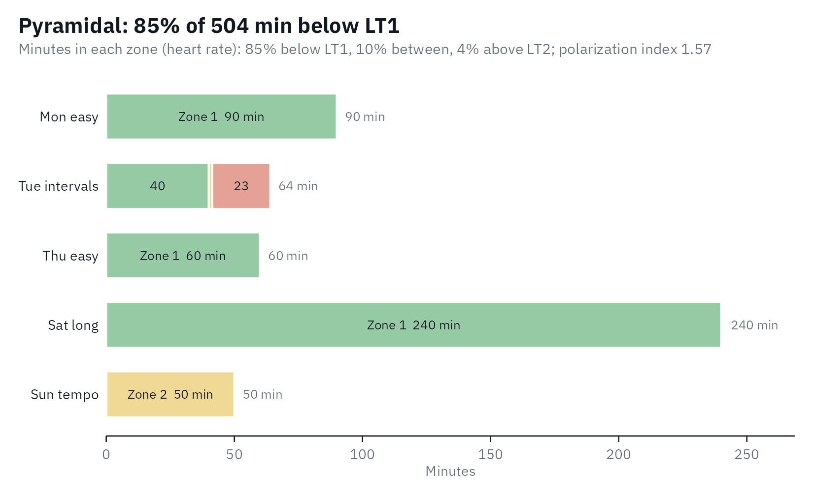

# Training load in the lactate zones

A step test gives the zones; training happens between tests.
[`training_load()`](https://fmmattioni.github.io/lactater/reference/training_load.md)
sorts the heart-rate, power or speed samples of training sessions into
the zones of
[`lactate_zones()`](https://fmmattioni.github.io/lactater/reference/lactate_zones.md)
and answers two questions: how much time was spent in each zone, and how
was the training spread across the intensity domains?

## Zones from a test

The second test of the cyclist in `lactate_tests`, with LT1 at Log-log
and LT2 at ModD_(max):

``` r

library(lactater)
library(dplyr)

test <- lactate_tests |>
  filter(test == "cycling_series_2")
results <- test |>
  lactate_threshold(intensity, lactate, heart_rate, plot = FALSE)

zones <- lactate_zones(results, lt1 = "Log-log", lt2 = "ModDmax")
zones |>
  select(zone, domain, intensity_from, intensity_to, heart_rate_from, heart_rate_to)
#> # A tibble: 3 × 6
#>   zone   domain   intensity_from intensity_to heart_rate_from heart_rate_to
#>   <chr>  <chr>             <dbl>        <dbl>           <dbl>         <dbl>
#> 1 Zone 1 moderate             NA          236              NA           156
#> 2 Zone 2 heavy               236          327             156           178
#> 3 Zone 3 severe              327           NA             178            NA
```

## Time in zone

Any data frame with one row per sample works: a CSV exported from a
heart-rate monitor, a bike computer or a training platform. Here is a
made-up week of heart rate, one sample every 5 s:

``` r

set.seed(1)
session <- function(name, minutes, heart_rate) {
  tibble(session = name, heart_rate = round(rnorm(minutes * 12, heart_rate, 3)))
}
week <- bind_rows(
  session("Mon easy", 90, 135),
  session("Tue intervals", 20, 140), session("Tue intervals", 24, 182), session("Tue intervals", 20, 140),
  session("Thu easy", 60, 138),
  session("Sat long", 240, 142),
  session("Sun tempo", 50, 165)
)
week
#> # A tibble: 6,048 × 2
#>    session  heart_rate
#>    <chr>         <dbl>
#>  1 Mon easy        133
#>  2 Mon easy        136
#>  3 Mon easy        132
#>  4 Mon easy        140
#>  5 Mon easy        136
#>  6 Mon easy        133
#>  7 Mon easy        136
#>  8 Mon easy        137
#>  9 Mon easy        137
#> 10 Mon easy        134
#> # ℹ 6,038 more rows
```

Every sample counts for `interval` seconds in the zone of its value.
With `.by`, each session gets its own row, in the order the sessions
appear:

``` r

training_load(week, zones, interval = 5, .by = "session")
#> # Training load: 5 groups, 8.4 h in 3 zones (heart rate)
#> # Distribution:  pyramidal: 85% moderate, 10% heavy, 4% severe (polarization
#> #   index 1.57)
#>   session       minutes zone_1 zone_2 zone_3 zone_1_percent zone_2_percent
#>   <chr>           <dbl>  <dbl>  <dbl>  <dbl>          <dbl>          <dbl>
#> 1 Mon easy           90   90      0      0            100              0  
#> 2 Tue intervals      64   40      1.4   22.6           62.5            2.2
#> 3 Thu easy           60   60      0      0            100              0  
#> 4 Sat long          240  240      0      0            100              0  
#> 5 Sun tempo          50    0.1   49.9    0              0.2           99.8
#> # ℹ 3 more variables: zone_3_percent <dbl>, polarization_index <dbl>,
#> #   distribution <chr>
```

Without `.by`, the whole week is one row. The header says how the time
was spread:

``` r

load <- training_load(week, zones, interval = 5)
load
#> # Training load: 1 group, 8.4 h in 3 zones (heart rate)
#> # Distribution:  pyramidal: 85% moderate, 10% heavy, 4% severe (polarization
#> #   index 1.57)
#>   minutes zone_1 zone_2 zone_3 zone_1_percent zone_2_percent zone_3_percent
#>     <dbl>  <dbl>  <dbl>  <dbl>          <dbl>          <dbl>          <dbl>
#> 1     504   430.   51.3   22.6           85.3           10.2            4.5
#> # ℹ 2 more variables: polarization_index <dbl>, distribution <chr>
```

The plot shows the minutes in each zone per session, colored by domain
like the zones, so a long session looks long; the shares of the whole
are in its subtitle:

``` r

autoplot(training_load(week, zones, interval = 5, .by = "session"))
```



Five zones work the same way, and the distribution is still computed on
the three domains:

``` r

five <- lactate_zones(results, lt1 = "Log-log", lt2 = "ModDmax", model = 5)
training_load(week, five, interval = 5)
#> # Training load: 1 group, 8.4 h in 5 zones (heart rate)
#> # Distribution:  pyramidal: 85% moderate, 10% heavy, 4% severe (polarization
#> #   index 1.57)
#>   minutes zone_1 zone_2 zone_3 zone_4 zone_5 zone_1_percent zone_2_percent
#>     <dbl>  <dbl>  <dbl>  <dbl>  <dbl>  <dbl>          <dbl>          <dbl>
#> 1     504   33.2   397.   51.3   21.8    0.8            6.6           78.7
#> # ℹ 8 more variables: zone_3_percent <dbl>, zone_4_percent <dbl>,
#> #   zone_5_percent <dbl>, moderate_percent <dbl>, heavy_percent <dbl>,
#> #   severe_percent <dbl>, polarization_index <dbl>, distribution <chr>
```

## How the training was spread

The share of time in the moderate, heavy and severe domains is the
training intensity distribution. [Treff et al.
(2019)](https://doi.org/10.3389/fphys.2019.00707) proposed a
polarization index to tell the common distributions apart:

`polarization index = log10((moderate / heavy) * severe * 100)`

with each domain as a fraction of the total time. A distribution is
labeled:

- **polarized** when the index is above 2.00 and moderate \> severe \>
  heavy: much easy training, some hard, little in between;
- **pyramidal** when moderate \> heavy \> severe;
- **threshold** when the heavy domain holds the most time;
- **high intensity** when the severe domain holds the most time;
- **other** for anything else.

This week is pyramidal: 85% moderate, 10% heavy and 4% severe, with an
index of 1.57. The distribution describes a period of training, not one
session, so give
[`training_load()`](https://fmmattioni.github.io/lactater/reference/training_load.md)
all the sessions of the period, for example with `.by = "week"`. [Treff
et al. (2019)](https://doi.org/10.3389/fphys.2019.00707) note that a
threshold distribution can also be pyramidal; the label is a summary,
not a diagnosis.

## Heart rate or power?

Heart rate lags behind intensity: in short intervals it is still rising
when the interval ends, so time in zone from heart rate under-counts the
highest zones ([Seiler, 2010](https://doi.org/10.1123/ijspp.5.3.276)).
Power or speed samples, with `measure = "intensity"`, do not lag. Here
is one interval session, 6 x (3 min at 330 W, 3 min at 150 W), with a
heart rate that follows power with a delay (simulated, with a time
constant of 40 s):

``` r

power <- rep(rep(c(330, 150), each = 36), times = 6)
stages <- test |>
  filter(intensity > 0)
steady <- approx(stages$intensity, stages$heart_rate, power, rule = 2)$y
heart_rate <- numeric(length(power))
heart_rate[1] <- 110
for (k in seq_along(power)[-1]) {
  heart_rate[k] <- heart_rate[k - 1] + (steady[k] - heart_rate[k - 1]) * (1 - exp(-5 / 40))
}
intervals <- tibble(power = power, heart_rate = round(heart_rate))

by_power <- training_load(intervals, zones, column = "power", measure = "intensity", interval = 5)
by_heart_rate <- training_load(intervals, zones, interval = 5)
bind_rows(power = by_power, `heart rate` = by_heart_rate, .id = "samples") |>
  select(samples, moderate = zone_1, heavy = zone_2, severe = zone_3)
#> # Training load: 2 groups, 0.6 h in 3 zones (intensity)
#> # Distribution:  other: 50% moderate, 0% heavy, 50% severe (polarization index
#> #   3.39)
#>   samples    moderate heavy severe
#>   <chr>         <dbl> <dbl>  <dbl>
#> 1 power          18     0     18  
#> 2 heart rate     19.7  13.6    2.8
```

The power samples put 18 minutes in the severe domain; the heart rate
only 2.8. When power or speed is available, use it for interval
sessions.

## Why time in zone, and not a training impulse?

Training impulse (TRIMP) scores multiply the time spent at each heart
rate or in each zone by a weight and add it up into one number. lactater
reports the time in each zone instead: it is what the lactate zones
measure directly, it keeps the distribution that a single number hides,
and it needs no weights from outside the test. If you need a zone-based
TRIMP, the minutes in each zone are what it is computed from.

## References

Seiler S. What is best practice for training intensity and duration
distribution in endurance athletes? Int J Sports Physiol Perform.
2010;5(3):276-91.
[doi:10.1123/ijspp.5.3.276](https://doi.org/10.1123/ijspp.5.3.276)

Treff G, Winkert K, Sareban M, Steinacker JM, Sperlich B. The
polarization-index: a simple calculation to distinguish polarized from
non-polarized training intensity distributions. Front Physiol.
2019;10:707.
[doi:10.3389/fphys.2019.00707](https://doi.org/10.3389/fphys.2019.00707)
